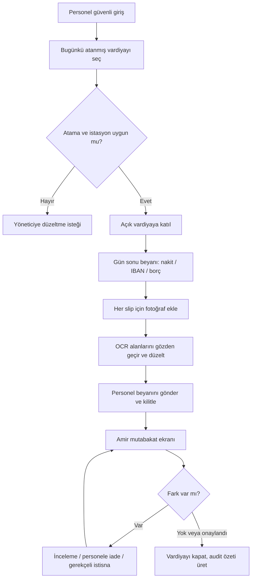
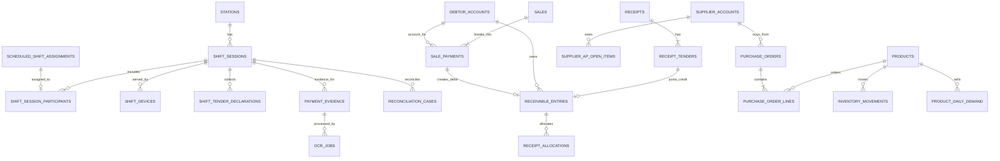

# AKARYAKIT V1 — v1.4 Mobil UI, SQL DDL ve Haftalık Sipariş Asistanı

**Durum:** Tasarım eki ve örnek teknik sözleşme; canlı uygulama veya üretim migration’ı değildir.  
**Temel belge:** [v1.3 mobil vardiya, OCR, API ve migration planı](teknik-planlama-v1.3-mobil-vardiya-ocr-api-migration.md)  
**Tarih:** 8 Ekim 2026  
**Veritabanı varsayımı:** PostgreSQL 15+; örnek şemalar `core`, `ops`, `evidence`, `ar`, `market` olarak ayrılmıştır. Mevcut veritabanında aynı tablolar varsa bu DDL doğrudan çalıştırılmaz; önce gerçek şemaya eşleme ve migration planı yapılır.

## 1. Bu ekin kapsadığı kararlar

1. Personelin telefonundan atanmış vardiyaya katılması, gün sonu beyanı vermesi ve kart slipini fotoğraflaması için örnek UI akışı.
2. Beş personel ekranı için düşük ayrıntılı, statik mobil wireframe.
3. Vardiya, cihaz, ödeme beyanı, slip kanıtı/OCR, mutabakat, müşteri cari/alacak ve market tedarikçi borç/sipariş tabloları için PostgreSQL DDL.
4. Var olan v1.3 M0–M7 migration sırasına uyumlu, genişlet–taşı–doğrula–geç yaklaşımı.
5. Toptancı açık hesabı/vadesi/limiti ve market stok ihtiyacını birlikte kullanan deterministik haftalık sipariş önerisi; parametreli sorgu örnekleri ve senaryolar.

> **Canlı sistem uyarısı:** SQL dosyası yalnızca tasarım örneğidir. Şu an proje klasöründe uygulama şeması veya veritabanı bulunmadığından hiçbir DDL çalıştırılmamış, Turpak/ÖKC/banka bağlantısı açılmamıştır.

## 2. Personel mobil UI akışı

### 2.1 Ekran sırası



### 2.2 Ekran envanteri

| Ekran | Kullanıcı ve amaç | Öne çıkan bileşenler | İş kuralı |
|---|---|---|---|
| 01 — Vardiyam | Personel, bugünkü kendi atamasını görür ve vardiyaya katılır | İstasyon, tarih, başlangıç-bitiş, vardiya sahibi, açık oturum durumu, “Vardiyaya katıl” | Personel yalnızca kendisine atanmış ve yetkili olduğu istasyon vardiyasını seçebilir; yoksa yöneticiye talep gönderir. |
| 02 — Kapanış beyanı | Personel vardiyadaki ödeme toplamlarını ve fiziki sayımı girer | Akaryakıt/market alanı, açılış float, kapanış nakit sayımı, kart slip sayısı/toplamı, IBAN beyanı, borç satış kontrolü | Kuruş hassasiyetindeki tutar sunucuya minor-unit tamsayıyla gider; beyan satış/cari kaydını kendi başına üretmez. |
| 03 — Slipler | Her kart slipi için ayrı fotoğraf/kanıt ekler | Slip listesi, OCR durumu, toplam, tekrar uyarısı, kamera düğmesi, “başka slip ekle” | Her görsel benzersiz kanıt ID’si alır; yinelenen hash/terminal+referans toplamı ikinci kez artırmaz. |
| 04 — OCR doğrula | Personel fotoğraftaki alanları teyit eder | Görsel önizleme, tutar, tarih-saat, terminal, onay/batch referansı, alan başına güven rozeti | Düşük güvenli alan `İnceleme gerekiyor` kalır; çalışan düzeltmesi orijinal OCR sonucunu silmez, audit’li düzeltme olarak saklanır. |
| 05 — Yetkili mutabakatı | Vardiya amiri/atanmış yetkili farkı inceler | Turpak toplamı, YN ÖKC/Z raporu, personel beyanı, slip/OCR, IBAN banka durumu, nakit farkı | Turpak/OCR/personel beyanı fiscal satışın yerine geçmez. Onay/gerekçe ve kapatma yetkisi rol kontrolüyle sunucuda uygulanır. |

### 2.3 Wireframe’ler

Bunlar **işlevsel olmayan, metni doğru ve düzeni tekrarlanabilir statik taslaklardır**. Görsel stil ve alan sırası ürün ekibiyle değerlendirilmek içindir; gerçek API veya marka tasarımı değildir.


Düzenlenebilir statik tasarım kaynağı: [wireframe HTML dosyası](ui-wireframe-v1.4.html). Görsel durumlar örnek/sentetiktir.

### 2.4 UI davranışı ve hata durumları

- Üst şeritte çalışan adı, istasyon, iş günü ve vardiya durumu sürekli görünür; bağlantı yoksa son eşitleme zamanı ve “gönderim kuyruğunda” uyarısı gösterilir.
- Personel vardiyayı kapatmaz; kendi beyanını gönderir. Kapatma, istisna çözümü ve yeniden açma yetkili amir işlemidir.
- Ekranda **Turpak beklenen toplamı**, **ÖKC/Z raporu**, **personel beyanı**, **slip kanıtı** ve **banka takası** birbirinden ayrı kaynak sütunlarıdır. Birinin toplamı diğerinin yerine yazılmaz.
- IBAN beyanı banka ekstresiyle eşleşene kadar bekleyen görünür; borç satışı ise tekil satış referansından AR kaydı doğurur, vardiya toplamı ikinci kez borç yazmaz.
- Nakit formülü görünür tutulur: `fiziki kapanış − (açılış float + kesin nakit tender + nakit cari tahsilat − nakit iade − belgeli kasa çıkışı)`.
- Slip çekiminde kamera kadrajı tam PAN/CVV/PIN’i almaktan kaçınır. On-device kırpma/maskeleme yoksa ham görüntü harici OCR/LLM’ye yollanmaz; kısa ömürlü güvenli redaksiyon ve saklama politikası gerekir.
- Ağ kesintisinde işlem cihazda benzersiz `client_event_id` ile şifreli kuyrukta tutulabilir. Aynı event tekrar gönderilirse idempotent yanıt döner; local beyan tek başına resmi finans kaydı sayılmaz.
- Erişilebilirlik: temel gövde metni en az 16 px, durumlar renk yanında metin/ikonla da ayrışır, sayısal alan klavyesi açılır, gönderme/kapatma düğmeleri çift dokunuşta idempotenttir.

## 3. SQL dosyası ve tablo grupları

Tam örnek DDL, aynı klasördeki [PostgreSQL şema taslağında](schema-v1.4-shift-ocr-ar-purchase.sql) bulunur. Şema kümeleri:

| Şema | Ana tablolar | Neden ayrı? |
|---|---|---|
| `core` | `tenants`, `stations`, `business_units`, `users`, `employees`, `parties` | Tenant/istasyon/iş alanı ve kimlik sınırlarının ortak referansları. Mevcut uygulamada zaten varsa yeniden oluşturulmaz. |
| `ops` | `scheduled_shift_assignments`, `shift_sessions`, `shift_session_participants`, `shift_devices`, `shift_tender_declarations`, `reconciliation_cases`, `sales`, `sale_payments` | Aylık plan, fiili vardiya, telefon/terminal izi, satış ve beyan kayıtları. |
| `evidence` | `payment_evidence`, `ocr_jobs`, `ocr_field_reviews` | Bu üçlü slip OCR modülünün veri omurgasıdır: dosya metadata/kanıtı, makine alan sonucu ve personelin onay/düzeltme geçmişi ayrı tutulur; OCR satış/tahsilat değildir. |
| `ar` | `debtor_accounts`, `receipts`, `receipt_tenders`, `receivable_entries`, `receipt_allocations`, `credit_limit_approvals` | Borçlu kişi/kurumun müşteri alacağı için append-only yardımcı defter. |
| `market` | `products`, `inventory_movements`, `inventory_balances`, `product_daily_demand`, `supplier_accounts`, `supplier_ap_open_items`, `supplier_product_offers`, `purchase_orders`, `purchase_order_lines`, `recommendation_batches/lines` | Market adet stoğu ve tedarikçi borcu; yakıt litre/tank defterinden ayrıdır. |

### 3.1 Başlıca tablo ilişkileri



> Varlık isimleri ve schema prefix’leri örnektir; var olan tablo isimlerine ve tenant anahtarlarına eşlenmelidir. Aynı müşteri alacak ve tedarikçi borç defteri bir arada netleştirilmez.

### 3.2 Önemli veri bütünlüğü kuralları

- Kayıtların scope’u `(tenant_id, station_id, business_unit_id)` ile korunur; çapraz tenant/istasyon/iş alanı ilişkisi composite FK ile engellenir.
- Her `market.*` kaydının iş alanı `domain_code='MARKET'` olmalıdır; aynı istasyonun `FUEL` iş alanı market tablolarına yazılamaz. Üretim DDL’sinde bunu composite FK/domain guard trigger veya eşdeğer DB kuralıyla kesinleştir.
- Para `BIGINT amount_minor + currency_code`; market adedi/ambalaj `NUMERIC`, stok defteri `market.inventory_movements` append-only ve bakiye tekrar üretilebilir olur.
- Borç satışında her `sale_payment_id` için tek `SALE_DEBIT`; her doğrulanmış `receipt_tender_id` için tek `RECEIPT_CREDIT` kuralı partial unique index ve transaction idempotency ile korunur.
- Tahsilat başlığındaki toplam, tender toplamlarıyla eşit olmalıdır. Kredi/borç allocation toplamı hem alacak hareketi hem borç hareketinin açık bakiyesini aşmamalı; eşzamanlı tahsiste satırlar kilitlenmelidir.
- `POSTED` alacak hareketi update/delete edilmez; iade/düzeltme ters kayıtla yapılır. `PENDING_MATCH` ödeme cari bakiyeyi azaltmaz.
- Tahsis iptali de eski satırın durumunu değiştirmek yerine `REVERSE` tahsis olayıdır; kaynak tahsis, borç/alacak hareketi, miktar ve gerekçe transaction içinde doğrulanır.
- Beş `DESKTOP_POS` cihaz sayısı satırlar arası koşuldur; yalnız `CHECK` constraint ile çözülemez. Vardiya satırını `FOR UPDATE` kilitleyen tek transaction/servis içinde sayılır. `PERSONAL_MOBILE` masaüstü kontenjanına dahil değildir.
- OCR satırı kanıt içerir; kendiliğinden satış, kasa tahsilatı, stok hareketi veya cari ledger post etmez.

### 3.3 Uygulama transaction örnekleri

**Masaüstü terminal kaydı (eşzamanlılık limiti):**

```sql
BEGIN;
SELECT status
FROM ops.shift_sessions
WHERE tenant_id = :tenant_id
  AND station_id = :station_id
  AND shift_session_id = :shift_session_id
FOR UPDATE;

SELECT count(*)
FROM ops.shift_devices
WHERE tenant_id = :tenant_id
  AND station_id = :station_id
  AND shift_session_id = :shift_session_id
  AND device_class = 'DESKTOP_POS'
  AND retired_at IS NULL;
-- Sayı 5 ise ROLLBACK + 409 SHIFT_DEVICE_LIMIT_REACHED.
-- Aksi halde yetkili cihaz satırını INSERT et ve COMMIT.
COMMIT;
```

**Borçlu satışının alacağa çevrilmesi:**

```sql
BEGIN;
INSERT INTO ar.receivable_entries (..., entry_side, entry_type, amount_minor,
                                    source_sale_payment_id, status)
SELECT ..., 'DEBIT', 'SALE_DEBIT', p.amount_minor, p.sale_payment_id, 'POSTED'
FROM ops.sale_payments AS p
WHERE p.tenant_id = :tenant_id
  AND p.sale_payment_id = :sale_payment_id
  AND p.tender_type = 'CREDIT'
ON CONFLICT DO NOTHING; -- source_sale_payment_id için partial unique index
COMMIT;
```

Üretimde `ON CONFLICT DO NOTHING` sonrasında var olan kayıt/hash/scope doğrulanmalıdır; farklı tutarlı aynı kaynak ID sessizce başarı sayılmaz.

## 4. Migration için önerilen sıraya alma

| Adım | İşlem | Kabul / geri dönüş |
|---|---|---|
| M0 — Şemayı keşfet | Canlı şema, tenant/istasyon/employee anahtarları, mevcut vardiya kayıtları, ödeme kaynakları ve kayıt sayıları salt okunur envanter; yedek/restore tatbikatı | Gerçek isim ve FK map’i olmadan DDL yok. |
| M1 — Ortak scope/FK’ler | Mevcut `core` varlıklarında composite unique/FK eksiklerini additive ekle; mevcut veri uyumsuzluk raporu | Orphan/mismatch listesi çözülmeden `NOT VALID` FK dahi validate edilmez. |
| M2 — Vardiya tabloları | Aylık `scheduled_shift_assignments` ile fiili `shift_sessions` ayrımı; katılımcı/cihaz tabloları; eski sahip/personel eşlemesi | Eski uygulama çalışmaya devam eder; backfill idempotent ve ID-map’li. |
| M3 — Beyan, kanıt, OCR | Tender deklarasyonu, görsel metadata, OCR job ve durumlar; storage ACL/retention ve maskeleme | OCR kapalıyken vardiya; duplicate hash finans toplamını artırmaz. |
| M4 — Cari/alacak | Borçlu hesap, receipt/tenders, receivable ledger, allocation ve onay/audit | Eski bakiyeler açılış hareketi olarak kaynak/tarih/onayla alınır; ledger çift post edilmez. |
| M5 — Market tedarik verisi | Ayrı tedarikçi hesap/AP projeksiyonu, sipariş satırı açık adet, günlük talep ve supplier offer/limit | Yakıt stoğu/borcu market görünümüne girmez; yoldaki ürün fiziksel kabul edilene kadar sayılır. |
| M6 — Gölge okuma/çift yazım | Feature flag ile sınırlı pilot; eski-yeni vardiya toplamları, tender ve AR bakiyesi karşılaştırması | Açıklanmamış fark varsa cutover yok; rollback eski okuma yoluna döner, yeni ledger/kanıt silinmez. |
| M7 — Kesinleştir | FK/index/check validate; eski alanı salt okunur yap; izleme ve restore tatbikatı | Eski kolon/tablo ancak ayrı sürümde, geri dönüş koşulları sağlanınca kaldırılır. |

## 5. Toptancı cari durumuna göre sipariş öneri algoritması

### 5.1 Hesap adımları

1. **Yetki ve kapsam:** Kullanıcının satın alma rolü, tenant, istasyon ve `MARKET` business unit backend’de doğrulanır. Model doğrudan SQL çalıştırmaz.
2. **Talep geçmişi:** Son 56 **tamamlanmış** işletme günü; void/iptal çıkarılır, satış iadeleri netlenir, stokta olmadığı bilinen süre işaretlenir. Eksik günler sıfır talep diye varsayılmaz; günlük özet görünümü aktif SKU/gün için sıfır satırı üretir.
3. **Talep tahmini:** Başlangıç ağırlıkları `daily_forecast = 0.50×ortalama_7g + 0.30×ortalama_21g + 0.20×ortalama_56g`. Stok yokluğu, kampanya, mevsim ve fiyat değişimi varsa düz ortalama yerine inceleme/uyarı ya da onaylı düzeltme uygulanır.
4. **Kullanılabilir stok:** `available = sağlam_fiziksel_stok − rezerve + onaylı_yoldaki_adet`. Yoldaki miktar, `ordered_qty − accepted/received_qty − cancelled/rejected_qty` olarak hesaplanır. **Fatura/AP post edilmesi mal kabul değildir:** ürün teslim alınana/iptal edilene kadar fiziksel yoldaki miktar korunur; fatura tutarı yalnızca finansal “faturalanmamış taahhüt” toplamından çıkar.
5. **Sipariş hedefi:** `horizon = lead_days + review_days`; `need_raw = max(0, forecast × horizon + safety_stock − available)`. Yeterli talep geçmişi varsa `safety_stock = z × demand_stddev × sqrt(lead_days)`; az veride işletme parametresiyle sabit gün stoğu kullanılır.
6. **Ambalaj/MOQ:** İhtiyaç pozitifse `order_qty = ceil(max(need_raw, MOQ) / pack_qty) × pack_qty`, değilse `0`. Stok kartında satış/mal kabul adet bazında kalır; koli yalnızca sipariş birimine dönüştürülür.
7. **Tedarikçi seçimi:** Önce ürün eşlemesi, geçerli fiyat/para birimi, istasyona servis ve minimum teslim şartları filtrelenir. Kalanlar net birim fiyat, nakliye, gerçek lead time, geçmiş tam teslim oranı, iade ve vade/limit koşullarıyla karşılaştırılır. Ağırlıklar kullanıcıya görünürdür; “gizli AI puanı” yoktur.
8. **Cari/risk kontrolü:** `available_credit = limit − posted_open_AP − unbilled_commitments`; limit tanımlı değilse `UNKNOWN`, aşılmışsa negatif gösterilir. Vadesi geçmiş borç kritik ürün önerisini silmez; `APPROVAL_REQUIRED`/`LIMIT_RISK` etiketi ve alternatif tedarikçi görünür.
9. **Taslak/insan onayı:** Asistan ürün, adet/koli, maliyet, teslim günü, cari/vade uyarısı ve gerekçeyi taslak olarak sunar. Sipariş kaydı/tedarikçiye gönderim/ödeme yalnız yetkili insan onayından sonra gerçekleşir.

### 5.2 Örnek sorgu iskeleti

Aşağıdaki örnekler SQL örnek dosyasındaki görünümlerin mantığını gösterir; parametreler sunucu tarafından bağlanır. `:as_of_date`, son kapanmış işletme gününün ertesi tarihidir.

```sql
-- 1) SKU bazında tamamlanmış 7/21/56 günlük net satış ritmi
SELECT product_id,
       AVG(net_qty) FILTER (WHERE business_date >= :as_of_date - 7)  AS avg_7d,
       AVG(net_qty) FILTER (WHERE business_date >= :as_of_date - 21) AS avg_21d,
       AVG(net_qty) FILTER (WHERE business_date >= :as_of_date - 56) AS avg_56d,
       SUM(stockout_minutes) AS stockout_minutes,
       MAX(source_updated_at) AS fresh_at
FROM market.product_daily_demand
WHERE tenant_id = :tenant_id AND station_id = :station_id
  AND business_unit_id = :market_business_unit_id
  AND business_date >= :as_of_date - 56 AND business_date < :as_of_date
  AND product_id = ANY(:authorized_product_ids)
GROUP BY product_id;
```

```sql
-- 2) Stok ve yoldaki adet: önce PO satırlarını SKU başına topla
WITH inbound AS (
  SELECT tenant_id, station_id, business_unit_id, product_id,
         SUM(open_inbound_qty) AS on_order_qty
  FROM market.v_open_supply
  WHERE tenant_id = :tenant_id AND station_id = :station_id
    AND business_unit_id = :market_business_unit_id
  GROUP BY tenant_id, station_id, business_unit_id, product_id
)
SELECT b.product_id, b.on_hand_good_qty, b.reserved_qty,
       COALESCE(i.on_order_qty, 0) AS on_order_qty,
       b.snapshot_at
FROM market.inventory_balances b
LEFT JOIN inbound i USING (tenant_id, station_id, business_unit_id, product_id)
WHERE b.tenant_id = :tenant_id AND b.station_id = :station_id
  AND b.business_unit_id = :market_business_unit_id
  AND b.product_id = ANY(:authorized_product_ids);
```

```sql
-- 3) Cari/vade/limit: AP ve faturalanmamış taahhütleri ayrı ayrı grupla
WITH ap AS (
  SELECT i.tenant_id, i.supplier_account_id, i.currency_code,
         SUM(i.open_amount_minor) AS open_ap_minor,
         SUM(i.open_amount_minor) FILTER (WHERE i.due_date < :as_of_date) AS overdue_minor,
         SUM(i.open_amount_minor) FILTER (
           WHERE i.due_date >= :as_of_date AND i.due_date < :as_of_date + 7
         ) AS due_next_7d_minor
  FROM market.supplier_ap_open_items i
  WHERE i.tenant_id = :tenant_id AND i.status = 'OPEN'
  GROUP BY i.tenant_id, i.supplier_account_id, i.currency_code
), commitments AS (
  SELECT tenant_id, supplier_account_id, currency_code,
         SUM(commitment_minor) AS unbilled_commitment_minor
  FROM market.v_unbilled_commitments
  WHERE tenant_id = :tenant_id AND station_id = :station_id
    AND business_unit_id = :market_business_unit_id
  GROUP BY tenant_id, supplier_account_id, currency_code
)
SELECT a.supplier_account_id,
       COALESCE(ap.open_ap_minor, 0) AS open_ap_minor,
       COALESCE(ap.overdue_minor, 0) AS overdue_minor,
       COALESCE(ap.due_next_7d_minor, 0) AS due_next_7d_minor,
       COALESCE(c.unbilled_commitment_minor, 0) AS unbilled_commitment_minor,
       cp.credit_limit_minor,
       CASE WHEN cp.credit_limit_minor IS NULL THEN NULL
         ELSE cp.credit_limit_minor - COALESCE(ap.open_ap_minor, 0)
              - COALESCE(c.unbilled_commitment_minor, 0)
       END AS estimated_available_credit_minor
FROM market.supplier_accounts a
LEFT JOIN ap ON ap.tenant_id = a.tenant_id
            AND ap.supplier_account_id = a.supplier_account_id
            AND ap.currency_code = a.currency_code
LEFT JOIN commitments c ON c.tenant_id = a.tenant_id
                       AND c.supplier_account_id = a.supplier_account_id
                       AND c.currency_code = a.currency_code
LEFT JOIN LATERAL (
  SELECT p.credit_limit_minor
  FROM market.supplier_credit_profiles p
  WHERE p.tenant_id = a.tenant_id
    AND p.supplier_account_id = a.supplier_account_id
    AND p.currency_code = a.currency_code
    AND p.valid_from <= :as_of_date
    AND (p.valid_to IS NULL OR p.valid_to >= :as_of_date)
  ORDER BY p.valid_from DESC
  LIMIT 1
) cp ON TRUE
WHERE a.tenant_id = :tenant_id AND a.station_id = :station_id
  AND a.business_unit_id = :market_business_unit_id;
```

Üretim sorguları `AP` hareketleri ve açık PO’ları join etmeden önce ayrı ayrı gruplayıp birleştirir; aksi halde 1:N join toplamı şişirir. `open_ap` ve `unbilled_commitments` ayrı tutularak aynı fatura/taahhüt iki kez borçtan düşülmez.

### 5.3 Örnek senaryolar

#### Senaryo A — Normal haftalık sipariş

- SKU: 500 ml su, günlük ortalama: 7g **3,0**, 21g **2,5**, 56g **2,0** adet.
- Ağırlıklı talep: `0,5×3 + 0,3×2,5 + 0,2×2 = 2,65 adet/gün`.
- Lead time 3 gün, haftalık gözden geçirme 7 gün; dönem talebi `2,65×10 = 26,5`. Güvenlik stoğu 6 adet: hedef **32,5**.
- Sağlam elde 12, rezerve 3, fiziksel yolda onaylı sipariş 8: kullanılabilir `12−3+8 = 17`; ham ihtiyaç `15,5`.
- MOQ 12, ambalaj 12 adet: `ceil(max(15,5,12)/12)×12 = 24 adet` (2 koli).
- Tedarikçi A fiyatı 8,50 TL/adet, toplam yaklaşık **204 TL**. Açık AP 22.000 TL, 7 günde vade 4.000 TL, geçmiş vade 0, limit 50.000 TL, faturasız taahhüt 12.000 TL: yaklaşık kullanılabilir limit **16.000 TL**. Sonuç: “Taslak — cari limit içinde”.

#### Senaryo B — En ucuz tedarikçi limit aşımında

- Aynı SKU için Tedarikçi A daha ucuzdur; fakat açık AP 28.000 TL, faturasız taahhüt 7.000 TL, limit 30.000 TL olduğundan limit boşluğu yaklaşık **−5.000 TL** ve ayrıca vadesi geçmiş tutar vardır.
- Ürün ihtiyacı gizlenmez: A seçeneği “limit riski — yetkili onayı” etiketiyle gösterilir. Eşleşmesi/teslim şartı uygun Tedarikçi B’nin birim maliyeti ve daha kısa teslim süresi karşılaştırmalı gösterilir.
- Sistem otomatik tedarikçi siparişi, mahsup veya ödeme göndermez. Yetkili kişi A/B seçimini ve gerekçeyi onaylar.

#### Senaryo C — Stok kesintisi satış hızını bastırmış

- Son 7 günlük satış ortalaması düşük görünse de stokta yokluk 2,5 gün raporlanmıştır. Algoritma bu rakamı “talep yok” diye yorumlayıp siparişi sıfırlamaz.
- Ekranda “satış geçmişi stok kesintisiyle sansürlenmiş” uyarısı, ham talep aralığı, son sağlam satış ritmi ve manuel inceleme gösterilir. Kullanıcı stok kesintisi düzeltilmeden/öneri onaylanmadan sipariş taslağını kesinleştiremez.

## 6. Kabul testleri

- Atanmamış çalışanın vardiyaya katılımı reddedilir; doğru vardiyadaki personel mobilinden tek katılım ve benzersiz deklarasyon alır.
- Aynı anda 6 masaüstü cihaz kaydı yarışında en fazla 5 cihaz etkinleşir; telefonlar bu limiti tüketmez.
- Slip OCR düşük güvenli alanı kesin tutar gibi göstermez; yinelenen yükleme iki defa toplama girmez; PAN/CVV/PIN görseli harici OCR’a gönderilmez veya kalıcı saklanmaz.
- Vardiya amiri Turpak/ÖKC/personel/slip/kasa kaynaklarını ayrı sütunlarda görür; gerekçesiz veya yetkisiz kapatma reddedilir.
- Aynı BORC satış mesajı tekrarlanınca ikinci `SALE_DEBIT` oluşmaz; bekleyen IBAN tender’ı `POSTED` cari alacak gibi görünmez.
- Tahsilat başlığı ile tender toplamı eşit değilse post olmaz; iki paralel allocation aynı açık alacağı aşamaz; düzeltme ters kayıt üretir.
- AP/PO 1:N sorguları toplamı çoğaltmaz; fatura kesilip mal alınmamış sipariş fiziksel yoldaki miktarda kalır, ancak faturalanmamış taahhüt riskinde ikinci kez sayılmaz.
- MOQ/ambalaj yuvarlaması, limit aşımı uyarısı, stokta yokluk uyarısı ve öneri sonucu sabit fixture veriyle tekrar üretilebilir.
- Asistan izinli özetleri açıklar; ham SQL üretemez, siparişi onaysız kaydedemez.

## 7. ERD/uygulama öncesi netleştirilecek değerler

- Gerçek PostgreSQL sürümü ve mevcut migration aracı/ORM; tablo isimleri, ID türleri, şema adları ve tenant bileşik FK standardı.
- Mobil istemcinin PWA mı Android/iOS native mi olacağı; çalışan başına telefon sayısı, offline süresi ve cihaz iptal akışı.
- Varsayılan tasarım vardiya başına katılımcı başına tek etkin kişisel telefon varsayar; kayıp cihaz/telefon değişimi, paylaşılan telefon veya aynı çalışanın ikinci cihazına izin kararı.
- Fark ve tutar eşiğine göre vardiya amiri/ikinci onay matrisi; cash float/kasa çıkışı kuralları.
- Slip ve Turpak rapor görseli için saklama/erişim süresi, OCR çalıştırma ortamı ve düşük güven eşiği; maskeleme davranışı.
- AR’de bireysel/kurumsal borçlu alanları, tahsis varsayılanı, kredi limiti ve onay eşiği.
- Toptancı AP’nin mevcut muhasebe kaynağı, limitin sözleşme para birimi, vadesi geçmiş toleransı, fiyat tazeliği, MOQ/ambalaj ve teslimat başarımı.
- Toptancı hesabı/kredi limiti istasyon başına mı, yoksa beş istasyonun kullandığı ortak şirket hesabı mı? Ortaksa limit boşluğu hesabı beş istasyonun açık AP ve taahhütlerini aynı tenant/group scope’unda toplamalıdır.
- Sipariş tahmininde dönem/gün ağırlıkları, güvenlik stoğu, stok kesintisi etiketinin kaynağı, kampanya/mevsimsellik düzeltmesi ve satın alma bütçesi.

## İlgili belgeler

- [Ana v1.3 teknik plan](teknik-planlama-v1.3-mobil-vardiya-ocr-api-migration.md)
- [Cari/alacak görsel ERD (v1.2)](cari-alacak-erd-v1.2.png)
- [v1.4 örnek PostgreSQL DDL](schema-v1.4-shift-ocr-ar-purchase.sql)
- [v1.4 mobil UI wireframe kaynağı](ui-wireframe-v1.4.html)
