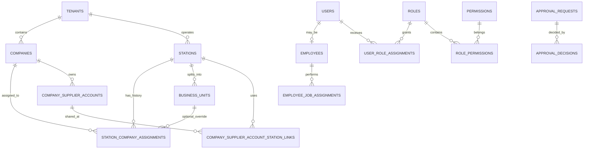

# AKARYAKIT V1 — v1.5 Mutabakat, Satın Alma Asistanı ve Firma/Yetki Tasarımı

**Durum:** Ürün ve teknik tasarım eki; canlı uygulama, gerçek entegrasyon veya üretim migration’ı değildir.  
**Temel belgeler:** [v1.3 teknik plan](teknik-planlama-v1.3-mobil-vardiya-ocr-api-migration.md), [v1.4 mobil UI/DDL/sipariş tasarımı](tasarim-v1.4-mobil-ui-ddl-satin-alma.md), [v1.4 örnek şema](schema-v1.4-shift-ocr-ar-purchase.sql).  
**Tarih:** 8 Ekim 2026.  
**Son doğrulama:** 10 Ekim 2026; v1.4/v1.5 örnek DDL geçici PostgreSQL üzerinde kontrol edildi. Canlı veritabanına migration uygulanmadı.  
**Veritabanı varsayımı:** PostgreSQL 15+. Örnek ek DDL [ayrı SQL dosyasındadır](schema-v1.5-company-rbac-approvals.sql) ve v1.4 tablo adlarını/anahtarlarını temel alır; gerçek şemaya uyarlanmadan çalıştırılmaz.

## 1. Tasarım kararları ve sınırlar

1. Turpak satış/raporu, yetkili YN ÖKC/Z raporu, personel beyanı, slip OCR sonucu ve banka takası **birbirinden ayrı kaynaklar** olarak kalır. Bir kaynak diğerini sessizce düzeltmez veya üzerine yazmaz.
2. OCR bir **kanıt okuma ve alan önerme** adımıdır; tek başına tahsilat, satış, cari hareket veya vardiya kapanışı oluşturmaz.
3. İlk sürümde **sıfır olmayan her mutabakat farkı inceleme kaydı** açar. Otomatik fark silme/tolerans uygulama yoktur. Daha sonra tanımlanacak toleranslar tutar, oran, iş alanı ve istasyon bazında açıkça yapılandırılır; kaynak mali/fiscal kaydı yine değiştirilmez.
4. Yetki hem ekranda hem API/servis/veritabanı sınırında uygulanır. Gizli düğme veya LLM talimatı yetki kontrolü sayılmaz.
5. Önerilen organizasyon hiyerarşisi: **tenant/abonelik hesabı → bir veya daha fazla hukuki firma → istasyon → akaryakıt ve market iş alanları**. Tenant SaaS güvenlik/müşteri sınırıdır; şirket (`company`) hukuki ve finansal varlıktır. Bir tenantın birden fazla firması olabilir.
6. Varsayılan olarak istasyon tek bir firmaya bağlıdır. Gerekirse akaryakıt veya market iş alanı için ayrıca firma ataması yapılır; bu istisna etkin tarihli ve denetlenebilir olur. Firma değişikliği geçmiş fiş/fatura/cari hareketleri geriye dönük taşımaz.
7. Toptancı hesabı ve kredi limiti **hukuki firma + cari hesap kodu + para birimi** kapsamında tutulur. Aynı tedarikçide farklı limit/sözleşme varsa ayrı cari kodu açılır; yalnızca ad benzerliğine bakarak hesap birleştirilmez. Gerçekten ortak hesap kullanan istasyonların AP ve sipariş taahhütleri birlikte hesaba katılır. İstasyon alımı yine istasyon/market iş alanı bazında izlenir. Gerçek sözleşme istasyon bazlıysa ayrı hesap tanımlanır.

## 2. Vardiya kapanışı ve slip OCR: durumlar, hatalar, onay

### 2.1 Durum makinesi

Önerilen vardiya akışı:

`OPEN → SUBMITTING → RECONCILIATION → READY_FOR_APPROVAL → CLOSED`

- Personel kendi beyanını gönderince `SUBMITTING`; sonradan doğrudan alanı değiştiremez, düzeltme yeni sürüm/audit olayıdır.
- Kaynaklar eşleştirilirken `RECONCILIATION`; Turpak/ÖKC veya banka verisi henüz gelmemişse kaydı sıfır kabul etmeden `EVIDENCE_PENDING` alt durumu gösterilir.
- Gerekli beyanlar ve kaynaklar mevcut, fark yok veya tüm farklar çözümlenmişse `READY_FOR_APPROVAL`.
- Yetkili kararından sonra `CLOSED`. Bekleyen IBAN/takas kalemi vardiya operasyonel olarak gerekçeyle kapatılabilir; o kalem **finansal olarak eşleşti/ödendi** statüsüne geçirilmez.
- Yeniden açma, yeni kapanış sürümü üretir; eski onay ve rakamlar silinmez. Sonradan gelen veri yeni uzlaştırma farkı/ek kayıt oluşturur.

Her kapanış isteği `shift_session_id + row_version + idempotency_key` ile çalışır. Onay, incelenen veri anlık görüntüsünün hash’i/sürümü üzerine verilir. Onaydan önce kaynak veya beyan değişmişse eski onay geçersiz olur ve yeniden inceleme istenir.

### 2.2 Hata ve istisna senaryoları

| No | Senaryo / tespit | Sistem davranışı | Kim çözer / gerekli kanıt | Kapanış etkisi |
|---|---|---|---|---|
| 1 | Fotoğraf bulanık, eğik, karanlık veya tutar/terminal/referans kesilmiş | OCR `NEEDS_RETAKE`; sonuç toplam beyana katılmaz. Fotoğraf yeniden çekilir. | Personel yeni görüntü yükler. | Kanıt tamamlanana kadar bekler; manuel beyan gerekirse amir gerekçe ile ayrı yol açar. |
| 2 | OCR alan güveni düşük (önerilen başlangıç: tutar veya referans için `<0,95`; işletme ayarıdır) | Alan `NEEDS_REVIEW`; OCR değeri yalnız öneri olarak görünür. Düşük puanlı alanları otomatik onaylamaz. | Personel fotoğraftan doğrular/düzeltir; düşük güven veya belirsiz kanıtta amir ikinci kontrol eder. | İncelenmemiş tutar doğrulanmış slip toplamına girmez. |
| 3 | OCR tutarı para birimi/tarih/saat biçimini çözemiyor veya belge başka güne ait | Kanıt karantinaya alınır; dönem/yerel saat dilimi kontrol edilir. | Personel fişin vardiya tarihine ait olduğunu doğrular; amir dönem hatasını onaylar. | Doğru vardiyaya bağlanana kadar bekler. |
| 4 | Aynı dosya hash’i tekrar yüklendi | Aynı upload/event ID’si idempotent no-op; farklı event ID’de aynı hash mükerrer uyarısı. | İlk yükleme ile karşılaştırma; gerekirse amir yanlış pozitif gerekçesi kaydeder. | Mükerrer tutar ikinci kez sayılmaz. |
| 5 | Aynı POS terminali + onay referansı + tutar/zaman kombinasyonu tekrarlandı | Yakın-mükerrer şüphe; ikinci kanıt otomatik silinmez, `DUPLICATE_REVIEW`. | Vardiya amiri slipleri karşılaştırır; ayrı işlem olduğunu kanıtlarsa ikisini de tutar. | İnceleme bitene kadar ikinci slip toplamdan hariçtir. |
| 6 | Tam PAN/CVV/PIN veya manyetik iz görüntüde olabilir; maskeleme başarısız | Görsel OCR servisine gönderilmez; güvenli yerel redaksiyon/yeniden çekim istenir. Hassas içerik loglanmaz. | Personel güvenli kadrajla tekrar çeker; başarısız yüklemeler kısa ömürlü temizlenir. | Güvenli kanıt yoksa finansal toplamı onaylanmış sayma. |
| 7 | OCR servisi zaman aşımı veya geçici hata | Kanıt `OCR_PENDING/RETRY_WAIT`; bounded retry ve aynı job/idempotency anahtarı. Kullanıcı tekrar yüklemek zorunda kalmaz. | Sistem operasyon ekranı; personel manuel tekrar deneme yapmaz. | OCR gecikmesi satış/shift kaydını kaybettirmez; kapanış, işletme kuralına göre bekler veya manuel yetkili istisnaya gider. |
| 8 | Slip OCR toplamı personelin kart beyanından farklı | Fark alanı açılır; kaynak tutarları ayrı gösterilir. | Personel slip setini ve eksik/iptal slipi kontrol eder; amir onay/ret verir. | Fark kapanmadan normal mutabakat onayı yoktur. |
| 9 | POS batch/Z raporu/Turpak toplamı eksik, gecikmiş veya dönemi farklı | Kaynak `MISSING/STALE/PERIOD_MISMATCH`; **eksik kaynak sıfır kabul edilmez**. | Entegrasyon operatörü/vendor veya yetkili yönetici; aynı zaman aralığı yeniden çekilir. | Otomatik kapanış yok; kaynağı olmayan kapanış ancak açıkça “kaynak bekleniyor” istisnası ve yetkili onayla operasyonel kapanır. Mali satış/fiscal kayıt değişmez. |
| 10 | Turpak yakıt toplamı ile yetkili YN ÖKC/Z raporu tutarsız | Kaynaklar karantinaya alınmadan ayrı tutulur; `FISCAL_MISMATCH` vakası açılır. | İstasyon yöneticisi fiş/rapor kimliklerini kontrol eder; mali/fiscal kaydı yalnız yetkili kaynak düzeltir. | Yasal kaydın üzerine yazılmaz. Çözülmeyen fark normal kapanış olarak işaretlenemez. |
| 11 | Fiziki nakit sayımı beklenen nakitten farklı | Nakit farkı = fiziki sayım − (float + kesin nakit tender + nakit cari tahsilat − iadeler − belgeli kasa çıkışı); sayım tekrar girişi önerilir. | Personel tekrar sayar; vardiya amiri kasa/çekmece/terminali inceler ve gerekçe kaydeder. | İlk sürümde her fark inceleme ister; gerekçesiz istisna ile kapanmaz. |
| 12 | IBAN dekontu/personel beyanı var, banka ekstresinde hareket yok | `PENDING_BANK_MATCH`; kanıt görülebilir ancak tahsilat kesinleşmez ve cari alacak azalmaz. | Muhasebeci banka hareketi ve referansla eşleştirir veya reddeder. | Vardiya yalnız pending takibi görünür kalacak biçimde kapanabilir; alacak kapalı raporlanmaz. |
| 13 | Borç tender’ı borçlu hesabına bağlı değil veya defter toplamı satıştan farklı | Kapanış gönderimi bloke; satış ödeme satırı ile `SALE_DEBIT` idempotent kontrol edilir. | Yetkili muhasebe/istasyon yöneticisi doğru borçlu ve tekil satış referansını düzeltir; doğrudan toplam fişi girmez. | Alacak kaydı satıştan bir kez doğar; vardiya toplamı ikinci kez borç oluşturmaz. |
| 14 | İki amir aynı vakayı eşzamanlı onaylıyor / personel beyanı onay anında değişiyor | `row_version`/kilit karşılaştırması; biri başarılı, diğeri `409 STALE_CASE_VERSION`. | İkinci amir en güncel görüntüyü yeniden açar. | Eski sürümle kapanış yapılamaz; çift onay/çift post engellenir. |
| 15 | Yetkisiz kullanıcı kendi vardiyasını onaylıyor veya farklı istasyon vakasına erişiyor | Backend 403; kapsam bilgisi değiştirilerek tekrar deneme de reddedilir; güvenli audit. | İstasyon yöneticisi yetki/atamayı düzeltir; şüpheli deneme güvenlik incelemesine gider. | Onay oluşmaz. |
| 16 | Kapanıştan sonra banka/ÖKC/Turpak verisi düzeltme veya gecikmeli mesajla geliyor | Eski kapanış değişmez; ek fark/adjustment vakası açılır. | Yetkili rol, gerekçe ve gerekiyorsa ikinci onayla yeni sürüm/ters kayıt oluşturur. | Geçmiş rapor korunur; yeni durum ayrıca görünür. |

### 2.3 Yetkili onay kuralları

- **Personel:** yalnızca kendi atanmış vardiyasına katılır, kendi kanıtını/beyanını girer ve gönderir. Kendi kapanış farkını onaylayamaz; gönderim sonrası değerleri sessizce düzenleyemez.
- **Vardiya amiri/istasyon yöneticisi:** atanmış istasyonda kaynakları ve fark dosyasını görür; personel beyanını geri gönderebilir, eksik kanıt isteyebilir. Tüm kaynaklar mevcut ve eşit olduğunda kapanışı onaylayabilir. İstisnayı ancak rol, tutar/işlem türü ve politika buna izin veriyorsa gerekçeyle onaylar.
- **Muhasebeci:** banka/IBAN/POS takası, cari alacak ve finansal dönem eşleşmesini inceler; saha sayımının yerine geçmez. IBAN ve banka hareketi eşleşmesini doğrular/reddeder.
- **Patron/firma yöneticisi:** istasyon grubu toplamlarını görür; kritik istisna veya yüksek tutarlı farklar için ikinci onay verebilir. Patron paneli erişimi, tek başına onay hakkı değildir.
- **Ayrılık ilkesi:** talebi oluşturan kişi aynı talebi onaylayamaz. Yüksek riskli kararlar için iki farklı kullanıcı gerekir. Aynı kişi farklı rol üzerinden oturum açsa da kimlik aynıysa self-approval sayılır.
- **Zorunlu gerekçe:** her exception approval’da kod + serbest açıklama; inceleyen kullanıcı, etkin rol ataması, kapsam, zaman, önce/sonra durum, kaynak referansları, veri sürümü/hash ve istemci correlation ID saklanır.
- **İstisna onayının sınırı:** onay yalnız operasyon vakasını/işletme kapanışını sonuçlandırır. Eksik fiscal belgeyi geçerli belgeye, pending banka hareketini kesin tahsilata veya OCR alanını mali kayda dönüştürmez.
- **İlk sürüm eşikleri:** tüm sıfır olmayan farklar review. İlerideki mutlak/nispi eşikler yetkili tarafından istasyon ve `FUEL/MARKET` bazında konfigüre edilir; sistem geçmiş vakalarda eşik değişikliğini geriye dönük uygulamaz.
- **Kapanış sonrası yeniden açma:** ayrı `REOPEN` yetkisi, gerekçe ve önerilen çift onay (istasyon yöneticisi + muhasebe/patron); yeni sürüm oluşturulur. Finans hareketi gerekiyorsa append-only ters kayıtla düzeltilir.

Önerilen onay veri modeli ve örnek DDL `ops.approval_requests` / `ops.approval_decisions` ile SQL ekindedir. Polimorfik belge referansı olan approval motorunda nesnenin tenant, firma, istasyon ve iş alanı kapsamını uygulama servisi her kararda yeniden doğrulamalıdır.

**Onay transaction sırası:** kimlik/aktif rol/izin/kapsam kontrolü → hedef vaka ve request satırlarını sabit sırada `FOR UPDATE` kilitle → istek sürümü ve payload hash karşılaştır → self-approval kontrolü → değişmez decision ekle → gerekli ayrı imzaları say → yalnız yeterli imza varsa vakayı ve kapanış durumunu güncelle → audit/outbox ekle → tek transaction commit. İmzalar tek kapanış görüntüsünü onaylar; kaynak tutarları değiştirmek yeni talep ve yeni hash gerektirir.

- `idempotency_key` tekrarında aynı payload aynı talep sonucunu döndürür; aynı key ile farklı payload `409 IDEMPOTENCY_CONFLICT` üretir.
- `NEEDS_INFO` sonrasında eski karar değiştirilmez. Düzeltilen içerik yeni request ile açılır; eski request gerekçeyle `CANCELLED` olur ve audit içinde yeni request referansı tutulur. Önceki imzalar yeni içeriğe taşınmaz.
- `row_version` yalnız optimistic-lock sürümüdür; her başarılı durum değişikliğinde servis artırır. İlk imza sonrası status `PENDING` kalabilir; ikinci farklı yetkili kullanıcı aynı payload'ı onaylar. SQL tek başına yeterli imza sayısını, aktif izinleri veya gerçek vaka kapanışını çalıştırmaz.
- Önerilen iki imzalı örnekler: kaynağı eksik operasyonel kapanış, kapanmış vardiyayı yeniden açma, yüksek riskli fiscal fark ve tedarikçi limit aşımı istisnası. Politika `policy_version` ile talebe sabitlenir.

## 3. Toptancı carisine göre haftalık sipariş önerisi

### 3.1 Deterministik algoritma

Asistan LLM’si SQL üretmez ve para/adet hesaplamaz. Rapor servisi aşağıdaki sabit adımları hesaplar; LLM sadece kaynaklı açıklama üretir.

1. **Kapsam:** kullanıcıya atanmış firma/istasyonlar ve MARKET birimleri; talep penceresinin bitişi son tamamlanmış yerel işletme günüdür.
2. **Talep temizliği:** 56 takvim günü, iptal/void hariç, iadeler netlenmiş, tam ve stok kesintisiz günler. Eksik/partial/stale günlük satır sıfır satış sayılmaz; coverage uyarısı üretir. Stokout günleri talebi aşağı sansürleyebilir; ham satış ayrı gösterilir, otomatik düşük siparişe çevrilmez.
3. **Talep tahmini:** yeterli kalite varsa `forecast_daily = 0.50 × avg_7 + 0.30 × avg_21 + 0.20 × avg_56`. Yeterli geçmiş yoksa tanımlı yeni ürün/manuel min–max kuralı uygulanır; sessiz sıfır yok.
4. **Kullanılabilir miktar:** `on_hand_good_qty − reserved_qty + confirmed_open_inbound_qty`. Onaylı yoldaki ürün stok değildir, fakat planlama kullanılabilirliğinde sayılır. Fatura gelmiş olması fiziksel mal kabul değildir; stok yalnız kabul hareketinde artar.
5. **Hedef ihtiyaç:** `horizon_days = lead_days + review_days`; `raw_need = max(0, forecast_daily × horizon_days + safety_stock_qty − available_qty)`. Ürün politikası varsa servis seviyesi için varyans temelli güvenlik stoğu kullanılabilir; ilk sürümde açıklanabilir parametre tercih edilir.
6. **Paket/MOQ:** `order_qty = 0` eğer `raw_need <= 0`; aksi halde `ceil(max(raw_need, MOQ) / pack_qty) × pack_qty`. Katalog ve satış/mal kabul adedi tekil adet kalır; koli tedarikçi sipariş birimidir.
7. **Tedarikçi alternatifleri:** yalnız geçerli SKU eşlemesi, güncel fiyat, istasyonu servis etme, etkin cari hesap, aynı para birimi ve geçerli teslim süresi olan teklifler. Varsayılan sıralama: **toplam birim maliyet, kısa teslim süresi, yüksek 90 günlük fill-rate, fiyat güncelliği**; kullanıcı alternatifleri görebilir. Sevkiyat/vergi/iskonto dahil gerçek maliyet alanları sözleşme ve fatura verisiyle teyit edilene kadar net fiyat olarak etiketlenir.
8. **Firma ortak cari/limit:** her tedarikçi hesabı için firma çapındaki açık AP + yalnız **faturalanmamış** sipariş taahhüdü + öneri taslağının tüm istasyonlardaki maliyeti aynı para biriminde toplanır. Faturalanmış kısım AP’de, faturalanmamış kısım taahhütte yer alır; aynı tutar iki kez düşülmez. `remaining_after_proposal = credit_limit − open_AP − unbilled_commitments − proposed_batch_cost`.
9. **Risk gösterimi:** limit yoksa `UNKNOWN_LIMIT`; limit aşımı `LIMIT_RISK`; vadesi geçmiş borç `OVERDUE`; eski fiyat veya veri `STALE_DATA`; stokout sansürü `STOCKOUT_CENSORED`. Kritik ürün satırı risk yüzünden gizlenmez; risk açıklaması ve alternatif tedarikçi gösterilir.
10. **İnsan onayı:** asistan öneri taslağı saklar. PO oluşturma/onaylama/gönderme, cari değiştirme veya ödeme; ayrı satın alma/finans yetkisi ve gerektiğinde ikinci onay ister. Teklif anlık snapshot ve algoritma sürümü kaydedilir.

**Hesaplamayı koruyan ek kurallar:**
- Planlama kullanılabilirliğine yalnız ilgili ihtiyaç döneminden önce gelmesi beklenen, onaylı ve tedarikçi tarafından doğrulanmış yoldaki miktar alınır. Teslim tarihi bilinmeyen veya gecikmiş PO otomatik stok sayılmaz; ayrıca gecikme riski gösterilir. Faturalanmış olması teslimat teyidi değildir.
- Paket yuvarlamasında MOQ da paket katsayısına yuvarlanır. Örneğin ham ihtiyaç 3, MOQ 13, paket 6 ise öneri 18 olur; 13 adetlik tedarik siparişi önerilmez. Nihai adet negatif veya kesirli olamaz.
- Kritik üründe stoksuzluk riski, raf ömrü, depo kapasitesi ve teslim süresi maliyetten önce uygunluk filtresi olabilir. Kapasite üst sınırı pakete aşağı yuvarlanır; ihtiyaç karşılanmazsa kalan açık ihtiyaç ve alternatif teslimat gösterilir.
- **AP ve limit brüt borç esaslıysa net PO fiyatı ile doğrudan karşılaştırılmaz.** Mevcut v1.4 net fiyat/taahhüt view'u yalnız net bazlı demo hesabıdır. Canlıda KDV, iskonto ve masraf dahil aynı esaslı `financial_commitment_minor` ve `proposed_financial_cost_minor` üretilmelidir. Mali tutar esası bilinmiyorsa `AMOUNT_BASIS_UNKNOWN` ile otomatik limit onayı kapatılır. Aşağıdaki limit senaryosu tüm tutarların aynı esasta olduğunu varsayar.
- Eksik supplier link, AP verisinin güncel olmaması, maliyeti NULL taslak satır veya run kapsamı eksikse “0 borç/0 maliyet” sonucu güvenilir kabul edilmez. Inner join/SUM davranışının satırları gizlemesini önleyen completeness kontrolü çalışır; `INCOMPLETE_EXPOSURE` ile limit kararı bekletilir.
- Faturalanıp commitment'tan çıkarılan miktarın AP'de görünmesi aynı transaction veya teyit edilmiş projeksiyonla sağlanır; eşitleme aralığındaki boşlukta limit serbestmiş gibi gösterilmez.
- Firma sahipliği değişen istasyonda **eski açık AP yeni firmaya taşınmaz**. Kaynak fatura/PO'nun hukuki firması sabit kalır. Etkin link'le toplama yapan SQL-B yalnız sahiplik değişimi olmayan pilot veri içindir; sahiplik değişiminde firma snapshot'lı AP/PO view'ları gerekir.

### 3.2 SQL-A — gün kalitesini koruyarak satış temposu

Parametreler (`:tenant_id`, `:station_id`, `:market_business_unit_id`, `:as_of_date`, `:authorized_product_ids`) API servisinde scope doğrulamasından sonra bağlanır. Takvim tablosu eksik günleri görünür kılar; eksik satır **satış yok** varsayılmaz.

```sql
WITH calendar AS (
  SELECT g::date AS business_date
  FROM generate_series(:as_of_date - 56, :as_of_date - 1, interval '1 day') AS g
), products AS (
  SELECT DISTINCT product_id
  FROM market.inventory_balances
  WHERE tenant_id = :tenant_id
    AND station_id = :station_id
    AND business_unit_id = :market_business_unit_id
    AND product_id = ANY(:authorized_product_ids)
), grid AS (
  SELECT p.product_id, c.business_date, d.net_qty, d.stockout_minutes,
         d.data_quality, d.source_updated_at
  FROM products p CROSS JOIN calendar c
  LEFT JOIN market.product_daily_demand d
    ON d.tenant_id = :tenant_id
   AND d.station_id = :station_id
   AND d.business_unit_id = :market_business_unit_id
   AND d.product_id = p.product_id
   AND d.business_date = c.business_date
), agg AS (
  SELECT product_id,
    AVG(net_qty) FILTER (WHERE business_date >= :as_of_date - 7
      AND data_quality = 'COMPLETE' AND stockout_minutes = 0) AS avg_7d,
    AVG(net_qty) FILTER (WHERE business_date >= :as_of_date - 21
      AND data_quality = 'COMPLETE' AND stockout_minutes = 0) AS avg_21d,
    AVG(net_qty) FILTER (WHERE data_quality = 'COMPLETE' AND stockout_minutes = 0) AS avg_56d,
    COUNT(*) FILTER (WHERE business_date >= :as_of_date - 7
      AND data_quality = 'COMPLETE' AND stockout_minutes = 0) AS usable_7d,
    COUNT(*) FILTER (WHERE business_date >= :as_of_date - 21
      AND data_quality = 'COMPLETE' AND stockout_minutes = 0) AS usable_21d,
    COUNT(*) FILTER (WHERE data_quality = 'COMPLETE' AND stockout_minutes = 0) AS usable_56d,
    COUNT(*) FILTER (WHERE data_quality IS NULL OR data_quality <> 'COMPLETE') AS missing_or_partial_days,
    SUM(COALESCE(stockout_minutes, 0)) AS stockout_minutes,
    MAX(source_updated_at) AS source_updated_at
  FROM grid
  GROUP BY product_id
)
SELECT *,
  CASE WHEN usable_7d = 7 AND usable_21d = 21 AND usable_56d = 56
       THEN 0.50 * avg_7d + 0.30 * avg_21d + 0.20 * avg_56d
       ELSE NULL END AS forecast_daily_qty,
  CASE WHEN stockout_minutes > 0 THEN 'STOCKOUT_CENSORED'
       WHEN usable_7d < 7 OR usable_21d < 21 OR usable_56d < 56
            OR missing_or_partial_days > 0 THEN 'INSUFFICIENT_OR_PARTIAL_HISTORY'
       ELSE 'OK' END AS demand_quality_status
FROM agg;
```

Bu örnekte tam 56 kullanılabilir gün yoksa otomatik tahmin üretmek yerine açık veri kalitesi durumu döner. Yeni SKU ve dönemsel işletme için ayrı, yönetici tarafından onaylı fallback kuralı eklenebilir.

**SQL-C — ihtiyaç ve paket hesabı (servis tarafından doğrulanmış girdiler):**

```sql
WITH inputs AS (
  SELECT CAST(:forecast_daily_qty AS numeric) AS forecast_daily_qty,
         CAST(:lead_days AS integer) AS lead_days,
         CAST(:review_days AS integer) AS review_days,
         CAST(:safety_stock_qty AS numeric) AS safety_stock_qty,
         CAST(:on_hand_good_qty AS numeric) AS on_hand_good_qty,
         CAST(:reserved_qty AS numeric) AS reserved_qty,
         CAST(:confirmed_open_inbound_qty AS numeric) AS confirmed_open_inbound_qty,
         CAST(:min_order_qty AS numeric) AS min_order_qty,
         CAST(:pack_qty AS numeric) AS pack_qty
), calc AS (
  SELECT *, on_hand_good_qty - reserved_qty + confirmed_open_inbound_qty AS available_qty,
    GREATEST(0, forecast_daily_qty * (lead_days + review_days) + safety_stock_qty
       - (on_hand_good_qty - reserved_qty + confirmed_open_inbound_qty)) AS raw_need_qty
  FROM inputs
)
SELECT available_qty, raw_need_qty,
       CASE WHEN raw_need_qty <= 0 THEN 0
            ELSE CEIL(GREATEST(raw_need_qty, min_order_qty) / pack_qty) * pack_qty
       END AS recommended_qty
FROM calc;
```

Servis NULL/eksik girdiyi sorgudan önce reddeder; `pack_qty > 0`, adet/MOQ/paket tam sayı, `0 <= reserved_qty <= on_hand_good_qty`, günler ve miktarlar negatif değil koşullarını doğrular. Aksi halde PostgreSQL `GREATEST` NULL'ı göz ardı ederek eksik bilgiyi gerçek ihtiyaç gibi gösterebilir. Fiyat ve cari risk hesabı bu adet hesabından ayrı yapılır.

### 3.3 SQL-B — firma/tedarikçi hesabı için limit ve sipariş sonrası risk

Aşağıdaki sorgu `company_supplier_account_station_links` ile v1.4 istasyon-local cari hesaplarını firma hesabına bağlar. Bu bir **firma çapı risk hesabıdır**; doğru limit hesabı için aynı firmadaki tüm etkin station links taranır. Endpoint ancak `supplier_account:company_summary` yetkili rolüne açılmalıdır. İstasyon kapsamlı satın almacıya, politika izin vermezse diğer istasyonların kalem detayları gösterilmez; fakat risk motoru eksik istasyonları dışarıda bırakıp limit boşluğunu olduğundan fazla göstermez. `:company_id`, `:as_of_date` ve öneri `:recommendation_run_id` sunucu tarafından doğrulanır. Tablolar/field names target-state örneğidir; yürürlükteki muhasebe kaynağına göre view oluşturulur.

```sql
WITH mapped_accounts AS (
  SELECT l.tenant_id, l.company_supplier_account_id,
         l.station_id, l.business_unit_id, l.local_supplier_account_id,
         l.currency_code
  FROM market.company_supplier_account_station_links l
  JOIN market.company_supplier_accounts ca
    ON ca.tenant_id = l.tenant_id
   AND ca.company_supplier_account_id = l.company_supplier_account_id
   AND ca.company_id = l.company_id
  WHERE l.tenant_id = :tenant_id
    AND l.company_id = :company_id
    AND ca.account_status = 'ACTIVE'
    AND l.valid_from <= :as_of_date
    AND (l.valid_to IS NULL OR l.valid_to > :as_of_date)
), ap AS (
  SELECT m.tenant_id, m.company_supplier_account_id, i.currency_code,
         SUM(i.open_amount_minor) AS open_ap_minor,
         SUM(i.open_amount_minor) FILTER (
           WHERE i.due_date < :as_of_date) AS overdue_minor,
         SUM(i.open_amount_minor) FILTER (
           WHERE i.due_date >= :as_of_date AND i.due_date < :as_of_date + 7) AS due_next_7d_minor
  FROM mapped_accounts m
  JOIN market.supplier_ap_open_items i
    ON i.tenant_id = m.tenant_id
   AND i.supplier_account_id = m.local_supplier_account_id
   AND i.currency_code = m.currency_code
  WHERE i.status IN ('OPEN', 'DISPUTED')
  GROUP BY m.tenant_id, m.company_supplier_account_id, i.currency_code
), commitments AS (
  SELECT m.tenant_id, m.company_supplier_account_id, v.currency_code,
         SUM(v.commitment_minor) AS unbilled_commitment_minor
  FROM mapped_accounts m
  JOIN market.v_unbilled_commitments v
    ON v.tenant_id = m.tenant_id
   AND v.station_id = m.station_id
   AND v.business_unit_id = m.business_unit_id
   AND v.supplier_account_id = m.local_supplier_account_id
   AND v.currency_code = m.currency_code
  GROUP BY m.tenant_id, m.company_supplier_account_id, v.currency_code
), proposed AS (
  SELECT r.tenant_id, r.company_supplier_account_id, r.currency_code,
         SUM(r.proposed_cost_minor) AS proposed_batch_minor
  FROM market.v_recommendation_cost_by_company_account r
  WHERE r.tenant_id = :tenant_id
    AND r.company_id = :company_id
    AND r.recommendation_run_id = :recommendation_run_id
  GROUP BY r.tenant_id, r.company_supplier_account_id, r.currency_code
), limits AS (
  SELECT DISTINCT ON (p.tenant_id, p.company_supplier_account_id, p.currency_code)
         p.tenant_id, p.company_supplier_account_id, p.currency_code,
         p.credit_limit_minor
  FROM market.company_supplier_credit_profiles p
  WHERE p.tenant_id = :tenant_id
    AND p.company_id = :company_id
    AND p.valid_from <= :as_of_date
    AND (p.valid_to IS NULL OR p.valid_to >= :as_of_date)
  ORDER BY p.tenant_id, p.company_supplier_account_id, p.currency_code,
           p.valid_from DESC
)
SELECT a.company_supplier_account_id, a.supplier_party_id, a.currency_code,
       COALESCE(ap.open_ap_minor, 0) AS open_ap_minor,
       COALESCE(ap.overdue_minor, 0) AS overdue_minor,
       COALESCE(ap.due_next_7d_minor, 0) AS due_next_7d_minor,
       COALESCE(c.unbilled_commitment_minor, 0) AS unbilled_commitment_minor,
       COALESCE(p.proposed_batch_minor, 0) AS proposed_batch_minor,
       l.credit_limit_minor,
       CASE WHEN l.credit_limit_minor IS NULL THEN NULL
         ELSE l.credit_limit_minor - COALESCE(ap.open_ap_minor, 0)
              - COALESCE(c.unbilled_commitment_minor, 0)
              - COALESCE(p.proposed_batch_minor, 0)
       END AS remaining_after_proposal_minor
FROM market.company_supplier_accounts a
LEFT JOIN ap ON ap.tenant_id = a.tenant_id
            AND ap.company_supplier_account_id = a.company_supplier_account_id
            AND ap.currency_code = a.currency_code
LEFT JOIN commitments c ON c.tenant_id = a.tenant_id
                       AND c.company_supplier_account_id = a.company_supplier_account_id
                       AND c.currency_code = a.currency_code
LEFT JOIN proposed p ON p.tenant_id = a.tenant_id
                    AND p.company_supplier_account_id = a.company_supplier_account_id
                    AND p.currency_code = a.currency_code
LEFT JOIN limits l ON l.tenant_id = a.tenant_id
                  AND l.company_supplier_account_id = a.company_supplier_account_id
                  AND l.currency_code = a.currency_code
WHERE a.tenant_id = :tenant_id AND a.company_id = :company_id;
```

`v_recommendation_cost_by_company_account` öneri taslak satırlarını istasyon-local teklif/cari hesabından `company_supplier_account_id`’ye toplar. `recommendation_run_id` birden çok istasyonun öneri batch’ini birleştirir; bu toplama tüm öneri run’indaki bütün istasyonları kapsamalıdır, aksi halde beş istasyonun her birinde aynı limit boşluğu tekrar kullanılabilir. Döviz kuru ve tarih yoksa para birimleri toplanmaz. Açık AP ve faturalanmamış commitment view’ları kaynak belge başına tekil olmalıdır. Öneri taslağı henüz limit rezerve etmez; PO onayında hesap satırı kilitlenip güncel açık AP, taahhüt ve diğer onaylanmış siparişlerle limit yeniden hesaplanır.

### 3.4 Sipariş senaryosu ve onay kararı

**Ürün:** süt, günlük ortalamalar 7g `2,5`, 21g `2,4`, 56g `2,2` adet. Ağırlıklı tahmin `0,50×2,5 + 0,30×2,4 + 0,20×2,2 = 2,41 adet/gün`. Teslim 2 gün, gözden geçirme 7 gün, güvenlik stoğu 5: hedef `2,41 × 9 + 5 = 26,69 adet`. Sağlam stok 8, rezerve 2, onaylı yoldaki 4: kullanılabilir `8 − 2 + 4 = 10`; ham ihtiyaç `16,69`. MOQ 12, paket 6 ise sipariş `ceil(max(16,69,12)/6)×6 = 18 adet` (3 paket).

Firma hesabı limiti 100.000 TL; tüm beş istasyonda açık AP 62.000 TL (gecikmiş 8.000), faturalanmamış sipariş taahhüdü 20.000 TL, batch’teki toplam yeni taslak 25.000 TL ise, sipariş sonrası limit boşluğu `100.000 − 62.000 − 20.000 − 25.000 = −7.000 TL`. Sistem kritik 18 adedi gizlemez; tedarikçi seçeneğini `LIMIT_RISK + OVERDUE` ile işaretleyip alternatifleri sunar. Onay sahibi limiti artırmaz, ödemeyi başlatmaz ve siparişi göndermeden önce risk/gerekçeyi değerlendirir.

### 3.5 Test/izlenebilirlik kuralları

- Aynı veri snapshot’ı, algoritma sürümü ve parametrelerle öneri tekrar üretilebilir olmalıdır.
- Her satırın girdileri: tarih aralığı, tam/stockout gün sayısı, stok snapshot zamanı, rezerve ve yoldaki adet, offer/fiyat tarihi, lead/MOQ/paket, tedarikçi hesap kapsamı, AP/taahhüt/limit ve öneri sonrası limit durumu.
- Tavsiye sonucu güncelliğini kaybederse PO taslağı onayı öncesinde yeniden hesaplanır; eski snapshot gizlice güncel gibi gösterilmez.
- Aynı supplier account için beş istasyonun batch toplamı limit/risk hesabında bir defa kullanılır; teklif ve mal kabul yerel istasyonun kapsamındadır.
- SQL/RLS ve API testleri: kullanıcı yetkisi dışındaki istasyon ID’sini `ANY()` listesine sokamaz; bind parametre ve read-only DB rolü dışında SQL çalıştırılamaz.

## 4. Firma, istasyon–firma ve kullanıcı yönetim sayfaları

### 4.1 Kavramlar

| Kavram | Anlamı | Yetki/defter etkisi |
|---|---|---|
| Tenant / abonelik hesabı | SaaS erişim ve tenant izolasyon sınırı; birden fazla hukuki firma içerir. | Veri izolasyonu, kullanıcı oturum alanı ve plan sınırı. Hukuki fatura unvanı olarak kullanılmaz. |
| Firma (`company`) | VKN/TCKN ve yasal unvanı olan hukuki işletme. Birkaç istasyona sahip olabilir. | Resmî e-belge profili, tedarikçi ortak cari/limit ve firma düzeyli finansal rapor. |
| İstasyon (`station`) | Fiziksel operasyon yeri. `FUEL` ve `MARKET` alt iş alanları ayrıdır. | Pompa, vardiya, market POS ve lokal stok/rapor scope’u. |
| İstasyon–firma ataması | İstasyonu veya belirli iş alanını hukuki firmaya tarih aralığıyla bağlar. | İlgili dönemin belge ve cari kayıtları seçilen firmaya bağlanır; geçmiş kayıt yer değiştirmez. |
| Kullanıcı (`user`) | Giriş kimliği. | Kimlik doğrulama, kilitleme, MFA/cihaz politikası. |
| Çalışan (`employee`) | İK/operasyon kişi kaydı; bir kullanıcıya bağlanabilir. | Vardiya ataması, personel raporu ve iş unvanı. Kullanıcı hesabı olmayan çalışan da planlanabilir. |
| İş unvanı (`job assignment`) | Kişinin hangi işte ve hangi istasyon/iş alanında çalıştığı. | “Muhasebeci”, “Akaryakıt satış” gibi organizasyon bilgisi. Tek başına API izni vermez. |
| Rol/yetki ataması (`user_role_assignment`) | Kullanıcının hangi eylemleri hangi tenant/firma/istasyon/iş alanında yapabileceği. | Gerçek erişim kontrolü; iş unvanından ayrı, kapsamlı ve tarihli. |

### 4.2 Sayfa A — Firma tanımları

**Menü:** Yönetim → Firmalar.  
**Liste sütunları:** firma kodu, yasal unvan, ticari ad, VKN/TCKN, aktiflik, bağlı istasyon sayısı, e-belge bağlantı durumu, son güncelleme.  
**Yeni firma/düzenle alanları:** firma kodu (tenant içinde tekil), yasal unvan, ticari ad, kimlik tipi ve numarası, vergi dairesi, MERSİS (varsa), ülke, fatura adresi, iletişim e-posta/telefon, aktiflik.

**Davranış ve doğrulama:**
- VKN/TCKN biçimi ve firma kodu kaydetme anında kontrol edilir; aynı tenantta yinelenen vergi numarası uyarı/blok üretir.
- Firma silinmez; belge/cari/istasyon geçmişi varsa pasife alınır. Pasife alma öncesi açık istasyon atamaları, AP/AR ve yaklaşan belgeler gösterilir.
- E-Fatura/e-Arşiv entegrasyonu bu master sayfada ham API anahtarı olarak tutulmaz. Ayrı “E-Belge Bağlantıları” sekmesi provider, çevre (test/üretim), belge rolü, firma/iş alanı eşlemesi ve **secret vault referansı** gösterir; secret değeri tekrar ekranda açılmaz.
- Üretim bağlantısını etkinleştirme, VKN/şirket eşlemesi ve provider testi olmadan yapılmaz; kritik değişiklik audit ve önerilen ikinci onay gerektirir.

### 4.3 Sayfa B — İstasyon–firma tanımları

**Menü:** Yönetim → Organizasyon → İstasyon firma eşlemesi.  
**Kullanıcı akışı:** firma seç → istasyon seç (tek/çoklu) → kapsamı seç (`Tüm istasyon` varsayılanı veya `FUEL`/`MARKET` override) → başlangıç/bitiş tarihini gir → önizleme → kaydet/onay.

**Ekranda gösterilecekler:** istasyon kod/adı, mevcut hukuki firma, `FUEL` firma, `MARKET` firma, başlangıç–bitiş, etkinlik, atamayı oluşturan/onaylayan, geçmiş değişiklikler, bağlı cihaz/e-belge ve açık cari durumu.

**Kurallar:**
- Varsayılan `STATION` eşlemesi bütün iş alanlarına uygulanır; `BUSINESS_UNIT` eşlemesi tanımlıysa yalnız seçilen iş alanında varsayılanı geçersiz kılar. Aynı kapsam ve tarih aralığında çakışan atama olamaz.
- İstasyon ya da iş alanı farklı firmaya geçirilirken açık vardiya, sipariş, fatura, POS mutabakatı veya cari hareket varsa sistem etki önizlemesi verir; yeni atama geçmiş kayıtları değiştirmez.
- Değişiklik gelecek tarihli uygulanabilir. Etkin geçmiş kaydını değiştirmek için gerekçe, audit ve ikinci yetkili onayı önerilir.
- Firma/istasyon eşlemesi yalnız operasyonel kullanıcıya değil; e-belge, AP/AR, banka profili ve patron panelindeki konsolidasyona da uygulanır.

### 4.4 Sayfa C — Kullanıcı, çalışan ve görev tanımları

**Menü:** Yönetim → Kullanıcılar ve roller. Aynı formda üç ayrı sekme bulunur: **Kullanıcı girişi**, **Çalışan kartı**, **Rol/erişim ataması**.

**Kullanıcı hesabı:** e-posta/telefon veya desteklenen giriş kimliği, davet durumu, aktif/kilitli/pasif, son giriş, MFA durumu, kayıtlı mobil cihazlar. Paylaşılan kasiyer hesabı yok; her çalışan kendine ait kimlik kullanır.

Bu, önceki **aynı kullanıcının beş bilgisayarda aynı vardiyaya erişmesi** kararını değiştirmez: aynı kişi her cihazda ayrı erişim token'ı ile kendi oturumunu açabilir. Ortak vardiya sahibinin kimliği, işlemi yapan kişi ve kullanılan terminal ayrı kaydedilir; farklı çalışanlar tek şifre paylaşmaz. Telefonlar beş sabit POS bilgisayarı limitine dahil değildir.

**Çalışan kartı:** çalışan kodu, ad, aktiflik, kullanıcı eşleşmesi (opsiyonel), işe giriş/çıkış, iş unvanı, bağlı firma/istasyon/iş alanı ve aylık vardiya erişimi.

**İş unvanları (başlangıç seti):**
- **Yönetici:** firma yöneticisi veya istasyon yöneticisi ayrımıyla; firma yöneticisi kendisine atanmış firma/istasyonları, istasyon yöneticisi yalnız atanmış istasyonu yönetir.
- **Muhasebeci:** firma düzeyi veya istasyon düzeyi muhasebe; alacak/borç, fatura istisnası, banka ekstresi ve POS takası görüntüleme/eşleme. Fiscal cihaz/TSM ayarı veya personel vardiya onayı otomatik olarak verilmez.
- **Akaryakıt satış elemanı:** yalnız atanmış `FUEL` birimi ve vardiyada; kendi mobil beyanı, pompa/fiş referansını görüntüleme ve kendi slip kanıtını ekleme. Kapanış onayı, mali cihaz ayarı, market stok ve başka istasyon yok.
- **Market satış elemanı:** yalnız `MARKET` birimi; market POS/ürün/stock akışında izinli işlevler, kendi vardiya ve kanıtları. `FUEL` satışları, tedarikçi limit/fatura finansı ve vardiya amiri onayı yok.
- **Satın alma personeli:** MARKET ürün/tedarikçi tekliflerini ve cari risk özetini görür, haftalık öneri taslağı üretir; sipariş onayı/gönderme limiti ayrı rol/politikadır.
- **Tenant yöneticisi:** tenant içi firma, istasyon ve kullanıcı/rol kurulumunu yönetir; tenantlar arası veri göremez. Bu teknik rolde olmak finansal işlem onayı anlamına gelmez.
- **Patron/firma sahibi:** kendisine atanmış firma veya istasyon grubunun konsolide KPI’larını görür; rol matrisi ayrıca vermedikçe günlük düzeltme/ödeme işlemi yapamaz.

Bir çalışan hem akaryakıt hem markette görevliyse iki ayrı iş unvanı/iş alanı ataması yapılır. Kullanıcı birden fazla rol taşıyabilir; her rolün scope’u ayrıca seçilir. İş unvanı ve yetki birbirinden ayrı tutulur.

### 4.5 Örnek yetki matrisi

`R=oku`, `W=işlem başlat/düzenle`, `A=onayla`, `—=erişim yok`. Gerçek izinler permission code seviyesinde seed edilir; aşağıdaki tablo rol şablonudur.

| İşlev | Tenant admin | Firma yöneticisi/patron | İstasyon yöneticisi | Muhasebeci | Akaryakıt satış | Market satış | Satın alma |
|---|---:|---:|---:|---:|---:|---:|---:|
| Firma/istasyon/çalışan kurulum | W | R/A (atanmış firma) | R (atanmış istasyon) | — | — | — | — |
| Rol atama / bağlantı secret’ı | W, audit | talebe göre A | — | — | — | — | — |
| Firma/istasyon KPI | teknik kapsam | R | atanmış istasyon R | finans odaklı R | kendi vardiya R | kendi vardiya R | satın alma kapsamı R |
| Vardiya atama/açma | W | A/W | W/A | R | kendi atamasına katılır | kendi atamasına katılır | — |
| Kendi nakit/slip/IBAN/borç beyanı | — | — | kendi çalışması varsa | — | W | W | — |
| Vardiya mutabakat/kapatma | varsayılan — | exception A (gerektiğinde 2. imza) | A (atanmış istasyon) | finans bileşeni A/R | — | — | — |
| Cari, banka, AP/AR, e-belge raporu | — | özet R | sınırlı | R/W; eylem onaya tabi | — | — | sınırlı AP risk R |
| Market stok/mal kabul | — | R | R/W istisna | R (finans eşlemesi) | — | W (görev kapsamı) | R; taslak sipariş |
| Sipariş önerisi / PO taslağı | — | A | scope varsa A | cari risk R | — | — | W/draft |
| PO onay/gönderim | — | limit üstü A | politika izin verirse A | mali limit kontrolü | — | — | kendi taslağını onaylayamaz |
| Turpak/YN ÖKC ayarı | W, ayrı audit | talebe göre ikinci onay | bağlantı durumu R | — | — | — | — |

**Yetki uygulaması:** her API isteği token kullanıcı kimliği → aktif role assignment → scope → permission zinciriyle yetkilendirilir. Firma yöneticisi sorgusu etkin tarihli station-company atamalarını çözer; URL’den gönderilen firma/istasyon ID’si yetki kanıtı kabul edilmez. Tenant çaprazı erişim varsayılan olarak kapalıdır.

## 5. ERD hedefi ve migration sırası

### 5.1 İlişki taslağı



### 5.2 Güvenli migration planı

| Aşama | İş | Çıkış kriteri |
|---|---|---|
| M0 — Keşif | Mevcut `tenant`, şirket/VKN kayıtları, istasyon sahipliği, user–employee, mevcut rol kodları, supplier cari kapsamı, vardiya/OCR ve mutabakat verisini read-only envanterle | Sahiplik/kimlik eşleme raporu ve yedek/restore testi. |
| M1 — Şirket master | `core.companies` ve tekil vergi/kod doğrulamaları; eski `tenants.legal_name` verisi tenant adı olarak bırakılır, hukuki firma diye otomatik yorumlanmaz | Her mevcut istasyona doğrulanmış hukuki şirket eşlemesi veya açık “atanmamış” istisnası. |
| M2 — Etkin tarihli eşleme | Station default ve `FUEL/MARKET` override tablosu; çakışma engeli ve geçmiş eşleme | Aynı tarih aralığında iki firma yok; eski finans satırları değişmemiş. |
| M3 — İş unvanı ve RBAC | Role/permission katalog, kullanıcı/çalışan atamaları, scope FK’leri; rapor/API için backend policy | Yetkisiz tenant/firma/istasyon/iş alanı testleri geçer. |
| M4 — Onay motoru | Approval request/decision audit, idempotency, row version, self-approval yasağı ve 4-göz politikasını ekle | Her kapatma/onay işi aktör, rol ve payload sürümüyle denetlenebilir. |
| M5 — Tedarikçi ortak cari | İstasyon-local supplier hesaplarını doğrulanmış hukuki firma tedarikçi hesabına haritala; AP/commitment ve limitleri para biriminde uzlaştır | Beş istasyonun aynı cari hesabı mükerrer AP/limit oluşturmadan toplanır. |
| M6 — Gölge rapor | Eski/yeni scope, banka/AP, öneri ve mutabakat toplamlarını yan yana çalıştır | Açıklanmamış fark yok; approval veya ledger silinmez. |
| M7 — Kademeli geçiş | Firma/istasyon ve rol ekranlarını feature flag ile pilotla; geri dönüş yolunu koru | Audit, log, RLS/API scope test ve geri dönüş tatbikatı başarılı. |
| M8 — Kesinleştir | Eski `legal_name`/role alanlarını kullanım dışı, read-only veya yeni sürümde migrate et | Eski kolon/tablo ancak ayrı release ve restore kanıtıyla kaldırılır. |

**DDL kapsam boşlukları (canlıya geçmeden kapanacak):** v1.4 `shift_sessions` CHECK'i `READY_FOR_APPROVAL` içermediğinden bu durum ilk pilotta UI/workflow durumudur; kalıcı alan olarak kullanılacaksa CHECK ve aktif-session partial index birlikte yeni migration ile genişletilir. Mutabakat/OCR alt durumları ana tablonun mevcut enum listesine doğrudan yazılmaz; ayrı workflow olayı veya uyarlanmış durum alanına bağlanır. `reconciliation_cases` için row_version, kapanış snapshot tablosu, posted kararların append-only guard'ı, izin/RLS ve imza sayacı ayrıca uygulanmalıdır. V1.5 firma ataması, eski hareketlere hukuki firma FK/snapshot eklemez; özellikle geçmiş AP/PO/e-belge sahipliği backfill edilmeden firma değişimi açılmaz.

İstasyon/firma ve supplier link dönem çakışmasını kontrol eden örnek trigger'lar tek oturumlu işlev testinden geçse de tam eşzamanlılık garantisi değildir. Üretimde exclusion constraint veya tüm yazarların kullandığı **önceden** alınan parent-row kilidi + SERIALIZABLE/retry stratejisiyle test edilmelidir. Kilit alınmadan başlayan bir statement'ın snapshot'ı eski kalabilir. Firma/link kimlikleri yerinde taşınmaz; yeni tarihli kayıt oluşturulur ve tüm dönem boyunca sahiplik uyumu kontrol edilir.

## 6. Kabul testleri ve ERD öncesi açık kararlar

**Kabul testleri**
- OCR duplicate/hash tekrarı slip toplamını artırmaz; confidence düşük/maskeleme başarısız fotoğraf kesin slip sayılmaz.
- OCR 3.500 + 2.500 TL tutarı personel beyanı/terminal batch’i ile ayrı ayrı karşılaştırır; hiçbir kaynak diğerini sessizce değiştirmez.
- Eksik Turpak/ÖKC/Z raporu sıfır gibi görünmez; `MISSING/STALE` durumuyla normal otomatik kapanış engellenir.
- Her sıfır olmayan nakit/kart/IBAN/borç/fiscal farkı vaka açar; gerekçesiz veya kendi talebini onaylayan kullanıcı kapatamaz.
- Aynı vakaya eşzamanlı karar verildiğinde eski `row_version` 409 ile reddedilir; tek karar/tek post; kapanış sonrası düzeltme ters kayıt/yeni sürümle olur.
- Bekleyen IBAN banka eşleşene kadar müşteri alacağını azaltmaz; OCR slip POS/banka batch’i yerine geçmez.
- Kullanıcı rolüne rağmen kapsam dışı firmada/istasyonda `403` alır; patron konsolidasyonu sadece role atanmış firmaları içerir.
- İstasyon firmasını değiştirmek tarih aralığı çakışmasında reddedilir; geçiş mevcut fiş, stok, AP/AR kayıtlarını yeniden sınıflandırmaz.
- Firma VKN/TCKN tekrarları; çalışan hesabı–iş unvanı–yetki ataması ayrılığı; bir çalışana FUEL + MARKET görevlerinin ayrı kapsamda verilmesi test edilir.
- Paylaşılan tedarikçi cari hesabı için beş istasyondaki AP + faturalanmamış taahhüt + bütün öneri batch maliyeti aynı hesap/para biriminde toplanır; faturalanmış sipariş taahhütlerde ikinci kez sayılmaz.
- Limit aşımı ve vadesi geçmiş cari kritik sipariş satırını gizlemez; `LIMIT_RISK/OVERDUE` ve alternatif supplier gösterir; satın alma personeli onaysız PO gönderemez.
- Eksik gün/stockout/stale demand veri kalitesi durumları tahmini sıfıra indirmez; SQL parametreli/read-only ve tenant scope kontrolünden geçer.

**ERD/migration öncesi doğrulanacak kararlar**
1. Tenant hesabı başına kaç hukuki firma ve aynı istasyonun FUEL/MARKET alanları aynı mı farklı tüzel kişilikte mi?
2. İstasyon ve iş alanı sahiplik değişimlerinin geçmiş tarihleri; yeni atama canlı kayıt tarihi mi, dönem başlangıcı mı?
3. Toptancı cari/limit gerçekte firma hesabı mı, istasyon başına ayrı cari mi; aynı firmada AP’nin muhasebe kaynağı hangi sistem?
4. E-Fatura/e-Arşiv provider bağlantısı firma bazında mı, iş alanı bazında mı; connector ve secret vault seçimi.
5. Yönetici rolünün firma mı, istasyon mu kapsamlı olacağı; muhasebecinin banka ekstrelerini ve personel verisini ne ölçüde görebileceği.
6. Vardiya kapatmada muhasebeci ikinci imzası hangi fark türü/tutarında zorunlu olacak? İlk sürüm için öneri: her fark vaka, yüksek riskte ikinci onay, otomatik tolerans yok.
7. Çalışanların kullanıcı hesabı açma, MFA, kişisel telefon kaydı ve işten ayrılınca erişimi iptal akışı.
8. Sipariş önerisi için bütçe limiti, fiyat güncellik süresi, min–max stoğu, lead/review günleri ve talep geçmişi fallback değerleri.

## 7. Gerçek veritabanı doğrulaması — 10 Ekim 2026

**Sonuç: PostgreSQL 16.15 üzerinde tek kullanımlık test veritabanında 30 kontrol başarılı.** Beş istasyon, bir ortak tedarikçi cari hesabı, üç kullanıcı, 56 günlük ürün talebi ve farklı onay vakaları sentetik olarak oluşturuldu. Test ortamı çalıştırma sonunda kaldırıldı; canlı sisteme veya gerçek finans verisine dokunulmadı.

| Test grubu | Doğrulanan sonuç |
|---|---|
| DDL yürütme | V1.4 temel şema ve v1.5 firma/rol/onay eki PostgreSQL'de kuruldu. |
| Onay kimliği ve sürümü | Kendi talebini onaylama, eski sürüm/hash, başkasının rol ataması, ikinci mükerrer imza ve çözümlenmiş talebe imza reddedildi. İki farklı kullanıcının imzası kaydedildi. |
| İstek tekilliği | Aynı idempotency anahtarıyla ikinci talep veritabanı düzeyinde engellendi. Servisin aynı sonucu döndürme/409 eşleme davranışı henüz uygulanmadı. |
| Firma ve yetki | Çakışan firma dönemi, tenant dışı firma ilişkisi, yinelenen VKN, akaryakıt rolünün MARKET veya firma çapına atanması reddedildi. Doğru FUEL ataması kabul edildi. İş unvanı tek başına rol oluşturmadı. |
| Tedarikçi eşleme | Çakışan yerel cari bağlantısı ve farklı tedarikçinin aynı firma hesabına bağlanması reddedildi. |
| Talep SQL-A | 56 tam günde tahmin üretildi; eksik geçmişte veya stokout'ta otomatik tahmin NULL ve açıklamalı kalite durumu döndü. |
| Firma riski SQL-B | Beş istasyonda AP 62.000 TL, gecikmiş AP 8.000 TL, taahhüt 20.000 TL ve öneri 25.000 TL; 100.000 TL limit sonrası −7.000 TL doğru hesaplandı. Join'ler toplamları çoğaltmadı. |
| Adet SQL-C | 16,69 adet ham ihtiyaç 18 adede; MOQ 13 / paket 6 da 18 adede doğru yuvarlandı. |
| Fatura ve stok ayrılığı | Siparişin kısmen faturalanması fiziksel yoldaki adedi azaltmadı; faturalanmış kısım faturalanmamış taahhütte ikinci kez sayılmadı. |

**Bu denemelerde düzeltilen hatalar:** v1.4 supplier account'ta AP FK'sinin gerektirdiği `(tenant_id, supplier_account_id, currency_code)` unique anahtarı; v1.5 onay kararının dört alanlı role assignment FK eşlemesi; iki PL/pgSQL trigger'ında `OLD` değişkeniyle çakışan tablo takma adları. Önceki parser testi bu yürütme hatalarını ortaya çıkaramamıştı.

**Doğrulama sınırı:** canlı Turpak/YN ÖKC, kamera/OCR, API kimlik doğrulama, tam RBAC/RLS, paralel transaction yarışları, imza sayısına göre otomatik kapanış ve üretim migration/rollback testi yapılmadı. Sonuç “üretime hazır yazılım” değil, çalıştırılmış örnek şema ve sorgu taslağıdır. PostgreSQL 15 uyumluluğu hedeflenir; burada gerçek yürütme PostgreSQL 16.15 ile yapıldı.

## İlgili dosyalar

- [Önceki v1.4 tasarım eki](tasarim-v1.4-mobil-ui-ddl-satin-alma.md)
- [V1.5 firma/RBAC/onay SQL taslağı](schema-v1.5-company-rbac-approvals.sql)
- [Ana teknik plan v1.3](teknik-planlama-v1.3-mobil-vardiya-ocr-api-migration.md)
- [Mobil wireframe HTML](ui-wireframe-v1.4.html)
