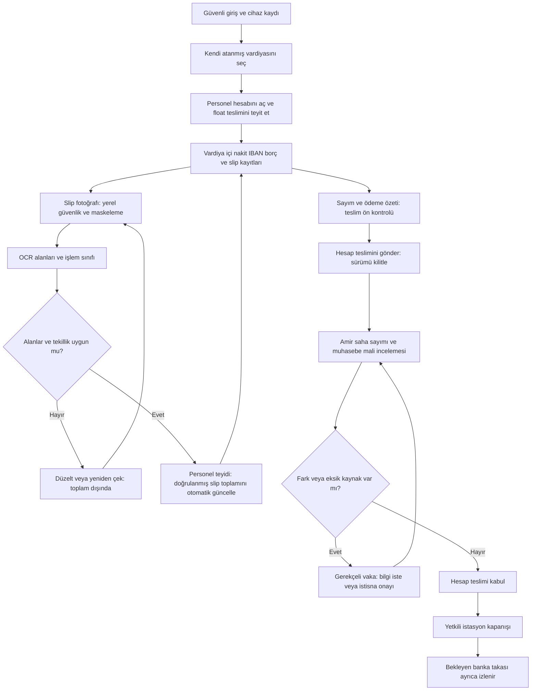

# AKARYAKIT V1 — v1.9 Personel Mobil Vardiya, Slip OCR ve Muhasebeye Hesap Teslimi

**Tarih:** 10 Ekim 2026. **Durum:** uygulama planı; kurulabilir uygulama/APK, canlı OCR veya banka bağlantısı henüz üretilmedi. [V1.4 veri modeli](tasarim-v1.4-mobil-ui-ddl-satin-alma.md), [v1.5 onay kuralları](tasarim-v1.5-mutabakat-satin-alma-firma-yetki.md) ve [v1.8 pilot kapıları](pilot-v1.8-canliya-gecis-kontrol-risk-plani.md) korunur. Bu belge personel hesabının açılışından muhasebe teslimine kadar ayrıntı ekler.

## 1. Ürün kararı: istasyon vardiyası ve personel hesabı ayrı

- **İstasyon vardiyası:** yöneticinin açtığı veya takvimle planladığı ortak operasyon dönemi. Turpak/ÖKC kaynakları bu döneme bağlanır.
- **Personel vardiya hesabı:** ilgili vardiyaya katılan gerçek çalışan için açılan ayrı ödeme, kanıt ve teslim dosyası. Çalışan yalnız kendi hesabını yönetir.
- **Vardiya sahibi / işlemi yapan / terminal / personel hesabı** farklı alanlardır. Beş bilgisayarda aynı yetkili kişinin oturumu açık olabilir; başka personelin işlemi yapan kimliğini kaybettirmemelidir.
- Telefon katılımcı cihazıdır; en çok beş masaüstü POS kontenjanını tüketmez. Varsayılan pilotta çalışan başına bir aktif telefon; cihaz değişimi yöneticinin iptal/kayıt akışıyla olur.
- Çalışan bir vardiya atamasına katılabilir; kendine istediği firma/istasyon/iş alanını seçemez. Atanmamış vardiyaya giriş talebi yöneticide bekler.
- Personelin hesap teslimi istasyon vardiyasını kapatmaz. Muhasebenin mali incelemesi ve amirin saha kapanışı farklı yetkilerdir.

**Önemli kaynak sınırı:** Turpak yalnız istasyon/terminal toplamı veriyorsa toplamı personeller arasında eşit veya oranlı bölmeyiz. Personel attribution, gerçek kaynak personel ID'si ya da onaylı terminal/pompa zaman aralığı ve işlem eşleme kayıtlarıyla yapılır. Atanamayan satışlar `UNASSIGNED_SOURCE` kuyruğuna gider; kişi bazında kesin fark hesabı kaynak eşlemesi tamamlanmadan yapılamaz. İstasyon toplamı ayrıca gösterilir.

## 2. Telefona kurulabilir dağıtım yaklaşımı

**Önerilen ilk pilot:** HTTPS üzerinden kurulan **PWA**; telefonda ana ekrana uygulama simgesi, uygulama görünümü, kamera izinleri ve mobil uyumlu formlar. App Store/Google Play zorunluluğu olmadan pilot erişimi sağlanır. Android/iOS kurulum ve kamera/offline davranışı gerçek telefonlarda ayrı denenir.

PWA seçimi bu aşamada teknik öneridir; nihai platform kararı değildir. Desteklenen iOS/Android listesi, kurum MDM'i, yerel güvenli depolama/redaksiyon, gelişmiş offline background ve dağıtım zorunluluğu varsa native/hybrid uygulama fazı seçilir. PWA'nın her telefonda arka planda sorunsuz OCR/senkron yapacağı varsayılmaz.

### Kurulum ve ilk giriş

1. Yönetici çalışan kartını, kullanıcı hesabını, FUEL rolünü ve istasyon/aylık atamasını oluşturur.
2. Çalışana süreli tek kullanımlık davet gönderilir; davet yetki değil hesabı etkinleştirme yoludur.
3. Personel hesabını etkinleştirir, güvenli giriş yapar; cihaz kaydı backend'de kullanıcıya bağlanır.
4. Desteklenen telefonunda “Ana ekrana ekle” kurulum akışını tamamlar. Kurulum çalışmazsa desteklenen tarayıcı fallback'i pilot politika kapsamında denenir.
5. Kamera ve dosya izinleri amacı açıkça gösterilerek alınır. Gereksiz rehber/konum/mikrofon erişimi istenmez.
6. Oturum/yenileme token'ları güvenli politika ile yönetilir. PWA'da uzun ömürlü token düz localStorage'da tutulmaz; cookie/BFF ve CSRF koruması veya eşdeğer uygun mimari seçilir.
7. Site İSG/saha kurallarıyla telefon/kamera kullanılabilecek **izinli güvenli alan** belirlenir. Telefon çekiminin pompa yanında her ortamda uygun olduğu varsayılmaz; vardiya girişi/slip çekimi onaylı alanda yapılır.

İlk sürüm biometrik/kesintisiz geofencing zorunlu değildir. Yönetim/muhasebe için MFA politikası ayrı uygulanır. Personelin ücret/bordro hesabı bu vardiya ödeme hesabının kapsamı değildir.

## 3. Kullanıcı akışı

İstisna kapalı durumunda pending banka/eksik fiscal veri kesinleşmez. Gönderim sonrası yeni slip/alan düzeltmesi yeni hesap sürümü üretir; muhasebenin incelediği hash değişirse eski karar taşınmaz.

## 4. Mobil ekran envanteri ve alanları

| Ekran | Alanlar / eylemler | Otomatik davranış ve kontrol |
|---|---|---|
| M01 — Giriş / cihaz | Giriş kimliği, davet, cihaz durumu, desteklenen sürüm | Pasif çalışan, iptal cihaz veya scope dışı erişim reddedilir |
| M02 — Vardiyam | Tarih, istasyon, FUEL, planlanan saat, amir, atama | Sadece kendi atamaları; “Hesabımı aç” idempotent |
| M03 — Açılış teslimi | Float/bozuk para, önceki teslim, sayım notu; varsa kupür sayımı | Beklenen teslim ve sayılan ayrı; fark amir vakası; float satış değildir |
| M04 — Hesabım / gün içi | Nakit, kart slipleri, IBAN, borç, eski cari tahsilat sekmeleri; kuyruk ve son eşitleme | Kaynak satış, beyan ve banka kesinliği farklı etiketlerle |
| M05 — Ödeme girişi | Tür, tutar TRY, zaman, kaynak fiş/satış referansı, not | Sıfır/negatif/biçim hata; aynı kaynak ikinci satış yaratmaz |
| M06 — Borçlu satış | Kişi/kurum seçimi, kaynak satış, borç tutarı, vade; varsa limit sonucu | Personel sınırlı borçlu araması; limit/hesap yaratma ayrı yetki; satıştan tek AR debit |
| M07 — IBAN beyanı | Hesap takma adı, tutar, ödeme saati, bankanın güvenli ref'i; maskeli dekont opsiyonel | Banka eşleşene kadar pending; tutar tek başına kesin tahsilat değil |
| M08 — Slip çek / liste | Kamera, güvenli kadraj, OCR kuyruğu, slip no, kişi/tarih/terminal, aday ve teyitli toplam | Fotoğraf başına kanıt; aynı işlem ikinci defa sayılmaz |
| M09 — OCR kontrol | Tutar, currency, belge türü, tarih-saat, terminal/merchant, RRN/ref, işlem sonucu | Otomatik doldur; alan teyidi/düzeltme; doğru fotoğraf revizyonu korunur |
| M10 — Gün sonu sayım | Kapanış kupür sayımı, kasa içi float, gün içi teslim/çıkış, iade, tekrar say | Beklenen nakit açık formülle; aynı cash handover iki defa düşülmez |
| M11 — Teslim önizleme | Kaynak satış, ödeme dağılımı, teyitli slip, pending slip/IBAN, borç, sayım/teslim farkı | Eksik çekirdek alan bloke; sadece tutar eşitliği yeterli değil |
| M12 — Teslim durumu | Teslim no/sürüm, amir/muhasebe incelemesi, bilgi talebi, kabul, pending takip | Personel kendi dosyasını görür; sessiz edit yok |

**Alt gezinme:** Vardiyam / Ödeme ekle / Slipler / Hesap teslimi / Hesabım. Üstte personel, istasyon, dönem, `online/offline/son eşitleme`, personel hesabı durumu her ekranda görünür. Renk tek başına anlam taşımaz.

### Ödeme girişi mi, yeni satış mı?

FUEL satışının asıl kaynağı yetkili otomasyondur. Mobil form başlangıçta **beyan/kanıt ve payment allocation** oluşturur; otomasyon satışını yeniden yaratmaz. Kaynak API yoksa `MANUAL_EVIDENCE` taslağı, sonradan satışa bağlanacak eşleme kuyruğuna alınır. Bu beyanı Turpak'tan gelen aynı satışla birleştirmeden ciro/AR bir kez daha artırılmaz.

Bir satış nakit+kart+borç parçalı olabilir: satırları tek kaynak satışa bağlanır ve tutar toplamı kaynakla kontrol edilir. Kaynak satış iadesi, satış ödeme türü iadesi ve bankanın takas mahsupları aynı olay olarak çifte düşülmez.

## 5. Slip OCR — otomatik tanıma ve toplam

### 5.1 Aşamalar

1. **Güvenli capture:** kadraj rehberi, görüntü okunabilirliği; ham PAN/CVV/PIN/track alınmaması, kaynakta yerel kırpma/redaksiyon. Güvenli maskeleme yapılamıyorsa dış OCR'ye gönderim kapalı ve tekrar çekim istenir.
2. **Upload:** private object store, kısa ömürlü sınırlı upload; `client_event_id`, `evidence_id`, checksum, kullanıcı/katılımcı/istasyon/iş alanı. Aynı ID + aynı hash aynı sonucu döndürür; aynı ID + farklı veri 409.
3. **OCR:** iş kuyruğu ve bounded retry. `recognized_document_type`, para/tarih alanları, confidence, engine/parser version. Ham OCR metni maskelenmeden log/LLM'ye konmaz.
4. **Sınıflandırma:** onaylı satış slipi, iade, iptal/declined, POS gün sonu toplam raporu, banka dekontu, bilinmeyen. POS toplam raporu tek tek slip toplamına ayrıca eklenmez.
5. **Normalizasyon:** currency, binlik/ondalık, tarih-saat/time zone, merchant/terminal ve referans. Tutar kuruş tamsayıya çevrilir; belirsiz `1.250` değeri keyfi yorumlanmaz.
6. **Scope/eşleme:** gerçek terminal, vardiya zaman aralığı, kişi attribution ve kaynak işlem. Çekim saati işlem zamanı değildir.
7. **Tekillik:** aynı dosya hash'i kesin tekrar işareti; farklı fotoğrafın aynı slip olması terminal+merchant+işlem ref (RRN varsa)+tarih/currency/tutarla aday tarama. Onay kodu tek başına küresel tekil kabul edilmez. Yakın tekrar insan incelemesine gider.
8. **Personel teyidi:** yüksek confidence dahi “belgeden kontrol et” adımını atlamaz. Kendi düşük riskli adaylarını toplu kontrol seçeneği ancak pilot kalite verisi ve ayrı politika onayından sonra açılır. Düşük güven, dönem/terminal şüphesi veya iade ayrı inceleme.
9. **Toplam:** teyit edilen uygun ve mükerrer olmayan slipler sunucu tarafından otomatik toplanır; çalışan kart toplamını tekrar elle hesaplayıp yazmaz. OCR sonucu doğrudan satış/cari/banka kaydı oluşturmaz.
10. **Muhasebe kontrolü:** slip/işlem seti POS batch ve satış payment satırlarına bağlanır; toplam eşit olsa da kayıp+tekrar iki işlemin birbirini kapatması incelenir.

### 5.2 Üç ayrı toplam

- **OCR aday toplamı:** okunmuş fakat henüz teyit edilmemiş alanlar. Açık “taslak” etiketi, kesin teslim hesabına girmez.
- **Doğrulanmış slip toplamı:** personel/atanmış inceleyici tarafından teyitli, tekil onaylı satışlar eksi bağlanmış uygun iadeler. Otomatik güncellenir.
- **POS kaynak toplamı / banka net takası:** ayrı referanslar. Brüt kart slipi ile komisyon düşülmüş banka girişi doğrudan eşitlenmez.

`verified_card_evidence_total = Σ approved_unique_sale_evidence − Σ linked_verified_refund_evidence`

İade POS/source tarafında zaten netlenmişse rapor modeli aynı iade kimliğini kullanır; ikinci bağımsız çıkarım yok. İptal/başarısız slip toplam dışındadır. Başka vardiyanın veya başkasının slipi ownership eşlemesi yapılana kadar toplam dışı.

**Yeni fotoğraf / düzeltme:** aggregate delta ile istemcide kalıcı hesap yapmak yerine sunucu geçerli son review sürümlerini tekrar toplar. Böylece OCR retry veya kullanıcının iki tıklaması toplamı şişirmez. Toplam revision ile dönülür; onay anında evidence-set hash kontrol edilir.

### 5.3 Hata kodları

| Kod | Kullanıcı mesajı / işlem | Muhasebe etkisi |
|---|---|---|
| `RETAKE_REQUIRED` | Fotoğrafı izinli alanda yeniden çek | Toplam dışı |
| `SENSITIVE_IMAGE_BLOCKED` | Kart verisini kadraj dışında bırak/redaksiyonu düzelt | Dış OCR yok |
| `AMOUNT_AMBIGUOUS` | Ondalık ve currency'yi belgeden kontrol et | Teyitsiz |
| `DOCUMENT_NOT_SALE_SLIP` | İade/rapor/dekont türüne taşı | Satış slip toplamına eklenmez |
| `DUPLICATE_SUSPECT` | Önceki kanıtla karşılaştır | İkinci kanıt review bitene kadar dışarıda |
| `OUT_OF_SHIFT` / `UNASSIGNED_SOURCE` | Dönem/kişi atamasını amire sor | Kişi farkı kesinleşmez |
| `OCR_RETRY_WAIT` | Aynı upload sırada, tekrar fotoğraf gerekmez | Pending |
| `STALE_HANDOVER_VERSION` | Son sürümü tekrar aç | Eski inceleme kararı reddedilir |

## 6. Muhasebeye hesap teslimi: dijital + fizikî

### 6.1 Ön kontrol ve gönderim

Personel “Hesabımı teslim et” öncesinde nakit sayımı, gün içi kasa hareketi, slip seti, pending IBAN, borçlu satış ve eski cari tahsilatı görür. Bekleyen kanıt sayısı ayrı. Sunucu katılım/aktif vardiya/scope, para biçimi, duplicate ve hesap tutarlılığını kontrol eder.

**Nakit:**

`beklenen_fiziki_kasa = başlangıç_teslimi + doğrulanmış_nakit_satış + eski_cari_nakit_tahsilat − nakit_iade − belgeli_kasa_çıkışı − önceki_ara_teslim`

`nakit_sayım_farkı = fiziki_sayım − beklenen_fiziki_kasa`

`teslim_edilebilir_nakit = fiziki_sayım − kasada_kalacak_onaylı_float`

Float değişimi ayrı onaylı cash-movement olayıdır. Satış borcu nakit değildir; IBAN pending nakit değildir; kart komisyonu kasanın nakit sayımından çıkarılmaz.

### 6.2 Fizikî teslim kaydı

- `cash_handover`: veren kişi, teslim alan yetkili/vezne, tutar, kupür özeti, zaman, kişi hesabı, para birimi, varsa mühürlü zarf referansı.
- Personelin “teslim ettim” beyanı `OFFERED` olur. Teslim alan tekrar sayar ve `ACCEPTED` veya `DISPUTED` kaydeder; iki tutar korunur.
- Muhasebe fizikî parayı almıyorsa teslim alan saha vezne/amir olur; muhasebe bu teslim kanıtını denetler. Muhasebe kullanıcıya sadece uzaktan kontrol ettiği parayı “fiziken aldım” dedirtmeyiz.
- Gün sonu nakit teslime geçmeden önce closing count fotoğrafı/kanıtı varsa snapshot'a sabitlenir. Son teslim, aynı snapshot'ın beklenen kasa hesabından ikinci kez düşülmez.
- Bankaya nakit yatırımı ayrı transfer ID'siyle kasa çıkışı/banka girişi olur. Kaynak toplam nakit aynı firma konsolidasyonunda ikinci kez artmaz.

### 6.3 Muhasebe ekranı

**Menü:** Finans → Vardiya hesap teslimleri. Filtre: hukuki firma/istasyon/FUEL, gün, personel, durum, fark, kaynak eksikliği, yaş.

**Liste:** hesap/teslim no, vardiya dönem, kişi, nakit beklenen/sayılan/teslim alınan, kart slip/POS farkı, borç, eski cari tahsilat, IBAN pending, açık OCR sayısı, kaynak güncelliği, amir inceleme, muhasebe inceleme, revision.

**Detay sekmeleri:**
1. Özet ve ödeme dağılımı.
2. Slip görseli + OCR alanı + personel düzeltme geçmişi + kaynak POS işlem.
3. Kasa sayım/ara teslim/gün sonu teslim ve teslim alan teyidi.
4. Borçlu satış–AR debit, eski borç tahsilatı–AR credit/allocation.
5. Banka/IBAN/POS batch/takas/komisyon.
6. Kaynaklar ve karşılaştırma, eşleşmemiş işlemler.
7. Karar ve değişmez audit.

**Karar düğmeleri:** `Bilgi iste`, `Kanıtı reddet`, `Mali incelemeyi kabul et`, `İstisna talep et`. Muhasebe personelin orijinal beyanını veya fiscal satışını doğrudan edit etmez. İnceleme kabulü, bütün bankaya bekleyen kartların tahsil olduğunu söylemez.

### 6.4 Kontrollü örnek — gerçek veri değil

Kaynak net yakıt satışının **10.000 TL** olduğu tek personel hesabını düşünelim:

| Bileşen | Tutar | Kaynak/etki |
|---|---:|---|
| Nakit satış | 3.000 TL | Satış ödeme satırı |
| Kart onaylı slip | 6.000 TL | Teyitli tekil OCR + POS source |
| IBAN beyanı | 700 TL | Banka pending |
| Borçlu satış | 300 TL | Kaynak satıştan tek AR debit |
| Eski cari nakit tahsilatı | 500 TL | Yeni satış değil; AR credit/allocation |
| Açılış float | 100 TL | Gelir değil |
| Belgeli ara teslim | 1.000 TL | Kasadan teslim alınmış, satış değişmez |

Beklenen fiziki kasa `100 + 3.000 + 500 − 1.000 = 2.600 TL`. Sayım 2.590 TL ise fark **−10 TL**. Kasada 100 TL kalacaksa son teslim teklifi **2.490 TL**. Teslim alan 2.490 TL'yi kabul ettiğinde gün içi+son kabul edilmiş teslim toplamı 3.490 TL'dir; beklenen float hariç tutar 3.500 TL, fark yine −10 TL. Eski tahsilat eklenerek satış 10.500 TL yapılmaz.

Kart slipleri 3.500 + 2.500 = 6.000 TL. Tekrar fotoğraflanan 3.500 TL slip ikinci kez girmez. Banka/POS sözleşmesinde kesinti **örnek %2** ve takasta netleniyorsa 120 TL ücret/5.880 TL net banka girişi beklenir; bu oran gerçek değil, örnektir. Slip/POS 6.000 TL ile banka net 5.880 TL ayrı satırlar; 120 TL “personel kart açığı” değildir.

Muhasebe pending 700 TL'yi daha sonra doğrular; eski hesap teslim snapshot'ını değiştirmeden bağlı banka eşleme olayı/fark durumu güncellenir. 300 TL borç kapanışta ikinci AR debit üretmez.

## 7. Durum makineleri ve yetki

**Personel hesabı:** `DRAFT → OPEN → SUBMITTED → IN_REVIEW → ACCEPTED`.

- `NEEDS_INFO`: çalışan yeni revision taslağı hazırlar; eski teslim ve kararlar korunur.
- `ACCEPTED_WITH_PENDING`: yalnız tanımlı politika/ayrı imzalarla; pending IBAN/takas açık kalır.
- `REJECTED`: gerekçeli review, eski içerik silinmez.
- `REOPEN_REQUESTED`: kapanış sonrası ayrı yetki/ikinci onay; yeni revision.

**Fizikî nakit teslimi:** `OFFERED → ACCEPTED / DISPUTED`; iade/düzeltme eski hareketi update/delete değil ters/düzeltme olayı.

**Banka/POS:** `PENDING_MATCH → MATCHED / PARTIAL / DISPUTED`; operasyon hesabı kabulü bunların yerine geçmez.

| İşlem | Personel | Amir | Muhasebe | Firma yetkilisi |
|---|---|---|---|---|
| Kendi hesabı/kanıtı | Gir, teyit et, gönder | Oku/geri gönder | İncele | Özet |
| Başka kişinin beyanını edit | Yok | Yok; düzeltme talebi | Yok; düzeltme talebi | Yok |
| Saha nakit sayım / fizikî alma | Kendi sayımı/teklif | Yetkiyle kabul | Fizikî teslim alıyorsa ayrı yetki | Özet |
| Borçlu/limit oluşturma | Talep/sınırlı seç | Politikayla | Cari yetkisiyle | Kritik limit onayı |
| Banka/IBAN eşleme | Beyan | Pending oku | Kanıtla doğrula | Özet/istisna |
| Hesap teslim mali incelemesi | Yok | Saha inceleme | Atanmış scope'ta kabul | İstisna ikinci imza |
| İstasyon operasyonel kapanışı | Yok | Ayrı close izni | Otomatik verilmez | Ayrı izin/politika |

Talep sahibi aynı talebi onaylayamaz; farklı rol altında aynı gerçek kişi ikinci imza sayılmaz. Nakit sayım küçük farkı dahil her sıfır olmayan fark review vakası açar. İnceleme snapshot'ında beyan/source/evidence-set değiştiyse eski imza yeniden kullanılmaz.

## 8. Hedef veri modeli ve API sözleşmesi

Mevcut v1.4/v1.5 DDL'leri doğrudan çalıştırmadan gerçek ORM/migration aracına eşlenecek **yeni hedef varlıklar**:

| Varlık | Önemli alanlar / bütünlük |
|---|---|
| `ops.employee_shift_accounts` | tenant, hukuki firma snapshot, station, FUEL BU, shift, participant, account ID, state, revision; katılımcı+vardiya için tek aktif hesap |
| `ops.shift_account_revisions` | account, revision, source/evidence hash, snapshot time/cursor, submitted_by/time; değişmez teslim görüntüsü |
| `ops.payment_declaration_events` | actor, account, CASH/CARD/IBAN/DEBT/AR_COLLECTION, currency/amount_minor, source_sale/tender; client_event_id tekil |
| `ops.source_transaction_assignments` | kaynak işlem ID, employee account, eşleyen/onaylayan, dönem, nedeni; tek kaynak işlem çakışan iki hesaba atanamaz |
| `evidence.payment_evidence` | mevcut dosya metadata + account/participant ownership, checksum ve redaksiyon durumu |
| `evidence.ocr_jobs/reviews` | mevcut parser/engine, alan confidence, review revision; ham ve teyitli sonuç ayrı |
| `ops.cash_handovers` | offered/received minor, payer/receiver, person account, float snapshot, status, audit |
| `ops.shift_handover_reviews` | hesap revision/hash, saha/mali inceleme, rol/permission, decision, gerekçe/kanıt |
| `ops.approval_requests/decisions` | mevcut görev ayrımı ve değişmez onay kayıtları |
| `ops.outbox_events` | hesabın durumu/kanıt toplamı değişimi; aynı transaction, idempotent consumer |

Para integer minor TRY/currency; client'tan company/station/employee ID'ye güvenilmez. Kanıt belongs-to scope backend'de doğrulanır. OCR aggregate kaynak veri doğrulaması/son review ile read model olarak hesaplanır; posted AR ledger'a OCR job'dan trigger bağlanmaz.

**Önerilen dahili endpoint'ler — canlı API değil:**

| Endpoint | Görev / kritik kontrol |
|---|---|
| `GET /v1/me/shift-assignments` | Kendi etkin atamaları |
| `POST /v1/me/shift-accounts` | Atama/cihaz doğrula, idempotent açılış |
| `POST /v1/shift-accounts/{id}/declarations` | Own-account scope + source/ref + event ID |
| `POST /v1/shift-accounts/{id}/evidence/uploads` | Maskeli safe upload + checksum + ownership |
| `POST /v1/evidence/{id}/reviews` | OCR teyidi/düzeltme, version/conflict kontrolü |
| `GET /v1/shift-accounts/{id}/summary` | Kaynak, aday, teyitli, pending ayrı toplam |
| `POST /v1/shift-accounts/{id}/handovers` | Snapshot/hash ile gönderim, çekirdek gates |
| `POST /v1/cash-handovers/{id}/receive` | Yetkili alıcı sayımı, self-approval değil |
| `GET /v1/accounting/shift-handovers` | Muhasebe scope'u ve kuyruğu |
| `POST /v1/accounting/shift-handovers/{id}/review` | Son revision, aktif permission, hash ve ayrı kişi |

`Idempotency-Key`, `client_event_id`, `If-Match/revision`, correlation ID standarttır. Yanıtlarda summary_revision, source_as_of ve completeness yer alır. Farklı hash'le aynı key sessiz başarı değil 409. Yetkisiz nesne erişimi uygun scope gizleme politikasıyla reddedilir.

### Muhasebe kabul transaction'ı

Kimlik/izin → account+handover+request sabit sırada lock → revision/hash/source completeness doğrula → own-request yasağı → bekleyen ve fark politikası doğrula → review/decision append → gereken farklı imzaları say → teslim mali review status güncelle → audit/outbox → commit. AR/cash/fiscal post ayrı idempotent domain olaylarıdır; kabul düğmesi bunları kendiliğinden yeniden post etmez.

## 9. Offline ve cihaz kaybı

- Kullanıcı atanmış hesabını online doğruladıktan sonra sınırlı offline taslak; offline kendine yeni vardiya/rol açılmaz.
- Offline pending sayısı/tutarı görünür. Sunucu ACK alınmadan “muhasebeye teslim edildi” gösterilmez.
- PWA'da güvenli ve test edilmiş depolama yoksa hassas slipler offline kalıcı saklanmaz; onaylı güvenli alanda bağlantı gelince çekme/gönderme fallback'i.
- Yeniden bağlantıda aynı client event IDs sırayla gönderilir; server revision değişmişse conflict ekranı, toplamı overwrite yok.
- Cihaz iptalinde session/token ve upload yetkisi kapanır. Offline cihazın içeriğine uzaktan kesin silme garantisi verilmez; retention/yerel silme ve kurum cihaz politikası ayrıca doğrulanır.
- Kapalı vardiyaya geç gelen olay yeni review kuyruğu; eski kapanışı değiştirmez.

## 10. Kabul testleri ve pilot teslimat fazları

### Uygulama fazları

1. Gerçek şema/kimlik keşfi, kullanıcı/atama/device ve employee account.
2. Mobil sayısal ödeme formları, kaynak transaction eşleme, cash count/handover.
3. Private kanıt upload, yerel maskeleme, OCR parser/review/tekil toplam.
4. Personel submit+revision; amir ve muhasebe ayrı review ekranı; approval.
5. Gerçek Turpak/ÖKC/POS/banka adapter ve pending takibi; API yoksa açık OCR/manual-evidence kapsamı.
6. Staging/restore/concurrency, telefon kurulum ve İSG alan testleri; gölge pilot; kontrollü cutover.

### Olmazsa olmaz testler

- Atanmamış vardiya / başka çalışan hesabı / scope dışı kanıt URL reddi.
- Aynı kullanıcı beş masaüstü + kişisel telefon; altıncı masaüstü red, ownership kaybolmaz.
- Yeni account isteği/submit iki tıkla bir hesap/teslim üretir.
- Nakit, borç, IBAN, eski cari tahsilat ayrımı; örnek 10.000 TL satış/−10 TL sayım hesabı doğrulanır.
- Aynı slip farklı fotoğrafla ikinci kez toplamda yok; distinct legitimate ref collision review ile çözülür.
- İade/declined/POS toplam raporu satış slipi diye sayılmaz.
- Düşük confidence veya belirsiz ondallı tutar, banka net komisyonu yanlış kart açığı sayılmaz.
- OCR retry sonrası aynı job/review aggregate ikinci kez artmaz.
- Personel submit anında tamamlanan OCR job revision conflict üretir; eski hash'le muhasebe kabul olmaz.
- Fizikî teslim offered ≠ accepted; alıcı sayımı/para transferi ayrı.
- Kısmi IBAN/pos eşleme ve sonradan gelen source olayı tarihi korur; satış/AR tekrarı yok.
- Muhasebenin review kabulü vardiya close yetkisi sayılmaz; kendi talebi ikinci rol üzerinden onaylanamaz.
- Offline draft/sync fail/server ACK ayrımı ve kayıp cihaz revoke denenir.

Testlerin mevcut olduğunu veya geçtiğini bu belge iddia etmez. İlgili pilot runbook [v1.9 teknik/operasyonel 46 adımda](pilot-v1.9-46-kontrol-uygulama-runbook.md) ayrıntılıdır.

## 11. Gerçek likidite bağlantısı ve açık bilgiler

Muhasebece doğrulanmış kasa/teslim/banka olayları gerçek opening snapshot'ına girer. OCR slip toplamı yalnız bekleyen **brüt kart kanıtını** besler; profil/value-date/komisyon ve batch doğrulaması olmadan kullanılabilir banka nakdine dönüşmez. Borçlu satış AR'ye girmişse ödeme planı beklenen tahsilattır, bugün nakit değildir.

[Gerçek pilot veri giriş şablonu](pilot-v1.9-gercek-veri-toplama.xlsx) doldurulunca mevcut demo yerine gerçek snapshot+bank/POS profilleriyle hesaplanacak. Bakiye ve oranlar henüz verilmedi: **gerçek likidite sonucu üretilemez**. %2 veya 125.500 TL demo değeri gerçek veri boşluğunu doldurmak için kullanılmaz.

Teyit bekleyenler: pilot firma/istasyon, actual snapshot saati, bank/POS sözleşmesi, kaynak personel attribution, PWA/native tercihi, cihaz listesi/İSG alanı, offline süresi, OCR çalışma yeri/retention, confidence inceleme politikası, amir–muhasebe teslim ve nakit alıcı rolleri, tampon/istisna eşikleri.
