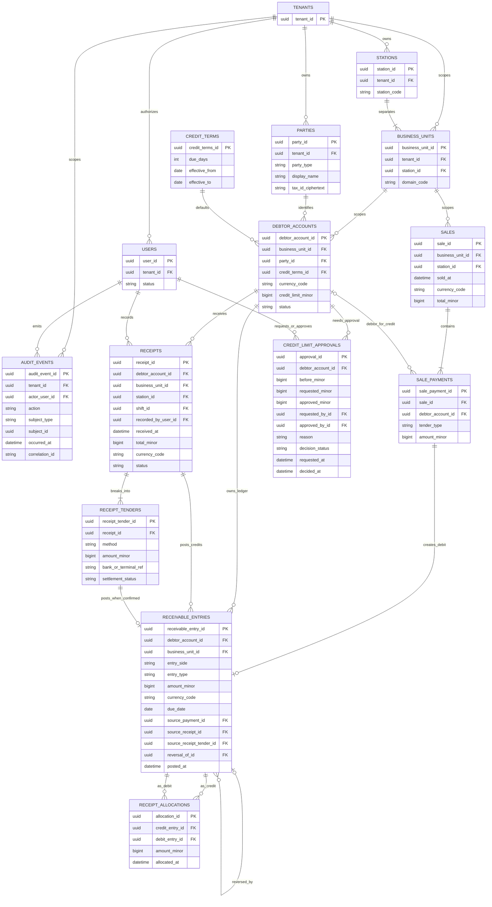
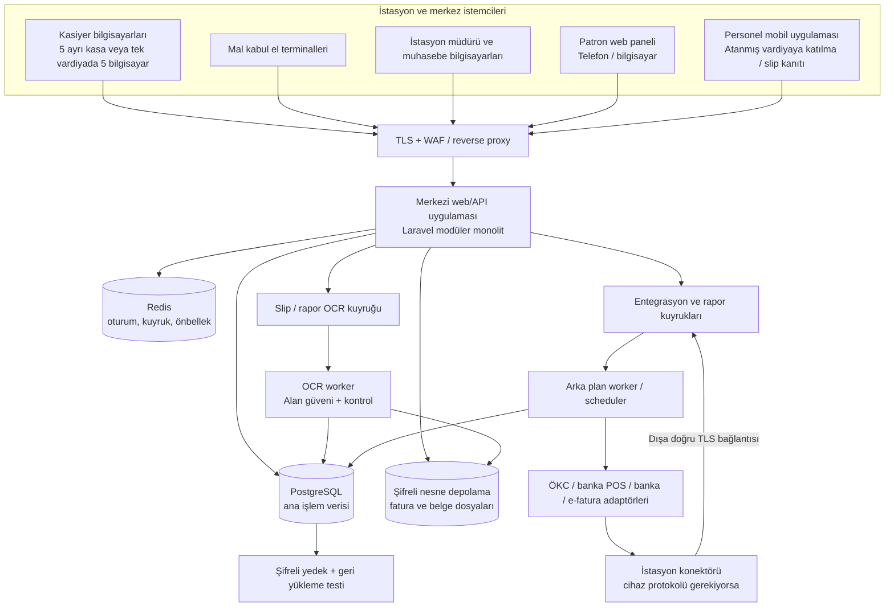
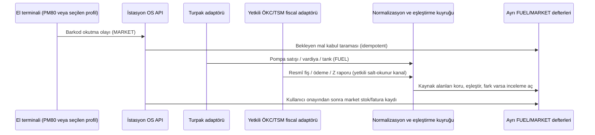
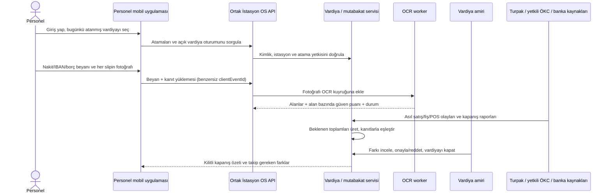

# İstasyon OS — Ayrıntılı Teknik Planlama v1.3

**Durum:** Tasarım önerisi; kodlama veya kesin şema değildir. Proje kuralına uygun olarak bu aşamada uygulama kodu yazılmamıştır.  
**Tarih:** 7 Ekim 2026  
**Kapsam:** Akaryakıt ve marketi ayrı yöneten istasyon ERP’si; çok bilgisayarlı ve kişisel telefonlu vardiya oturumları; seçilebilir el terminali; Turpak/YN Pompa ÖKC ve banka POS bağlantıları; yetkili veri yokluğunda insan onaylı fotoğraf-OCR kanıt akışı; cari/alacak ERD’si; satın alma öneri sorguları; patron paneli, hata yönetimi ve migration planı.

**v1.3 ekleri:** Mobil vardiya seçimi/katılımcı modeli, vardiya kapanışında slip fotoğrafı/OCR, Turpak ve YN ÖKC için iç JSON istek-yanıt sözleşmeleri, sistem kaynakları erişilemediğinde sınırlı OCR yedeği, tedarik sipariş algoritması ve sorguları, aşamalı PostgreSQL migration taslağı.

## 1. Kullanıcının yanıtlarıyla kesinleşen ürün kararları

- İstasyon başına **beş satış bilgisayarı/kasa noktası** desteklenecek. Kullanıcılar ya beş ayrı kasiyer oturumu açabilecek ya da aynı vardiya oturum sahibi aynı oturumu en çok beş bilgisayarda eşzamanlı kullanabilecek. Oturum sahibi, işlem cihazı ve ödeme terminali ayrı ayrı kaydedilecek. Çalışanların kişisel telefonlarından vardiyaya katılımı ayrı cihaz sınıfıdır; bu taslakta masaüstü beş-terminal sınırını tüketmez.
- Vardiya sonunda **nakit, kredi kartı, IBAN/banka transferi ve borç** tutarları ayrı ayrı uzlaştırılacak. Tek oturumun toplamı ile cihaz bazındaki alt toplamlar birlikte görülecek.
- Ürünler stok ve satışta yalnızca **adet** bazında izlenecek. Her barkod tek ürüne ait olmalı; GTIN biçimi/check-digit ve benzersizlik kontrolü ürün girişi, dosya içe alma ve istasyon eşitlemesinde çalışacak. Normal satıştaki stoklu ürün barkodsuz bırakılamayacak; istisna yetkili onayı ve iç kod/etiketle yönetilecek.
- Mal kabul, PM80’in ilk referans cihaz olduğu **seçilebilir el terminali profilleriyle** barkod okutularak yapılacak. Faturada barkod yoksa kullanıcı ürünle manuel eşleştirebilecek; eşleştirme ve miktar/fiyat farkı onay gerektirecek.
- Alış siparişi, fiziksel teslim alma ve tedarikçi faturası ayrı kayıtlardır; stok yalnızca onaylanmış mal kabulünde artar.
- YN ÖKC yasal fiş/GİB iletişimi cihaz ve yetkili üretici/entegratör çerçevesinde kalır. Uygulama, üretici/entegratörün izin verdiği satış satırı ve rapor verisini alır; cihazın resmî fişini uygulama üzerinden değiştirmez.
- Bankalardan POS işlem ve takas verisi alınabildiği için her banka/sağlayıcıya özgü API veya dosya adaptörü planlanır. Komisyon, iade ve valör farkları ayrı tutulur.
- Patron ekranı işletme sahibinin yetkisindeki **beş istasyonu** birleştirerek gelir, stok maliyeti, alacak pozisyonu ve yaklaşan ödeme yükünü göstermeli. Farklı tüzel kişilikler varsa konsolidasyon açık grup yetkisiyle yapılmalı; tenant izolasyonu atlanmamalı.
- Pazarlama amaçlı CRM, sadakat puanı ve kampanya yönetimi istenmiyor. Ancak kullanıcının son kararıyla **borçlu kişi/kurum ve sonraki tahsilatlar için ayrı cari/alacak alt defteri** kapsamda. Bu, müşteri ilişkileri/puan modülü değil; satıştan doğan alacağın ve tahsilatın ERP-finans takibidir.
- Sistem tedarikçi, stok, satın alma, nakit/banka/kart, alacak/borç ve muhasebe/e-belge bağlantılarıyla **ERP mantığında** kurgulanacak.
- Resmî muhasebe ve e-Fatura/e-Arşiv sistemlerine bağlanabilirlik hedef kapsamdır. Bağlantı yetkili özel entegratör API’si veya gerekli izinler edinilmiş resmî entegrasyon yöntemi üzerinden yapılmalıdır.
- Bütün bilgisayar, el terminali ve personel telefonları ortak sunucu/API’yi kullanır; istemciler doğrudan veri tabanına bağlanmaz.
- Personel sabah kendi hesabıyla mobil uygulamaya girer ve yalnızca kendisine atanmış aylık vardiyayı seçerek ortak vardiya oturumuna katılır. Her personelin mobil bildirimi/deklarasyonu kullanıcı, cihaz ve zamanla ayrı izlenir; vardiya toplamını nihai olarak yetkili amir kapatır.
- Turpak/YN ÖKC yetkili API veya dışa aktarım verilemiyorsa izinli rapor ekranı/çıktısı fotoğrafından OCR **geçici, insan onaylı kanıt ve mutabakat girdisi** üretebilir. OCR resmi kayıt, canlı entegrasyon, kesin stok/ciro postu veya GİB veri aktarım yükümlülüğünün yerine geçmez.
- Her istasyonda **AKARYAKIT** ve **MARKET** ayrı iş alanları/alt defterleridir: farklı satış ve stok modelleri, maliyet hesapları, satın alma/fatura kayıtları, e-belge bağlantı ayarları ve raporları olur. Bir alandaki belge ya da maliyet diğer alana otomatik yazılmaz; patron ekranı yalnızca ayrı kalemleri koruyan üst düzey konsolidasyon yapar.
- Akaryakıt alanı pompa/nozul, litre, yakıt türü, tank, totalizatör, pompa vardiyası ve yakıt teslimi/faturasıyla; market alanı SKU, adet, el terminaliyle mal kabul, market satışı ve market tedarikçi faturasıyla çalışır.
- Aynı tüzel kişiye bağlı olsalar bile akaryakıt ve market için e-Fatura/e-Arşiv adaptör profili, belge kuyruğu, eşleştirme ve muhasebe aktarım rotası ayrı tanımlanır. Ortak e-belge sağlayıcısı kullanılırsa bile sistemde iş alanı bazında ayrım ve rapor şarttır.

## 2. El terminaliyle mal kabul ve alış faturası eşleştirme

**Kapsam sınırı:** Bu bölüm, PM80’in ilk referans cihaz olduğu seçilebilir el terminali profilleriyle yapılan **MARKET toptancı mal kabulü ve market alış faturası** içindir. Akaryakıt teslimatı/faturası bu adetli ürün akışına girmez; ayrı `fuel` alanında tank/litre ve yakıt tedarik belgesiyle yönetilir.

### 2.1 Baştan sona operasyon akışı

**A. Ön hazırlık ve beklenen teslimat**

1. Yetkili satın alma personeli tedarikçi, istasyon, sipariş tarihi ve beklenen teslim tarihiyle satın alma siparişini açar.
2. Sipariş satırlarında istasyon ürünü, barkod/ürün kodu, beklenen adet, birim maliyet, vergi ve sipariş durumu tutulur.
3. Alış faturası siparişten önce gelmişse fatura “bekleyen eşleşme” durumuna alınabilir; fatura tek başına stok girişi oluşturmaz.
4. Mal kabul personeli el terminalinde doğru istasyon ve beklenen teslimatı seçer. Teslimatın başka istasyona kaydedilmesini sistem engeller.

**B. Barkodlu okutma**

5. El terminali barkodu okutur. Barkod tek bir etkin ürüne eşleniyorsa ekran ürün adı, ürün kodu, beklenen adet, daha önce okutulan adet ve farkı gösterir.
6. Normal akışta her fiziksel ürün paketi için bir okutma yapılır; okutma sayısı bir adet artırır. Operatörün klavyeyle toplu miktar girmesi gerekiyorsa bu ayrı yetkili işlem olarak gerekçe ve kullanıcı bilgisiyle kaydedilir.
7. Aynı ürün çok kez okutulabilir; ekran toplam okutulan adedi gösterirken, her okutma tekrar gönderimden korunmak için benzersiz terminal olayı olarak saklanır.
8. Bilinmeyen barkod kabulü durdurur ve “ürün eşleştirme” listesine düşer. Yetkili kullanıcı barkodu var olan ürüne bağlayabilir veya yeni ürün kartı açabilir. Bilinmeyen barkod kendi başına yeni stok ürünü yaratmaz.
9. Yanlış ürün, hasarlı ürün, eksik/fazla teslim veya barkodsuz ürün ayrı istisna olarak işaretlenir; kabul edilen, reddedilen ve bekleyen adetler birbirinden ayrılır.
10. Operatör okutma listesini gözden geçirir; beklenen ve fiilî adet farkları ile hasarlı ürünler görünür. Mal kabul kapatılmadan önce terminal ekranında toplam kalem/adet ve fark özeti gösterilir.

**C. Teslim alma ve stok hareketi**

11. Personel mal kabulü tamamlar. Fatura, sipariş ve okutulan adetlerde fark varsa sistem kaydı otomatik kapatmaz; yetkili kullanıcı onayı ve gerekçesi olmadan fark kabul edilmez.
12. Onay anında her kabul edilen satır için istasyon ve ürün bazında değiştirilemez `PURCHASE_RECEIPT` stok hareketi oluşturulur. Stok bakiyesi aynı veri tabanı transaction’ı içinde güncellenir.
13. Hasarlı/inceleme bekleyen ürünler satılabilir stoktan ayrı tutulacaksa `QUARANTINE` veya `NON_SELLABLE` statüsüyle izlenir; onaylanana kadar satış stokuna katılmaz.
14. Mal kabul belgesi kapatılır ve ilgili sipariş/faturayla ilişkilendirilir. Sonradan düzeltme gerekiyorsa orijinal belge silinmez; ters kayıt ve yeni düzeltme kaydı oluşturulur.

**D. Alış faturası ve üçlü eşleştirme**

15. Alış faturası elektronik belge (varsa XML/UBL), PDF veya yetkili manuel giriş yoluyla alınır. Belge no, tedarikçi, tarih, para birimi, satır, miktar, birim fiyat, iskonto, vergi ve toplamlar ayrıştırılır.
16. Fatura satırları önce tedarikçi kodu/barkodu, sonra istasyon/global SKU, en son yetkili kullanıcı onayıyla ürün kartına eşleştirilir. Sadece benzer ürün adıyla otomatik kesin eşleştirme yapılmaz.
17. Her fatura satırı için **sipariş edilen adet/fiyat ↔ barkodla kabul edilen adet ↔ fatura adedi/fiyatı** karşılaştırılır. Sipariş–teslim alma–fatura üçlü eşleştirmesi satır düzeyindedir.
18. Sistem aşağıdaki farkları ayrı ayrı üretir: sipariş dışı ürün, fatura edilen ama teslim alınmayan ürün, teslim alınmış ama faturada olmayan ürün, adet farkı, birim fiyat/iskonto/vergi farkı, mükerrer fatura numarası ve toplam farkı.
19. Adet/miktar farkı her durumda `MATCH_EXCEPTION` üretir ve kullanıcı onayı ister. Fiyat, iskonto, vergi veya toplam farkı da otomatik sessizce kapatılmaz; yalnızca mevzuat kaynaklı teknik yuvarlama kuralları ayrıca tanımlanırsa sistem bilgilendirici tolerans uygulayabilir, farkı onaysız ticari kabule çeviremez.
20. Yetkili kullanıcı farkı “kabul et”, “tedarikçiden düzeltme bekle”, “iade et” veya “faturayı reddet” olarak sonuçlandırır; gerekçe, eski/yeni değer ve onaylayıcı audit’e yazılır.
21. Onaylanmış fatura finans/ticari borç kaydı oluşturabilir. Stok miktarı faturadan ikinci kez artırılmaz; stok girişi mal kabul hareketinden gelir.

### 2.2 Hata ve istisna durumları

- **Barkod katalogda yok:** okutmayı karantinaya al; kullanıcı ürünü seçip onaylamadan stok kabulü yapma.
- **Barkod birden çok ürüne bağlı veya başka aktif SKU’da kayıtlı:** işlemi durdur; benzersiz indeks, ürün ana veri kontrolü ve yönetici çözümü iste.
- **Ürün kartında barkod yok/geçersiz:** normal satış ve okutmalı mal kabulü engelle; istisna yalnızca iç barkod üretilip yetkili onayından sonra açılabilsin.
- **Aynı terminal olayı yeniden gönderildi:** benzersiz `device_event_id` nedeniyle ikinci sayım yaratma.
- **Faturadaki ürün adı farklı:** tedarikçi ürün kodu ve SKU eşleştirmesi iste; otomatik AI önerisi sunulabilir fakat eşik altı olmayan belirsiz sonuçlar onay bekler.
- **Fatura miktarı kabul miktarından fazla:** eksik teslim farkı üret; stokta olmayan ürün kendiliğinden yaratılmaz.
- **Fatura miktarı kabul miktarından az:** fazla teslim veya ücretsiz promosyon ayrıştırılır; maliyet ve vergi yorumu onaya bırakılır.
- **İade veya hasar:** tedarikçi iadesi stoktan eksi hareket, hasar fire hareketi üretir; fiş/fatura ve sebep bağlantısı korunur.
- **İnternet kesintisi (çevrimdışı kullanım seçilirse):** terminal cihaz kimliğiyle doğrulanan ve benzersiz olay UUID’si taşıyan okutma olaylarını yerel kuyrukta saklar. Yeniden bağlanınca sunucuya gönderir; sunucu aynı olay kimliğini ikinci kez işlemez. Stok kesinleşmesi terminalin ekranda bildirdiği yerel sayımdan değil, sunucuda kabul edilmiş mal kabul onayından sonra gösterilir.

### 2.3 Önerilen temel kayıtlar

- `market_purchase_orders`, `market_purchase_order_lines`
- `market_supplier_invoices`, `market_supplier_invoice_lines`, market belge referansı
- `market_goods_receipts`, `market_goods_receipt_lines`
- `market_receiving_scan_events` (terminal kimliği, olay UUID’si, barkod, okutma zamanı, kullanıcı ve alınan adet)
- `market_supplier_product_mappings`
- `market_invoice_receipt_matches`, `market_match_exceptions`, market onay kayıtları
- `market_inventory_movements`, `market_inventory_balances`

Satın alma, mal kabul ve faturanın kendi durum akışı bulunmalı. Bir sipariş birden çok kısmi teslim alabilir; bir fatura birden çok teslimatla veya teslimatın bir kısmıyla eşleşebilir. Bu ilişki satır düzeyinde desteklenmelidir. Barkod başına tek ürün kuralı veri tabanı benzersizliği ve ürün oluşturma/import doğrulamalarıyla uygulanmalı; fatura barkodsuz satır içeriyorsa kullanıcı onaylı tedarikçi ürün kodu/adı eşlemesi yapılmalıdır.

### 2.4 PM80 referans cihazı ve seçilebilir el terminali bağlantısı

Point Mobile, Android tabanlı cihazların yerleşik tarayıcısı için resmî Flutter barkod okuyucu eklentisi yayımladığını belirtiyor. PM80 için incelenen cihaz kullanım rehberi ise tarayıcı çıktısını clipboard/wedge modunda `LF` satır sonuyla uygulamadaki barkod alanına gönderecek şekilde yapılandırmayı anlatıyor. İlk prototipte wedge/PWA yolu önerilir; gerekiyorsa Android yerel uygulamasında Point Mobile SDK/eklenti değerlendirilir. PM80 ilk referans cihazdır, tek desteklenen marka değildir: başka üretici/model de `ANDROID_WEDGE`, `ANDROID_SDK`, `HID_KEYBOARD` veya uyumlu istemci profiliyle aynı sunucu API’sine bağlanabilir. Firmware, Android sürümü, tarayıcı ayarı ve seçilen her model gerçek cihazla kabul testinde doğrulanmalıdır. [11] [12]

## 3. Ayrıntılı stok programı

Bu adetli stok tasarımı **MARKET SKU envanteri** içindir. Yakıt tankları, pompa totalizatörleri, litre ve teslimat hareketleri ayrı `fuel` şeması/defterinde kalır; market `inventory_balances` tablosuyla birleştirilmez.

### 3.1 Stok modülünün alt bileşenleri

1. **Ürün kataloğu:** Global ürün kimliği; istasyon bazlı ürün kartı; ad, marka, kategori, SKU, barkod(lar), temel birim `ADET`, vergi/fiyat ve aktiflik.
2. **Tedarikçi ürün eşlemesi:** Tedarikçi kodu, tedarikçi ürün adı ve varsa tedarikçi barkodu; fatura satırı eşleştirmesinin kaynağı.
3. **Satın alma:** Sipariş, sipariş onayı, kısmi sipariş, teslim tarihi ve bekleyen miktar.
4. **Mal kabul:** Terminal oturumu, okutma olayları, kabul miktarı, iade/hasar miktarı ve onay.
5. **Fatura eşleştirme:** Belge alımı, satır ayrıştırma, üçlü eşleşme, fark ve onay kuyruğu.
6. **Anlık satış ve stok düşümü:** Yazar kasa satır düzeyi fişi, ürün adedi, fiyat, ödeme dağılımı, kasiyer, oturum ve cihaz referansı.
7. **Stok hareket defteri:** Tüm giriş/çıkış olaylarının değiştirilemez kaynağı.
8. **Stok bakiyesi:** İstasyon–ürün bazında güncel adet; hareket defteriyle tutarlı şekilde güncellenir.
9. **Sayım:** Kör sayım seçeneği; barkodlu çevrimdışı/çevrimiçi sayım; beklenen ve bulunan miktar; fark onayı.
10. **İade, fire ve düzeltme:** Satış iadesi, tedarikçiye iade, hasarlı ürün, fire, kayıp, sayım farkı ve stok transferi.
11. **Raporlama ve satın alma önerileri:** Kritik stok, stokta yok, yavaş dönen ürün, yaşlanan stok, stok devir hızı, bekleyen mal kabul ve tedarikçi performansı.

### 3.2 Stok hareketi kuralları

Her hareket en az şu bilgileri taşır: tenant, istasyon, ürün, adet cinsinden artı/eksi miktar, hareket türü, olay/fiş/fatura referansı, işlem zamanı, yapan kullanıcı/entegrasyon ve varsa onaylayan.

- Mal kabul: artı adet.
- Satışın kesinleşmesi: eksi adet.
- Satış iadesi: orijinal satışa bağlı artı adet.
- Tedarikçiye iade: alış/mal kabul referansına bağlı eksi adet.
- Fire/hasar: gerekçe ve yetkiyle eksi adet.
- Sayım farkı: onaylanmış fark kadar artı/eksi.
- İptal: orijinal hareketi silmeden ters hareket.
- İstasyonlar arası transfer: kaynak istasyonda çıkış, hedef istasyonda giriş; iki taraflı ve tek transfer kimliğiyle izlenir.

Hareket defteri muhasebe/denetim kaynağıdır. Bakiye performans için tutulan özet tablodur; düzenli mutabakatla defterden yeniden üretilebilmelidir. Satış ve bakiye düşümü tek transaction/idempotent işlemle yapılır. Negatif stok varsayılan olarak engellenir; istisnaya yalnızca belirli yetkili, gerekçe ve audit ile izin verilir.

### 3.3 Maliyet, sipariş ve stok optimizasyonu

- **MVP maliyet önerisi:** İstasyon-ürün bazında hareketli ağırlıklı ortalama maliyet; her satın alma satırının fiilî birim maliyeti saklanır. FIFO veya mevzuata uygun maliyet yöntemi işletmenin muhasebe gereksinimiyle doğrulanmadan kesin seçilmemelidir.
- **Kritik stok:** Ürün için minimum adet ve tedarik süresi belirlenir. `önerilen sipariş = hedef stok − (mevcut satılabilir stok + yoldaki sipariş − ayrılmış miktar)` şeklinde hesaplanabilir; alt sınır sıfırdır.
- **Stok gün sayısı:** Ortalama günlük satışa göre `satılabilir adet / ortalama günlük satış` olarak hesaplanır; mevsimsellik ve satış yokluğu için uyarı gösterilir.
- **5.000 SKU:** Barkod, istasyon SKU’su ve normalize ürün adına indeksli arama; kategori/aktiflik filtresi; sayfalı arama. Beş bin ürün teknik sınır değil, ürün işletme hedefidir.
- **Devir hızı/ölü stok:** Seçilen tarih aralığında satılan adet ve ortalama stok üzerinden; iade ve transferlerin ayrıca gösterildiği şekilde hesaplanır.
- **Son kullanma tarihi/lot:** Başlangıç kapsamı için zorunlu değil; ürünlerde tarih takibi gerekiyorsa tasarım aşamasında lot alanı eklenmesi değerlendirilmelidir.

## 4. Yazar kasa ve banka POS mutabakatı

### 4.1 Kayıtları ve kaynakları ayırma

- **Yazar kasa / YN ÖKC:** Resmî fiş ve Z raporunun kaynağıdır; ürün satırları ancak seçilen cihaz/üretici entegrasyonu bunları sağlamayı destekliyorsa alınır.
- **Vardiya/kasa oturumu:** Oturum sahibi ve istasyon için tek vardiya üst kaydı. İşletme ya beş ayrı kasa noktasında ayrı kasiyer oturumları açar ya da aynı oturum sahibinin tek vardiya oturumunu en çok beş bilgisayarda eşzamanlı kullanmasına izin verir.
- **Bilgisayar/terminal alt oturumu:** Her oturumda bilgisayar/device ID, yazar kasa cihaz ID’si ve banka POS terminali ilişkilendirilir; beş bilgisayarın satış ve tahsilat alt toplamları ayrı, vardiya toplamı konsolide raporlanır.
- **Banka POS terminali:** Kart provizyonu, iptal/iade, batch ve terminal referanslarını sağlar.
- **Banka hesabı ekstresi:** POS işlemlerinin komisyon sonrası net takas tutarını ve valör tarihini gösterir.

Her sistemin harici belge ve işlem kimliği saklanır. Günlük Z raporu satış toplamını kontrol eder; stok için satır düzeyi PLU/ürün verisi gerekir. Yalnızca Z raporu toplamı varsa günlük kasa mutabakatı yapılabilir, ancak ürün bazlı gerçek stok düşümü sağlanamaz.

### 4.2 Günlük işleyiş

1. Kasiyer hesabı vardiya oturumunu başlatır. Sistem ya en çok beş bağımsız kasa oturumu açar ya da aynı oturum sahibine bağlı en çok beş bilgisayar oturumunu tek vardiya/kasa oturumuna bağlar. İki mod aynı anda karıştırılırsa hangi bilgisayarın hangi nakit çekmecesini temsil ettiği açıkça atanır.
2. Oturum açılış nakdi (float) her fiziksel çekmece için girilir. Bilgisayar, yazar kasa cihazı ve banka POS terminali ilişkisi kaydedilir; aynı kullanıcı hesabının beş bilgisayarda açık olması izinlidir ve her işlem cihaz/oturum ID’si taşır.
3. Yazar kasa üzerinden oluşan her satışın fiş numarası, satırları, toplamı, vergi/iskonto ve ödeme dağılımı sunucuya aktarılır. Ürün satırları geldiğinde stok derhal düşer.
4. Satış tahsilatı `NAKIT`, `KREDI_KARTI`, `IBAN_TRANSFERI` ve/veya `BORC` türlerinde kaydedilir. `BORC` seçilmesi zorunlu olarak bir borçlu kişi/kurum cari hesabına bağlanır ve satış fişinden alacak kaydı açar. Banka POS işlemi terminal/provizyon referansına, IBAN tahsilatı banka hareketi/transfer referansına bağlanır.
5. Vardiya kapanışında sistem nakit, kredi kartı, IBAN/banka transferi, **bu vardiyada yaratılan borç satışı** ve **bu vardiyada alınan cari tahsilatları** ayrı hesaplar. Nakit her çekmece/cihaz bazında sayılır; kart terminal batch’iyle, IBAN banka hareketiyle eşleşir. Cari tahsilatın hangi borç(lar)a uygulandığı ayrıca görünür.
6. Gün sonu Z raporu, yazar kasa satış satırları ve ödeme toplamlarıyla eşleştirilir.
7. Banka POS batch raporu işlem bazında kart tahsilatlarına bağlanır.
8. Banka ekstresine geçen net takas; brüt POS işlemleri, iade/iptal, komisyon ve valör farkıyla eşleştirilir.
9. Eşleşmeyen kalemler görev kuyruğuna alınır; manuel eşleştirme yetki, açıklama ve audit gerektirir.

### 4.3 Sayısal örnek senaryo

Bir istasyonda 15:00–23:00 oturumunda **Kasiyer Ayşe** çalışsın:

- Yazar kasa Z raporundaki brüt ürün satışı: **25.000 TL**.
- İade/iptal edilmiş satış: **300 TL**.
- Net satış: **24.700 TL**.
- Ödeme dağılımı: kart **14.000 TL net satış**, nakit **7.200 TL net** (7.300 TL nakit satış − 100 TL nakit iade), IBAN transferi **2.000 TL**, Müşteri A Ltd.’ye borç **1.500 TL**. Toplam `14.000 + 7.200 + 2.000 + 1.500 = 24.700 TL`.
- Banka POS batch’inde **14.200 TL başarılı brüt kart işlemi** ve **200 TL kart iadesi** bulunur. Net kart satışı `14.200 − 200 = 14.000 TL` olup yazar kasa ile eşleşir.
- Sözleşme komisyonu örnek olarak **%1,5** ise beklenen banka takası `14.000 − 210 = 13.790 TL` olur. Valör T+1 ise bu tutar aynı gün değil ertesi iş gününde banka ekstresine beklenir. Gerçek komisyon ve valör banka sözleşmesinden alınır; burada örnek amaçlıdır.
- IBAN ile tahsil edilen **2.000 TL**, dekont/işlem referansı ve banka ekstresindeki alacak hareketiyle eşleştirilir; banka hesabında henüz görünmüyorsa `TRANSFER_PENDING` kalır.
- Açılış nakdi **1.000 TL**, net nakit tahsilatı **7.200 TL** (7.300 TL satış − 100 TL iade), gün içinde kasadan bankaya/depozitoya teslim **500 TL** olsun. Beklenen kapanış nakdi `1.000 + 7.300 − 100 − 500 = 7.700 TL` olur.
- Kasiyer sayımı **7.690 TL** ise kasa farkı `7.690 − 7.700 = −10 TL` olarak kaydedilir; kapanış yönetici incelemesine gider.
- **Müşteri A Ltd.’ye** yazılan borç **1.500 TL** tahsil edilmiş para değildir; ilk vardiya raporunda yeni borç satışı, cari hesapta açık alacak olarak görünür. Örneğin sonraki gün 500 TL IBAN ve 1.000 TL nakit tahsilat alınırsa, her tahsilat dekont/kasa kaydıyla cari hesaba işlenir ve açık bakiye sıfırlanır. Bu tahsilatlar tahsil edildikleri yeni vardiyanın nakit/IBAN girişidir; önceki günün satışına ikinci kez eklenmez.
- 13.790 TL takas banka ekstresinde geldiğinde POS batch kapanır. 210 TL komisyon ayrı masraf/mutabakat bileşenidir; net takası 14.000 TL ile eşleştirip “eksik ödeme” sanmamak gerekir.

**Sonuç durumları:** Z raporu `RECONCILED`; kart batch’i `MATCHED`; POS banka takası valör gününe kadar `PENDING_SETTLEMENT`, geldiğinde `RECONCILED`; IBAN transferi banka ekstresi görünene kadar `TRANSFER_PENDING`; nakit farkı `NEEDS_REVIEW`; Müşteri A Ltd. alacağı **1.500 TL** `OPEN_RECEIVABLE` olur. Sonraki tahsilatlar alacaklara dağıtıldıkça bakiye kapanır. Bu senaryoda aynı vardiya sahibi en çok beş bilgisayarda satış yaptıysa fişler bilgisayar/terminal ID’siyle izlenir ve tüm alt toplamlar tek vardiya oturumunda kapanır.

### 4.4 Cari/alacak alt defteri: borç satışından tahsilata

1. **Borçlu kartı:** Borç yazılacak kişi/kurum için asgari cari kartı (ad/unvan, kişi/kurum türü, gerekli iletişim/vergi tanımları, vade koşulu, varsa kredi limiti ve aktiflik) açılır. Pazarlama izni, kampanya, puan ve CRM geçmişi bu karta otomatik eklenmez; kişisel/vergi verisi yalnızca gerekli alan ve izinlerle tutulur.
2. **Borç satışı:** Yazar kasa satış fişindeki `BORC` ödeme satırı borçlu ID’sine, satış fişine, vardiya sahibine ve terminale bağlanır. Aynı anda alacak alt defterinde borç hareketi yaratılır; stok satışı normal satış gibi düşer. Cari kaydı olmayan alıcıya borç yazılamaz.
3. **Tahsilat:** Kasiyer/finans kullanıcısı borçlu hesabını seçer, açık borçları görür, alınan tutarı nakit/kart/IBAN yöntemiyle kaydeder. Tahsilat tek borca veya seçilen açık borçlara tam/kısmi dağıtılabilir. Kart, banka transferi ve kasa referansları tahsilat kaydında saklanır.
4. **Mutabakat ayrımı:** Borç satış tutarı satış döneminin cirosudur; sonraki tahsilat yeni ciro değildir. Nakit/IBAN tahsilatı yapıldığı günün kasa/banka girişi ve vardiya tahsilat toplamında görünür; alacak bakiyesini azaltır. Banka ekstresi ile eşleşmeden IBAN tahsilatı kesinleşmiş sayılmaz.
5. **Kontrol:** Açık bakiye, vade tarihi, gecikmiş gün, cari ekstre, tahsilat geçmişi, kredi limiti aşımı ve bekleyen tahsilat raporlanır. Borç silme/iskonto/şüpheli alacak kapatma ayrı yetki, sebep, onay ve audit kaydı gerektirir.
6. **Önerilen temel kayıtlar:** `parties`, `debtor_accounts`, mevcut `sale_payments` (BORC tender satırı), `receivable_entries`, `receipts`, `receipt_tenders`, `receipt_allocations`, `credit_terms`, `credit_limit_approvals`, `audit_events`. Satışın BORC ödeme satırı tekil alacak kaydının kaynağıdır; ayrı borç satış kaydı yaratılmaz ve CRM/sadakat modülü bunlardan bağımsız kalır.

### 4.5 Akaryakıt ve marketi ayrı tutma kuralı

Her istasyon tek uygulama ve kullanıcı/rol yönetimi altında çalışabilir; ancak **AKARYAKIT** ile **MARKET** ayrı iş alanlarıdır. Kayıt, hesaplama ve e-belge entegrasyonunda her işleme bir `business_unit_id` ve `domain_code` (`FUEL` veya `MARKET`) atanır. Aynı tüzel kişiliğe bağlı olmak bu ayrımı kaldırmaz.

**Mimari varsayım:** başlangıçta aynı merkezî platform/oturum içinde iki ayrı iş modülü ve defter olarak tasarlanır; patron izinli özetleri konsolide eder. Kullanıcı “ayrı” derken her alan için farklı program kurulumu, sunucu/veritabanı ve kullanıcı girişini kastediyorsa bu, tek platform varsayımını değiştirir ve dağıtım mimarisi ayrıca kararlaştırılmalıdır.

| Konu | Akaryakıt alanı | Market alanı |
|---|---|---|
| Operasyon kaynağı | Turpak istasyon/pompa otomasyonu ve yetkili YN Pompa ÖKC arayüzü | Market POS/yazar kasa ve seçilmiş el terminali profiliyle çalışan mal kabul istemcisi |
| Stok ve ölçü | Yakıt türü, tank, pompa/nozul, litre, totalizatör, teslimat ve tank ölçümü | SKU/barkod, adet bazlı raf/arka depo stoku, mal kabul ve sayım |
| Alış belgesi | Dağıtım şirketinden yakıt alım faturası; tank teslimi/irsaliye ve litre ölçümüyle eşleştirme | Toptancı/tedarikçi market faturası; sipariş, barkodlu adetli mal kabul ve fatura satırı eşleştirmesi |
| Hesaplama | Litre ve yakıt türüne göre satış, teslimat, tank ve totalizatör mutabakatı; maliyet/vergi yöntemi ayrı parametrelenir | Adet, SKU maliyeti, market satış/iade ve stok değerleme; maliyet yöntemi ayrı parametrelenir |
| E-belge | `FUEL` alış/satış belge gelen kutusu, tedarikçi eşleştirmesi, posting ve muhasebe aktarım profili | `MARKET` alış/satış belge gelen kutusu, tedarikçi/ürün eşleştirmesi, posting ve muhasebe aktarım profili |

**Kayıt ve ekran ayrımı (önerilen şema isimleri):** aynı modüler uygulama/veri tabanı sunucusu kullanılabilir, fakat iş kayıtları ayrı `fuel` ve `market` şema/modüllerindedir. Akaryakıt tarafı `fuel.purchase_documents`, `fuel.deliveries`, `fuel.tank_movements`, `fuel.supplier_accounts`, `fuel.efatura_connections`; market tarafı `market.purchase_orders`, `market.supplier_invoices`, `market.goods_receipts`, `market.stock_movements`, `market.supplier_accounts`, `market.efatura_connections` kullanır. **İki alanı birleştiren ortak alış faturası tablosu, ortak stok defteri veya tek posting ekranı önerilmez.** XML/PDF asılları aynı şifreli nesne-depolama hizmetinde tutulmak zorunda kalırsa bile `fuel/` ve `market/` ayrı nesne kapsamı/erişim politikası ve belge listelerine yazılır. Sağlayıcı tek bir gelen kutusu sunarsa ham kaynak belge önce alan seçimi/istisna kuyruğundan geçer; yakıt veya market hedef kaydı kesinleşmeden hiçbir cari/stok hareketi yaratılmaz.

**Ayrı hesaplama örnekleri:** yakıt tankı beklenen kapanış litresi = açılış ölçümü + onaylı net teslimat − pompa totalizatöründen hesaplanan satış ± onaylı düzeltme; gerçek ATG/fiziki ölçüm farkı `FUEL` tolerans kuralına göre uyarı/onaya gider. Market beklenen adet = açılış adet + onaylı mal kabul − market satış/iade hareketleri ± onaylı sayım düzeltmesi; fiziki sayım farkı `MARKET` kuralına gider. Yakıt maliyet/vergi ve litre bazlı satış hesapları market SKU/COGS hesaplarına; market maliyet yöntemi de yakıt defterine uygulanmaz.

Tedarikçi/kişi kimlik kartı ortak referans olarak kullanılabilir; fakat **tedarikçi cari alt hesabı, borçlu hesabı, faturalar, stok hareketleri, maliyetler, belge kuyruğu ve raporlar iş alanı bazında ayrıdır**. Aynı e-belge sağlayıcısı kullanılsa bile iki ayrı bağlantı profili ve eşitleme/atama kuralı tanımlanır. Kaynak e-Fatura gelen kutusu ortaksa belge uygulamaya alınmadan `FUEL` veya `MARKET` alanına sınıflandırılır; belirsiz ya da iki alana birden ait satır içeren belge onaysız biçimde hiçbir deftere post edilmez. Patron paneli, her iki alanı önce ayrı gösterir; toplam satırı kontrollü konsolidasyondur.

### 4.6 Cari/alacak ERD önerisi

ERD, mevcut `tenant`, `station`, `sales`, `sale_payments`, `shifts` ve `users` tablolarına bağlanır. Aynı tüzel kişi/tedarikçi/borçlu için ortak `party` kimliği kullanılabilse de her istasyonun yakıt ve market cari hesabı **ayrı `business_unit_id` kapsamında** tutulur. Dolayısıyla bir market tahsilatı yakıt alacağını kapatamaz (ve tersi), kullanıcı ayrıca yetkilendirilmiş transfer işlemi yapmadıkça.



**Temel tablo ve kısıtlar**

- `business_units`: istasyon ve iş alanı bağı; `UNIQUE(station_id, domain_code)`, `domain_code IN (FUEL, MARKET)`. Alt hesap, satış ve tahsilatlar aynı business unit kapsamına zorunlu bileşik FK ile bağlanır.
- `parties`: tenant içinde ortak kişi/kurum kimliği; borçlu kimlik/vkn/tckn gerekiyorsa yalnızca asgari alan şifreli ve maskeli saklanır. Bir `party` için yakıt ve markette ayrı hesap açılabilir; pazarlama profili değildir.
- `debtor_accounts`: `debtor_account_id`, `party_id`, `business_unit_id`, `currency_code`, `credit_terms_id`, nullable `credit_limit_minor`, `status`, `opened_at`, `closed_at`, oluşturma/güncelleme kullanıcıları. `UNIQUE(business_unit_id, party_id, currency_code)`; FUEL ve MARKET bakiyeleri birleştirilmez. Tedarikçi borçları müşteri alacak defterinden ayrı `fuel.supplier_accounts` ve `market.supplier_accounts` alt defterlerindedir.
- `credit_terms`: sürümlü koşul (`due_days`, varsa ay sonu/son ödeme günü, geçerlilik aralığı ve varsayılan dağıtım kuralı). Satışta kullanılan koşul/vade tarihi alacak kaydına snapshot edilir; sonradan koşul değiştirmek eski vadeleri geriye dönük değiştirmez.
- `sale_payments`: mevcut satışın tahsilat dağılımındaki ödeme satırı; `tender_type=BORC` olduğunda `debtor_account_id` zorunlu, tutar pozitif, döviz ve satışın `business_unit_id` değeri hesapla aynı olmalıdır. `SALE_DEBIT` kaynağı için `source_payment_id` unique/idempotent olur.
- `receivable_entries`: silinmeyen cari hareket defteri; `entry_side` (`DEBIT`/`CREDIT`) ve `entry_type` (`SALE_DEBIT`, `RECEIPT_CREDIT`, `CREDIT_NOTE`, `ADJUSTMENT`, `WRITE_OFF`, `OPENING_BALANCE`, `REVERSAL`) tutar, döviz, vade, kaynak tür/ID, istasyon/iş alanı, `posted_at`, oluşturan/onaylayan bilgisiyle saklanır. Tutar kuruş gibi dövizin minor unit’inde tamsayı; miktar 0’dan büyük olur. `SALE_DEBIT` kaynağı `source_payment_id`; her doğrulanmış tender’ın `RECEIPT_CREDIT` kaynağı `source_receipt_tender_id` unique/idempotent olur. Açık/kapalı durumu dağıtımlardan türetilir; defter satırı update/delete edilmez.
- `receipts`: borçluya yapılan tahsilatın başlık kaydı: hesap, business unit, istasyon, vardiya, tahsil zamanı, toplam tutar/döviz, kaynak (`CASHIER`, `FINANCE`, `BANK_IMPORT`), kaydeden kullanıcı, not/referans ve durum (`DRAFT`, `PENDING_MATCH`, `PARTIALLY_POSTED`, `POSTED`, `REVERSED`). Tek tahsilat nakit+kart+IBAN’a bölünebildiği için yöntem başlıkta tek değer değildir. Her doğrulanmış tender kendi tutarı için bir `RECEIPT_CREDIT` defter satırı doğurur; yalnızca ilgili tender post edilir. PAN/CVV/PIN saklanmaz.
- `receipt_tenders`: tahsilat altındaki yöntem kırılımı (`CASH`, `CARD`, `IBAN`), pozitif tutar, kasa/shift veya banka hesabı referansı, POS terminal/batch/dekont no, `settlement_status`, kaynak referansı ve doğrulama zamanı. `SUM(receipt_tenders.amount_minor) = receipts.total_minor` transaction içinde doğrulanır. Her tender en fazla bir alacak defter satırı post edebilir. Nakit işletme kuralına göre anında; kart/IBAN kaynak onayı veya ekstre eşleşince post edilir. Bir tender beklerken diğeri doğrulanırsa receipt `PARTIALLY_POSTED` olur; doğrulanmamış pay cari bakiyeyi düşürmez.
- `receipt_allocations`: yalnızca `credit_entry_id`, `debit_entry_id`, `amount_minor`, `allocated_at`, dağıtan kullanıcı/kaynak. Bir tahsilatın bir veya birden çok doğrulanmış tender kredi satırı, bir veya daha çok açık satış borcunu kısmi/tam kapatabilir; tabloya ayrıca `receipt_id` kopyalanmaz, tahsilat credit entry → tender → receipt kaynak zincirinden bulunur. Pozitif tutar; iki hareketin aynı `debtor_account_id`, `business_unit_id` ve dövizde olması zorunlu. Tahsis toplamı hem kredi girişini hem hedef borç satırının kalan bakiyesini aşamaz. Kullanılmayan credit açık müşteri kredisi olarak ayrı gösterilir.
- `credit_limit_approvals`: hesap limiti değişimi veya limit/vade aşımlı satış için `before_minor`, talep, onaylanan miktar, para birimi, sebep, talep eden/onaylayan kullanıcı ve zaman damgası. Talep eden kendini onaylayamaz; eşik ve çift onay rol matrisiyle belirlenir.
- `audit_events`: create/post/allocate/reverse/limit change/approval gibi kritik eylemlerin aktör, işlem zamanı, tenant-istasyon-iş alanı, kaynak ID, önce/sonra güvenli farkı, gerekçe ve correlation ID kaydı. Defter ve audit kayıtları silinemez; loglara sır, PAN/CVV/PIN veya gereksiz kimlik verisi yazılmaz.

**Bakiye kuralı:** `POSTED` durumundaki cari defter **borç (debit) hareketleri** (satış borcu vb.) eksi **alacak (credit) hareketleri** (doğrulanmış tahsilat, iade/alacak dekontu, onaylı terkin) hesaplanır. Tahsilat dağıtım kayıtları credit hareketinin hangi borç belgelerini kapattığını gösterir; aynı tahsilatı ikinci kez bakiye düşürmez. Ekran için önbellek/projeksiyon üretilebilir ama kaynak doğruluk silinmeyen hareket defteridir.

**Defter ve hesaplama ayrıntıları**

- **Cari net bakiye:** seçilen `debtor_account_id`, `business_unit_id`, döviz ve tarih kesitindeki `POSTED` debit toplamı − `POSTED` credit toplamı. `PENDING_MATCH`, `DRAFT` ve reddedilmiş olaylar net bakiyeye girmez. Açılış bakiyesi ancak onaylı, kaynağı açıklanmış `OPENING_BALANCE` hareketi olarak alınır.
- **Belge bakiyesi/yaşlandırma:** her borç satırının açık tutarı = borç satırı tutarı − o satıra yazılmış geçerli `receipt_allocations` − belgeyi doğrudan azaltan onaylı credit-note tahsisi. Kısmi tahsilat alacağı otomatik silmez; açık tutar ile vade yaşı güncellenir. Dağıtılmamış tahsilat ayrı “müşteri avansı/açık credit” gösterilir; açık fatura yaşlandırmasını kapatmış sayılmaz.
- **Tek tahsilat, çoklu tahsilat yöntemi:** tek `receipts` toplamı, bir veya birden çok `receipt_tenders` satırına bölünür; her tender cash drawer, banka veya POS mutabakat kaynağına ayrı bağlanır. Header ve tender toplamı transaction içinde eşit değilse kayıt post edilmez. Başlık durumu tender sonuçlarından türetilir.
- **Tahsilatın post zamanı:** nakit kasada fiziksel sayım/shift hareketiyle aynı anda; kart başarılı işlem referansı ve işletmenin tanımlı tahsilat kabul kuralıyla; IBAN ise banka ekstresi/dekont eşleşince kesinleşir. Her doğrulanmış tender için `source_receipt_tender_id` unique `RECEIPT_CREDIT` yaratılır; bekleyen tender kredi satırı yaratmaz. POS valörü/komisyonu banka takas defterinde ayrıca mutabık kalır.
- **İşlem ve tahsis atomikliği:** BORC tender → `SALE_DEBIT` yaratımı; receipt header+tender kayıtları → doğrulanmış her tender için bir `RECEIPT_CREDIT` postu; dağıtım → allocation toplamı/hesap bakiyesi güncellemesi tek transaction veya güvenli idempotent iş akışıdır. Hesap + açık borç satırları kilitlenerek iki kullanıcının eşzamanlı tahsisle aynı alacağı aşması engellenir.
- **Değişmezlik ve ters kayıt:** `POSTED` kayıt update/delete edilmez. İptal/düzeltme, orijinal satıra `reversal_of_id` bağlayan eş tutarlı ters hareket ve gerekçeyle yapılır; ters kayıt da aynı tenant, hesap, iş alanı ve dövizde olmalıdır. `source_type + source_id` (ve varsa kaynak olay ID’si) unique/idempotenttir.
- **İş alanı/tenant güvenliği:** her kaynak sale payment, debtor account, receipt, tender ve ledger entry aynı tenant–istasyon–`business_unit_id` kompozit FK/servis kontrolünü geçer. Yakıt alacağına market tahsilatı tahsis edilemez; istasyonlar arası mahsup varsayılan olarak yasak, özel transfer varsa çift yetki, iki taraflı kayıt ve audit gerekir.
- **Sınır:** bu cari/alacak alt defteri operasyonel yardımcı defterdir; resmi büyük defter/yevmiye değildir. Onaylı hareketler accounting adapter ile eşleştirilir; dış muhasebe fişi ve raporlama kuralları muhasebeci/ERP ile ayrıca doğrulanır. Tedarikçi **borç/AP** alt defterleri (`fuel.supplier_accounts`, `market.supplier_accounts`) müşteri **alacak/AR** defterinden ayrı kalır.

### 4.7 Tahsilatın ayrıntılı iş akışı

1. **Borçlu seçimi ve limit:** BORC ödeme türü seçildiğinde istasyonun mevcut iş alanındaki borçlu hesabı aranır. Hesap pasifse satış bloke edilir; vade aşımı/limit üstü davranışı yetkiye göre uyarı, yönetici onayı veya bloke olacak şekilde parametrelenir. Onay, satış ve vardiya kimlikleriyle audit edilir.
2. **Borç satışını post etme:** YN ÖKC/market kasa satışı tamamlandığında borç ödeme satırı tek bir `SALE_DEBIT` kaydına çevrilir. `source_payment_id` benzersizliği tekrar gönderimden ikinci alacak oluşmasını önler. Resmî fiş ve dış yazar kasa kaydı değiştirilmez.
3. **Tahsilat oluşturma:** Kullanıcı borçlu hesabını seçer; açık faturaları ve yaşlandırmayı görür; tutar, yöntem ve referansı girer. Tahsilat tek borca veya seçili birden fazla borca tam/kısmi dağıtılabilir. Varsayılan öneri en eski vade tarihinden başlayarak dağıtımdır; kullanıcı yetkiliyse başka borcu seçebilir.
4. **Tahsilatın doğrulanması:** Nakit tender, fiziksel kasa/shift hareketiyle eş zamanlı; kart tender başarılı işlem referansı ve tanımlı tahsilat kabul kuralıyla; IBAN tender ekstre/yetkili dekont eşleşince `POSTED` olur ve yalnızca kendi tutarı kadar alacak bakiyesini düşürür. Diğer tender hâlâ bekliyorsa receipt `PARTIALLY_POSTED` kalır; bekleyen parça `PENDING_MATCH` olarak alacak bakiyesine girmez. Banka net takası ayrıca izlenir. Teklif/ödeme niyeti kesin tahsilat gibi raporlanmaz.
5. **Vardiya kapanışı:** `BORÇ SATIŞI (YENİ ALACAK)` ile `CARİ TAHSİLAT` ayrı göstergelerdir. Cari tahsilatın nakit/kart/IBAN kanalı kasa ve banka/POS mutabakatına girer; fakat tahsil edilen tutar satış cirosuna ikinci defa eklenmez.
6. **İade, iptal ve düzeltme:** Satış iadesi/credit note alacak kaydını tersler. Yanlış tahsilat veya silme düzeltmesi eski kaydı silmez; gerekçe, ters kayıt, rol, çift onay (eşik üstünde) ve audit gerekir.
7. **Rapor:** Cari ekstre borçlu + iş alanı + istasyonla filtrelenir; açık bakiye, vadesi geçen gün sayısı, 0–30/31–60/61–90/90+ yaşlandırması, tahsilat geçmişi ve açık/dağıtılmamış tahsilat ayrı raporlanır. Beş istasyon patronu izinli olduğu şirket grubunda yakıt/market alacağını ayrı, birleşik toplamı ayrıca görür.

### 4.8 Sayısal tahsilat ve kısmi mutabakat örneği

Örnek borçlu hesabında bir market borç satışından **1.500 TL** açık `SALE_DEBIT` bulunduğunu varsayalım. Borç satışının cirosu 1.500 TL’dir ve zaten satış tarihinde kaydedilmiştir.

1. Kullanıcı toplam **1.000 TL** tahsilat başlığı açar: `receipt_tenders` içine 300 TL `CASH` (sayılmış ve `POSTED`) ile 700 TL `IBAN` (`PENDING_MATCH`) kaydedilir. İki tender toplamı başlık toplamı olan 1.000 TL’dir.
2. İlk aşamada nakit tender için `source_receipt_tender_id` benzersiz **300 TL `RECEIPT_CREDIT`** yaratır ve bu tutar 1.500 TL borca tahsis edilir. Receipt durumu `PARTIALLY_POSTED`; IBAN pending olduğu için cari net bakiye **1.200 TL** olur.
3. Banka ekstresi 700 TL IBAN satırını doğrulayınca yalnızca o tender için ikinci, ayrı ve idempotent **700 TL `RECEIPT_CREDIT`** yaratılır. Bu da aynı borca tahsis edilir; receipt `POSTED`, açık borç/bakiye **500 TL** olur.
4. Tekrarlanan banka dosyası aynı tender ID’sini getirirse ikinci 700 TL kredi oluşturulmaz. İkinci tahsilat satış cirosu değildir; toplam ciro 1.500 TL kalır, banka/kasa hareketleri kendi mutabakat defterlerinde izlenir.

## 5. Patron ekranı: tasarım ve kritik KPI’lar

### 5.1 Ekran düzeni

- Üst şerit: tarih/dönem, şirket/işletme grubu, beş istasyon filtresi, **Akaryakıt / Market / izinli konsolide** iş alanı filtresi, son veri güncelleme zamanı ve veri/entegrasyon sağlık göstergesi.
- İlk sıra KPI kartları: toplam/istasyon net satış, tahmini brüt kâr, stok maliyeti, açık alacak, beklenen ödeme yükü (vadesi gelen/yaklaşan), nakit farkı, POS takası ve kritik stok SKU sayısı.
- Orta alan: beş istasyonun gelir ve brüt marj karşılaştırması; stok maliyeti/değeri, market–akaryakıt ayrımı ve gün içi eğilim.
- Alt alan: açık istisnalar ve işlemler: eksik Z raporu, kasa farkı, bekleyen POS takası, sayım farkı, stokta biten hızlı ürün, eşleşmeyen fatura.
- Her sayı tıklanabilir olmalı; istasyon → gün → terminal/kasiyer/ürün/fatura seviyesine kadar yetki kontrollü detay açılmalıdır.

### 5.2 Kritik KPI listesi ve tanımlar

**Satış ve kârlılık**

- Net satış: brüt satış − iadeler − iptaller; market ve akaryakıt ayrı, toplam da gösterilir.
- Satış adedi/işlem sayısı: fiş sayısı ve satılan ürün adedi ayrı ölçülür.
- Tahmini brüt kâr ve marj: net satış − satılan ürünlerin seçilen maliyet yöntemiyle maliyeti. Gerçek muhasebe kârı gibi sunulmamalı; maliyet güncelliği ve vergi görünümü belirtilmelidir.
- Ürün/kategori/istasyon bazında en çok satan ve düşük devirli kalemler.
- İndirim ve iade oranı; olağandışı kasiyer/istasyon sapması.

**Vardiya ve kasiyer**

- Açık kasiyer oturumu, eksik kapanış ve geciken vardiya kapanışı.
- Kasiyer bazında satış ve ödeme dağılımı; nakit beklenen/gerçek fark.
- Açık vardiya sahibi, açık bilgisayar/kasa alt oturumları ve beş bilgisayar sınırına yaklaşım.
- Tek vardiya oturumunda cihaz ve ödeme terminali bazında satış dağılımı.
- Yetkisiz fiyat değişikliği, fazla iskonto, iptal/iade sıklığı.

**Stok ve satın alma**

- Stokta olmayan ürün sayısı; kritik minimumun altındaki SKU sayısı.
- Stok değeri (maliyet yöntemi ve güncellik göstergesiyle), stok devir hızı ve tahmini stok gün sayısı.
- Son X günde satılmayan ürünler; sayım farkı toplamı ve onay bekleyen farklar.
- Bugünkü mal kabul adedi/tutarı; siparişe göre eksik/fazla teslim edilen satırlar.
- Eşleşmeyen alış faturası sayısı ve toplam fiyat/adet farkı; en uzun bekleyen eşleşme.
- Tedarikçi bazında teslimat tutarlılığı ve ortalama fark/kabul süresi.

**Nakit, banka, kart ve cari/alacak**

- Nakit beklenen–sayılan farkı ve inceleme bekleyen istasyon/kasiyer sayısı.
- Banka POS brüt işlem, iade, net kart satışı, bekleyen takas ve geciken takas toplamı.
- POS komisyonu ve net banka takası; beklenen tutar ile ekstreye geçen tutar farkı.
- Eşleşmemiş Z raporu, POS batch’i ve banka hareketi sayısı/tutarı.
- Banka hesap bakiyesi ve son ekstreden beri veri güncelliği.
- Tedarikçi ve diğer onaylanmış işletme borçları: vadesi geçmiş, 7/14/30 gün içinde ödenecek tutar ve vade takvimi.
- Vadesi gelen ödemeler sonrası tahmini nakit açığı; yalnızca sisteme işlenmiş ve kaynağı belli borçlar üzerinden hesaplandığı açıkça belirtilir.
- Borçlu kişi/kurum bazında toplam açık alacak, vadesi geçmiş alacak, 7/30 gün içinde vadesi gelecek alacak ve 0–30/31–60/61–90/90+ gün yaşlandırması.
- Vardiyada yeni oluşan borç satışları ile yapılan cari tahsilatlar; tahsilatın nakit/kart/IBAN dağılımı ve tahsilat sonrası kalan bakiye.
- Kredi limitini aşan veya vadesi geçmiş cari hesap sayısı/tutarı; en yüksek açık bakiyeler ve yoğunlaşma riski.
- Vardiya kapanışında nakit, kredi kartı, IBAN/banka transferi, yeni borç satışları ve borç tahsilatları ayrı toplamlar; cari bakiye kişi/kurum bazında detaya iner.

**Çok istasyonlu işletme sağlığı**

- Beş istasyonun ayrı ve birleşik net geliri, brüt kâr eğilimi, stok maliyet/değeri, kritik stok riski, borçlu bazında açık/yaşlandırılmış alacak, yaklaşan ödeme yükü ve kasa/POS mutabakat durumu.
- İstasyonlar arası sıralama ve sapma uyarıları: beklenmedik gelir düşüşü, stok maliyet artışı, gecikmiş ödeme veya kapanmamış mutabakat.
- POS, yazar kasa, el terminali ve banka veri bağlantısı son başarılı iletişim zamanı.
- Eksik veri uyarısı: veri gecikmişse KPI “anlık” gibi gösterilmemeli; gecikme rozeti ve son güncelleme saati görünmelidir.

### 5.3 Güncelleme sıklığı

- Uygulama içi satış, stok ve kasiyer oturumu: hedeflenen normal çalışma halinde olayla birlikte, saniyeler içinde.
- El terminali okutması: bağlantı varsa hemen; çevrimdışıysa son eşitleme zamanı ve kuyruktaki olay adediyle.
- Yazar kasa Z raporu: cihaz/API aktarımına bağlı, gün sonunda kontrol.
- Banka POS batch ve banka ekstresi: banka/sağlayıcının sunduğu anlık API veya dosya sıklığına göre. Banka verisi gelmeden “mutabık” olarak işaretlenmez.
- Patron ekranında her KPI, kaynak ve son güncellenme zamanını taşımalıdır.

## 6. Rakip incelemesi ve rekabetçi konumlanma

Aşağıdaki özellikler üreticilerin kamuya açık sayfalarındaki beyanlardır; ürün demosu ve teknik dokümanla ayrıca teyit edilmelidir. Kamuya açık sayfada bir işlevin ayrıntısı bulunmaması, ürünün o özelliği hiç desteklemediğini kanıtlamaz.

### ASİS — Akaria Pro / Arka Ofis ve Market

ASİS’in resmî ürün sayfaları istasyon marketi ve kuru stok yönetimini; yazarkasa, barkod ve el terminali desteğini; stok giriş/çıkış ve sayım raporlarını; e-fatura entegrasyonunu; finans/cari ve vardiya modüllerini tanıtıyor. Akaria Pro sayfası SQL veri tabanı, kullanıcı yetkileri ve işlem loglarını, opsiyonel market/POS-yeni nesil yazar kasa entegrasyonunu, PDA sayım aktarımını ve çeşitli envanter maliyet yöntemlerini de listeliyor. Bu, sektöre özel kapsamda güçlü ve doğrudan bir kıyas ürünüdür. [1] [2]

### Promaks — M-Stock, Benzin ve Master ERP

Promaks M-Stock sayfası Android el terminaliyle barkodlu sayım, mal kabul ve stok düzeltme akışını, bağlantı kesintisinde çevrimdışı çalışmayı ve sonra senkronizasyonu açıkça anlatıyor. Benzin–Master ERP ürün sayfası market kasa işlemleri, pompa/tank bilgisi, finans ve muhasebe entegrasyonunu; destek sayfası da market yönetimi, stok maliyet raporu ve stok sayımı içeriklerini gösteriyor. İncelenen rakipler içinde el terminali ve çevrimdışı sayım için en açık kamuya açık belge bu ürün ailesinde bulunuyor. [3] [4] [5]

### BYM — Akaryakıt ve Smart POS

BYM Akaryakıt sayfası bulut tabanlı istasyon/market/stok/finans yönetimi ve ERP entegrasyonunu; BYM Smart POS sayfası akaryakıt marketlerine uygun satış ekranı, stok-finans entegrasyonu, şube/kasa izleme, çevrimdışı/hibrit kullanım, yetkilendirme, vardiya takibi ve yazar kasa entegrasyonunu belirtiyor. Kamuya açık sayfalarda bizim hedeflediğimiz satır düzeyi üçlü alış faturası–el terminali mal kabul eşleştirmesinin tam kural ayrıntısı görünmüyor; satış görüşmesinde özellikle doğrulanmalıdır. [6] [7]

### OneSoft — Station ve Station Reports

OneSoft Station ürün tanımı pompa ve market satışları, pompacı vardiyası, stok/tank, kasa, nakit-kart-veresiye tahsilatı, kârlılık ve çoklu istasyon görünümünü bir arada konumlandırıyor. Station Reports sayfası şube karşılaştırma, rol bazlı paneller, stok devir/ölü stok, tahsilat/nakit akışı, özel KPI ve özetten detaya raporlama örneklerini açıklıyor. Satın alma–mal kabul–fatura satır düzeyinde barkodlu üçlü eşleştirmenin detayları incelenen sayfalarda belirtilmemiştir. [8] [9] [10]

### Rekabette öne çıkma önerisi

Rakiplerin çoğunda market, finans, POS ve raporlama başlıklarının birden fazlası bulunuyor. Bu nedenle “stok ve raporlarımız da var” tek başına güçlü fark yaratmaz. Önerilen farklılaşma, aşağıdaki zinciri tek işlem modeli ve denetim iziyle uçtan uca sunmaktır:

1. Sipariş → barkodlu el terminali mal kabulü → fatura satırı üçlü eşleştirmesi → otomatik fark kuyruğu.
2. Yazar kasa fiş satırı → kasiyer oturumu → ürün stok hareketi → ödeme satırı → banka POS batch’i → net banka takası.
3. Patron ekranında hem KPI hem veri kaynağı/freshness, istasyon detayı ve çözümlenmemiş aksiyon.
4. Çok bilgisayarlı kullanım; çevrimdışı saha olaylarının mükerrer kayıtsız güvenli senkronizasyonu.
5. Basit kurulum ve istasyon başına net rol/yetki; denetim için silinmeyen düzeltme geçmişi.

Piyasadaki dört ürün ailesinin kamuya açık sayfaları ürün işlevlerini tanıtıyor, ancak fiyat, kesin işlem hacmi ve sağlayıcı/cihaz uyumluluğuna dair karşılaştırılabilir nicel veri sunmuyor. Fiyat veya performans üstünlüğü iddiası bu incelemeyle kurulamaz; demo senaryosu ve teklif karşılaştırmasıyla doğrulanmalıdır.

## 7. Çok bilgisayarlı ve çok kullanıcılı server yapısı

### 7.1 Önerilen başlangıç mimarisi



**Başlangıç tercihi:** mikroservislerle başlamak yerine modüler monolit (ör. mevcut Laravel yönelimine uygun), merkezi PostgreSQL ve ayrı kuyruk worker’ı. Bu, vardiya, market, satın alma, stok, satış ve mutabakat modüllerini tek transaction sınırlarında tutmayı ve ilk sürümü daha basit işletmeyi sağlar. Yük ve ekip ihtiyacı kanıtlandıkça worker veya rapor okuma altyapısı yatay büyütülebilir.

### 7.2 Beş bilgisayar ve personel telefonlarıyla ortak vardiya oturumu

- Her çalışan için ayrı kullanıcı hesabı; aynı vardiya sahibi aynı oturumu en fazla **beş satış bilgisayarında** eşzamanlı açabilir. Alternatif modda en fazla beş ayrı kasiyer/terminal oturumu çalışabilir. Her terminal, kasa çekmecesi ve POS/ÖKC cihazı ayrı kimlikte tutulur.
- **Mobil katılım:** personel sabah kendi telefonundaki kurulabilir PWA/native istemciye giriş yapar; günlük takvimden sadece kendisine atanmış vardiyayı seçer ve o vardiyanın tek `shift_session` kaydına katılır. Vardiya oturumu zaten açıksa katılır; ataması yoksa veya oturum kapalıysa kendiliğinden yeni vardiya başlatamaz, yönetici atama/açma yapar.
- Bu taslakta personel telefonları, beş satış bilgisayarı sınırından ayrı `PERSONAL_MOBILE` cihaz sınıfıdır; her çalışanın mobil cihazı cihaz kayıt/oturum politikasıyla yönetilir. Mobil katılım aynı vardiya toplamını paylaştırmaz veya ikinci bir vardiya/ciro yaratmaz.
- Çalışan kendi kullanıcı kimliğiyle kendi nakit sayımı/deklarasyonunu, slip kanıtını, IBAN referansını ve borç satış özetini girer. Paylaşılan vardiya oturumu bu satırları personel/cihaz bazında toplar; yetkili vardiya sorumlusu son kapanış kontrolünü yapar.
- Vardiya kapanışında kasa, kart, IBAN ve borç toplamları; vardiya genelinde ve her bilgisayar/POS/çalışan alt kırılımında karşılaştırılır. Kaynak satış, çalışan beyanı ve OCR kanıtı ayrı provenance türleriyle saklanır.
- Her satış kaydı gerçek işlem kullanıcısını, vardiya ID’sini, workstation/device ID’sini, ÖKC ID’sini ve POS terminal ID’sini taşır. Aynı vardiya sahibinin beş bilgisayar arasında geçişi denetim izini kaybettirmez; fiilen işlem yapan çalışan ayrıca kaydedilir.
- Vardiya `SUBMITTED`/incelemede durumuna geçtikten sonra mobil girişler kilitlenir; farkı çözmek veya oturumu yeniden açmak yalnızca yetkili rolde, gerekçeyle ve audit kaydıyla yapılır.
- Mobil PWA/native istemci aynı HTTPS API’yi kullanır. Telefonlarda işletme politikasıyla cihaz kaydı, kısa ömürlü token, OS güvenli saklama, ekran kilidi/biometrik tekrar doğrulama ve kayıp cihazı uzaktan iptal desteklenir. Çevrimdışı kayıt gerekiyorsa yerel kuyruk şifreli kalır ve eşitlenene kadar kesin post sayılmaz.
- Tenant/istasyon/rol scope’u her API isteğinde sunucuda kontrol edilir; cihaz body’sinden gelen `user_id` kimlik kanıtı olarak kabul edilmez. İstemci cihazlarda DB parolası tutulmaz ve hiçbir dış istemci PostgreSQL’e doğrudan bağlanmaz.
- Aynı ürünü eşzamanlı iki terminal satmaya çalışırsa stok düşümü transaction/locking ile korunur. Entegrasyon ve mobil yüklemeler idempotent işlenir.

### 7.3 Sunucu ve güvenlik katmanları

- İnternet üzerinden TLS; kimlik doğrulama ve yetki kontrolü reverse proxy sonrasında uygulama katmanında.
- İşlem verisi PostgreSQL’de; e-fatura ve fiş dosyaları kontrollü nesne depolamada. Finansal belge dosyasına istasyon/rol erişimi uygulanır.
- Redis oturum, kısa ömürlü cache ve kuyruk için kullanılabilir; finansal/stok kayıtlarının tek doğruluk kaynağı olamaz.
- Banka/POS, fatura ayrıştırma, uzun rapor ve el terminali senkron işleri queue worker’da yürür. Başarısız mesajlar retry/backoff ve dead-letter inceleme kuyruğuna alınır.
- Uygulama sırları, banka API anahtarları ve sertifikalar kaynak kodda veya istasyon tablosunda açık tutulmaz; şifreli secret store kullanılır.
- Beş istasyon tek şirket/tenant altındaysa patron bu tenant içindeki beş istasyonun tamamını görebilir. Ayrı tüzel kişilik/tenant varsa açık bir `company_group`/işletme grubu ve grup sahibi yetkisiyle konsolidasyon yapılmalı; tenant izolasyonu atlanmamalıdır. Tenant izolasyonu uygulama katmanında zorunlu; uygun olgunlukta PostgreSQL row-level security ikinci savunma katmanı olabilir. İş tablolarında tenant/istasyon kapsamı, foreign key ve bileşik benzersizlik kurallarıyla korunur.
- Şifreli, düzenli yedek; ayrı erişim hesabı; geri yükleme tatbikatı. RPO/RTO hedefleri işletme tarafından belirlenmeden garanti verilmez.
- Merkezi log, hata izleme, health check, yavaş sorgu ve entegrasyon gecikmesi alarmı kurulur. Loglarda ödeme kartı hassas bilgileri saklanmaz.

### 7.4 Saha cihazlarına bağlantı

ÖKC veya el terminali yerel ağ/seri port protokolü istiyorsa istasyonda küçük bir **yerel konektör** çalışabilir. Bu konektör internetten istasyon bilgisayarına açık port bırakmak yerine merkez sunucuya dışa doğru TLS bağlantısı başlatır. Bağlantı kesilirse olayları yerelde kuyruklar; sunucuya geri döndüğünde kaynak cihaz kimliği ve benzersiz işlem ID’siyle aktarır. Banka POS cihazının kullanılabilir API’si yoksa dosya/rapor aktarım yöntemi ve manuel inceleme akışı ayrıca tasarlanır.

GİB’in YN ÖKC portalı cihazlar için teknik kılavuz ve protokolleri yayımlar; her cihazın arka ofis satış satırı/Z raporu erişim yolu yine cihaz modeli ve üretici/entegratör sözleşmesiyle doğrulanmalıdır. GİB’e yasal rapor gönderimi cihazın/ilgili yetkili tarafın sürecidir; bu uygulama resmî fiş üretme veya GİB’e yetkisiz kayıt gönderme yolunu varsaymaz. [13]

### 7.5 ERP, banka ve e-belge entegrasyonları

- Banka API’leri veya banka rapor dosyaları için `BankAdapter` arayüzü; banka bazında kimlik bilgisi, yetkilendirme, çekim sıklığı, işlem/takas/komisyon şeması ve hata kuyruğu.
- YN ÖKC üretici/sağlayıcısı için `FiscalDeviceAdapter`: fiş ve ürün satırları, iade/iptal, ödeme dağılımı, Z raporu, cihaz seri no ve kaynak fiş ID’si. Sağlayıcı veya model bazında adaptör; sertifikalı/yetkili yöntem öncelikli.
- Alış e-Fatura/e-Arşiv için `EInvoiceAdapter`: gelen alış belgelerini yetkili özel entegratör API’sinden veya işletmenin resmî entegrasyon başvuru/test sürecini tamamladığı yöntemden alır; gerekiyorsa giden belgeleri ve durumlarını da aynı adaptörle yönetir. GİB, Portal, Özel Entegrasyon ve Entegrasyon yöntemlerini ayrı sunar; doğrudan otomatik entegrasyon, sıradan bir API anahtarı varmış gibi varsayılmamalı; resmî teknik standart, başvuru ve test sürecine göre seçilmelidir. [14] [15]
- Muhasebe/ERP için `AccountingAdapter`: onaylanmış alış faturası, tedarikçi borcu, borçlu cari alacağı/tahsilatı, banka hareketi, POS komisyonu ve seçilen stok maliyet fişlerini muhasebe sistemine kontrollü aktarma; dışarıdan gelen belge/yevmiye durumu için geri okuma.
- Her adaptör kaynak belge ID’si, belge hash’i/versiyonu, son eşitleme, hata ve tekrar deneme durumunu saklar. Aynı belge ikinci kez içeri alınırsa mükerrer borç/stok yaratmaz.
- Pazarlama CRM’i, sadakat puanı ve kampanya entegrasyonu MVP’ye dahil değildir; borçlu kişi/kurum cari kartları ile alacak/tahsilat alt defteri finans modülünün parçasıdır. ERP ana kapsamı satın alma, stok, finans ve resmî muhasebe/e-belge bağlantısıdır.

### 7.6 Her istasyon için entegrasyon/API ayarları ve Turpak

Yönetim ekranında **Ayarlar → Entegrasyonlar → İstasyon seç → İş alanı seç (Akaryakıt/Market) → Sistem rolü seç** akışı olmalıdır. Her bağlantı `tenant_id`, `station_id`, `business_unit_id`, `provider`, `integration_role` ve veri kapsamıyla tanımlanır. Böylece aynı istasyondaki Turpak akaryakıt bağlantısı market stok/e-Fatura bağlantısına karışmaz.

**Bağlantı ayarları** (yalnızca sağlayıcının gerçek teknik sözleşmesinde bulunan seçenekler gösterilir):

| Ayar | Beklenen işlev |
|---|---|
| Sağlayıcı ve sistem rolü | Örn. Turpak pompa otomasyonu, Turpak Vision/YN Pompa ÖKC, market POS, e-Fatura; aynı üretici olsa bile farklı rol/profil |
| İstasyon eşlemesi | İç istasyon ID’si, sağlayıcının verdiği harici site/dealer ID’si, lisans/şube referansı |
| Taşıma biçimi | Sağlayıcının onayladığı API/Web Service veya XML/CSV/özel dosya dışa aktarımı; fiilen sunulmayan protokol seçilemez |
| Endpoint ve kimlik doğrulama | Vendor dokümanından alınan URL/port ve auth tipi; sırlar yalnızca şifreli secret store’da referanslanır, arayüzde maskeli görünür |
| İzin verilen veri kümeleri | Pompa/nozul, ürün/yakıt türü, pompa satışı, vardiya, fiyat değişimi, totalizatör, tank seviyesi/dolumu, ÖKC fiş/Z raporu — sağlayıcının gerçekten sunduklarıyla sınırlı |
| Eşleme ve zaman | Dış pompa/nozul/ürün kodu → iç yakıt kartı; saat dilimi; test/üretim; aktarım veya polling aralığı; cursor/son eşitleme |
| Bağlantı sağlığı | “Bağlantıyı test et”, son başarılı çekim, veri gecikmesi, son hata, bekleyen/dead-letter olay adedi ve tekrar deneme |

Bu işlemi taşıyan önerilen kayıtlar: `integration_connections` (istasyon + iş alanı + sağlayıcı/rol), `integration_secret_refs` (yalnızca secret store referansı), `integration_mappings`, `integration_sync_runs` ve `integration_events`. İlişkiler benzersizlik ve tenant/istasyon/iş alanı foreign key’leriyle korunur. API anahtarı, servis parolası, sertifika özel anahtarı veya banka/ÖKC sırrı düz metin ayar tablosuna yazılmaz.

**Turpak için doğrulanan kapsam ve sınır:** Turpak’ın resmî pompa otomasyon sayfası pompa, satış, vardiya ve fiyat yönetimini; gerçek zamanlı pompa satış izlemeyi; raporlamayı, merkezi/çok istasyonlu yönetimi ve “esnek entegrasyonu” anlatıyor. Vision ürün sayfası pompa yazar kasa ve banka POS özelliklerini tanıtıyor. İncelenen herkese açık sayfalarda üçüncü taraf geliştirici API referansı, kesin base URL, auth türü, endpoint veya payload şeması yayımlanmamış; bu, Turpak’ın özel/partner dokümanı olmadığı anlamına gelmez. Gerçek bağlantı sözleşmesi Turpak/kurulu otomasyon bayisinden alınmalıdır. [16] [17]

GİB’in İstasyon Otomasyon Sistemi Teknik Kılavuzu, harici muhasebe/puan uygulamalarına veri dışa aktarımını anlık veya periyodik; özel desenli dosya veya XML olarak tarif eder; merkez bağlantısında TLS 1.2 ve kimlik doğrulama/güvenlik hükümleri de bulunur. Bu kılavuz **Turpak’a ait REST API garantisi değildir**; Turpak API’si sunulmuyorsa üretici onaylı XML/özel dosya veya yetkili yerel konektör yedeğini değerlendirmek için dayanak sağlar. Doğrudan otomasyon veri tabanına bağlanma/şema kazıma yapılmaz. [18]

**Örnek bağlantı konfigürasyonu — tasarım örneğidir; Turpak endpoint’i/kimlik doğrulama yöntemi değildir:**

```json
{
  "stationId": "<internal-station-id>",
  "businessLine": "FUEL",
  "provider": "TURPAK",
  "integrationRole": "PUMP_AUTOMATION",
  "transportMode": "VENDOR_API",
  "environment": "PRODUCTION",
  "externalSiteId": "<turpak-assigned-site-id>",
  "endpointRef": "<vendor-contract-endpoint>",
  "auth": {
    "mode": "<vendor-documented-mode>",
    "secretRef": "secret://station/<id>/turpak-fuel"
  },
  "dataScopes": ["pump_sales", "shifts", "price_changes", "totalizers"],
  "sync": {"mode": "POLL", "intervalSeconds": "<agreed-value>", "cursorRef": "<encrypted-cursor>"},
  "timezone": "Europe/Istanbul"
}
```

`transportMode` API yerine `XML_EXPORT` ise bağlantı ayarları vendor onaylı SFTP/dışa aktarım klasörü, dosya desen adı, kodlama, XSD/sürüm ve arşivleme kuralını kullanır. Bağlantı ayarları API endpoint’ini tahmin etmez; kullanıcı tarafından vendor sözleşmesiyle girilir, sunucu “test bağlantısı” ve örnek veri doğrulaması yapar.

### 7.7 Turpak akaryakıt otomasyonu: örnek veri sözleşmesi

Turpak adaptörü akaryakıt alanında çalışır. Kanonik yakıt olayı en az kaynak olay ID’si, harici istasyon ID’si, olay zamanı, pompa/nozul, dış yakıt kodu, litre, birim fiyat ve toplam tutarı taşır. Sağlayıcı vermedikçe plaka, sürücü, filo/kart kimliği veya ÖKC fiş alanı zorunlu kabul edilmez; kişisel veri gerekmedikçe alınmaz. Her kapsam için `capability` testi ve alan eşlemesi uygulanır.

```json
{
  "schemaVersion": "1.0",
  "eventId": "<provider-event-id>",
  "source": {"provider": "TURPAK", "system": "PUMP_AUTOMATION", "externalSiteId": "<vendor-site>"},
  "eventType": "FUEL_SALE_COMPLETED",
  "occurredAt": "2026-10-06T18:42:11+03:00",
  "pump": {"externalPumpId": "<pump-id>", "externalNozzleId": "<nozzle-id>"},
  "product": {"externalGradeCode": "<grade-code>"},
  "measurement": {"quantity": "42.350", "unit": "L", "unitPrice": "44.250", "amount": "1873.99"},
  "references": {"automationShiftId": "<shift-id>", "fiscalReceiptId": "<if-exposed>"}
}
```

Yukarıdaki JSON **bizim iç kanonik olay şemamızdır**; Turpak’ın gerçek JSON/XML yanıtı değildir. `TurpakAdapter` vendor formatını bu iç şemaya çevirir; kaynak ham ileti/fiş hash’i, eşitleme zamanı ve dış anahtar denetim iziyle saklanır. Aynı olay tekrar geldiğinde `(connection_id, eventId)` idempotency anahtarıyla ikinci satış/tahsilat üretilmez. Pompa satışı litre/operasyon verisi olarak, ÖKC fişi yasal satış belgesi olarak ayrı tutulur ve eşleştirilir.

### 7.8 Cihazdan bağımsız el terminali API’si (PM80 referans profili)

**Tasarım hedefi:** Uygulama bir el terminalinin markasına özel API’ye bağlanmaz; Android/iOS/Web istemcisi barkod olayını ortak bizim REST API’mize yollar. Kullanıcı yönetim ekranında doğrulanmış cihaz profilini seçer. PM80 ilk referans test cihazıdır; başka terminal de aşağıdaki profillerden biriyle gerçek cihaz testini geçerse aynı API’yi kullanır. Bu örnek uçlar **bizim sistemimizin URL’leridir; Point Mobile, başka cihaz üreticisi, Turpak veya GİB API’si değildir.** PM80 için wedge/SDK bilgisi üretici ve cihaz kullanım kaynaklarında anlatılır; firmware/uyumluluk sahada doğrulanmalıdır. [11] [12]

| İstemci profili | Barkod uygulamaya nasıl ulaşır? | Seçim/uygulama kuralı |
|---|---|---|
| `ANDROID_WEDGE` | Terminalin yerleşik tarayıcısı barkod metnini odak alanına iletir (PM80 referansı) | İlk tercih; cihaz/Android sürümü, terminator, symbology ve tekrarlı tarama test edilir. |
| `ANDROID_SDK` | Üretici SDK/intent eklentisi tarama callback’i verir | Wedge yetersizse marka-model bazında ince adapter; adapter sunucu API’sini değiştirmez. |
| `HID_KEYBOARD` | USB/Bluetooth genel tarayıcı bilgisayar/tablet girişine klavye gibi yazar | Ortak PWA/web kabul ekranıyla kullanılabilir; kullanıcı/istasyon oturumu ayrıca doğrulanır. |
| `APP_CAMERA` | Cihaz kamerası desteklenen barkod symbology’sini okur | İsteğe bağlı yardımcı profil; yüksek adetli mal kabulde özel tarayıcının yerine geçeceği varsayılmaz. |

**Önerilen uç sözleşmesi** (v1, HTTPS + JSON):

| İşlem | Bizim API yolu | Amaç |
|---|---|---|
| Cihazı bağlama | `POST /api/v1/device-enrollments/claim` | Yönetici tek kullanımlık kod/QR üretir; cihaz istasyon/market kapsamına kayıt olur. |
| Profil ve kapsam | `GET /api/v1/devices/me/profile` | Bağlı cihaz, kabul edilen barkod tipleri, API şeması sürümü, istasyon/oturum scope’u ve çevrimdışı politika. |
| Barkod arama | `GET /api/v1/market/barcodes/{barcode}` | Ürünü, aktifliği ve yetkili kabul satırı eşleşmesini döndürür; fiyat/maliyet gibi alanlar rol iznine göre maskelenir. |
| Okutma gönderme | `POST /api/v1/stations/{stationId}/business-units/market/receiving-sessions/{sessionId}/scan-events/batch` | Tek veya sınırlı boyutta birden çok olay; her `eventId` bağımsız idempotent işlenir. |
| Eşitleme durumu | `GET /api/v1/market/receiving-sessions/{sessionId}/sync-status` | Sunucunun kabul ettiği sıra/cursor, istisnalar ve son eşitleme zamanı. |

**Cihaz kaydı ve koruma:** yönetici istasyon ve `MARKET` kapsamlı, tek kullanımlık enrollment kodu verir; sunucu cihazı `device_id`, cihaz tipi, istasyon, izinli kullanıcı/rol ve son kullanılan client version ile kaydeder. Claim sonrasında kısa ömürlü access token (ve mümkünse yenileme/cihaz anahtarı) verilir; token cihazın OS güvenli deposunda tutulur, paylaşılan sabit token uygulamaya gömülmez. Kayıp cihaz kaydı yönetim ekranından iptal edilir. Her istekte token’daki station/domain/device/session ile URL ve mal kabul oturumu eşleşmesi sunucuda doğrulanır; body’den gelen `user_id` yetki kaynağı sayılmaz.

**Batch istek örneği** (PM80, başka Android terminal veya HID istemci aynı sözleşmeyi kullanabilir):

```http
POST /api/v1/stations/{stationId}/business-units/market/receiving-sessions/{sessionId}/scan-events/batch
Authorization: Bearer <short-lived-device-token>
Idempotency-Key: <batch-uuid>
Content-Type: application/json
X-Client-Version: 1.4.0
```

```json
{
  "schemaVersion": "1.0",
  "deviceId": "<registered-device-id>",
  "sessionId": "<receiving-session-id>",
  "events": [
    {
      "eventId": "<unique-scan-uuid>",
      "clientSequence": 183,
      "action": "RECEIVE_SCAN",
      "barcode": "8690000000000",
      "symbology": "EAN_13",
      "unitQuantity": 1,
      "unit": "EA",
      "capturedAt": "2026-10-07T10:42:11+03:00"
    }
  ]
}
```

```json
{
  "schemaVersion": "1.0",
  "sessionId": "<receiving-session-id>",
  "results": [
    {
      "eventId": "<unique-scan-uuid>",
      "status": "ACCEPTED_PENDING_REVIEW",
      "productId": "<internal-sku-id>",
      "productName": "Örnek ürün",
      "scannedUnitTotal": 183,
      "serverReceivedAt": "2026-10-07T10:42:12+03:00"
    }
  ],
  "syncCursor": "<opaque-server-cursor>"
}
```

İşlenebilir satırlarda HTTP başarılı yanıtı ve **satır başına** durum döner: `ACCEPTED_PENDING_REVIEW`, `DUPLICATE_NOOP`, `UNKNOWN_BARCODE`, `SESSION_CLOSED`, `FORBIDDEN`, `INVALID_EVENT`. Bilinmeyen barkod, yinelenen ürün barkodu veya kapalı oturum stok hareketi oluşturmaz. `deviceId` token’ın bağlı olduğu cihazla aynı olmalı; kullanıcı, istasyon, domain ve session body’den değiştirilerek scope aşılamaz. Sunucu ürün eşleşmesini ve tarama adedini günceller; kesin `MARKET` stok artışı sadece mal kabul–fatura kontrolleri ve yetkili kullanıcı post işlemiyle oluşur.

**Çevrimdışı davranış:** işletme etkinleştirirse istemci her okutmaya cihaz içinde UUID ve monoton `clientSequence` verir; olayları OS anahtarıyla şifrelenmiş yerel kuyrukta tutar. Bağlantı gelince aynı `eventId`’lerle batch gönderir; cevap kaydedilmeden yerel olay silinmez. Retry için aynı idempotency anahtarı kullanılır; `DUPLICATE_NOOP` yeniden sayılmaz. Kuyruk yaşı/kapasite uyarı verir; veri dolunca otomatik silinmez. Tarama oturumunun offline taslakları sunucu mutabakatı ve kullanıcı onayı olmadan kesin stok sayılmaz. Sağlık/son sync/kuyruk adedi terminalde gösterilir.

**YN ÖKC ayrımı:** market el terminali bu mal kabul API’sini kullanır; YN Pompa ÖKC fişi, X/Y/Z raporu veya mali olay bu endpoint’e gönderilmez. YN ÖKC verisi yalnızca §7.9’daki ayrı, yetkili **`FiscalDeviceAdapter`** ve entegrasyon-scoped credentials üzerinden okunur. Her iki giriş de ortak güvenli API/queue ilkelerini paylaşabilir; izin kapsamları, payload şemaları ve defter/post adımları ayrıdır.

### 7.9 YN Pompa ÖKC / Turpak Vision: güvenli fiscal adaptör

Turpak Vision’ın kamuya açık sayfası pompa yazarkasa ve banka POS entegrasyon özelliklerini tanıtıyor; ancak arka ofisin okuyacağı üçüncü taraf teknik API’sini yayımlamıyor. YN Pompa ÖKC’nin GİB’e mali iletimi GMP mesajlaşma yapısı ve yetkili ÖKC TSM/BİM akışlarıyla yürür; TSM kılavuzu güvenli anahtar/HSM, izolasyon, yetkili TSM ve fiş/rapor bilgisinin güvenli yönetimini vurgular. Bu nedenle İstasyon OS, GMP protokolünü kendisi uygulamaz, TSM veritabanına girmez, anahtar/sertifika talep etmez ve mali fişe yazmaz. Yalnızca Turpak/cihaz sağlayıcısının veya yetkili TSM’nin verdiği, kullanımı onaylı **salt-okunur dış arayüz/rapor aktarımını** `FiscalDeviceAdapter` üzerinden tüketir. [17] [19]

Örnek, uygulamanın adaptöründen kendi alım API’sine normalize edilmiş mesajdır; YN ÖKC’nin gerçek protokolü olduğu iddia edilmez:

```http
POST /api/v1/integrations/fiscal-events
Authorization: Bearer <integration-scoped-token>
Idempotency-Key: <provider-event-id>
```

```json
{
  "schemaVersion": "1.0",
  "source": {"provider": "TURPAK_VISION", "system": "AUTHORIZED_FISCAL_EXPORT", "deviceSerial": "<device-serial>", "eventId": "<source-event-id>"},
  "stationExternalId": "<vendor-site-id>",
  "businessLine": "FUEL",
  "eventType": "FISCAL_RECEIPT_FINALIZED",
  "issuedAt": "2026-10-06T18:42:11+03:00",
  "fiscalReceipt": {"receiptNumber": "<fiscal-receipt-no>", "grossAmount": "1873.99", "currency": "TRY", "status": "FINAL"},
  "lines": [{"externalProductCode": "<fuel-grade>", "quantity": "42.350", "unit": "L", "unitPrice": "44.250", "amount": "1873.99", "vatRate": "<provider-value>"}],
  "payments": [{"method": "CARD", "amount": "1873.99", "terminalReference": "<if-provided>"}],
  "references": {"pumpSaleId": "<matched-turpak-event>", "zReportId": "<if-provided>"}
}
```

`lines`, `payments`, iade iptal ve Z raporu alanlarının varlığı model/sağlayıcı arayüzünden teyit edilmelidir; yoksa alan uydurulmaz, veri eksikliği açık durum olarak işaretlenir. Ham resmi kayıt değiştirilmeden tutulur; uygulama fiscal `FINAL` belge üretmez veya değiştirmez.

### 7.10 Çift kaynaktan satış eşleştirme ve istasyon veri akışı

Turpak otomasyonu operasyonel pompa hareketinin; YN Pompa ÖKC ise yasal fiş/raporun kaynağıdır. Her alanda hangi kaynağın hangi alan için otorite olduğu konfigürasyonda tanımlanır. Eşleştirme önceliği, sağlayıcı ortak işlem/fiş ID veriyorsa bu ID; yoksa istasyon + pompa/nozul + yakıt kodu + zaman penceresi + litre/tutar toleransıdır. Eşleşmeyen veya aynı satış için iki ayrı kayıt gelen olay `NEEDS_REVIEW` olur; ikili ciro veya stok hareketi oluşturulmaz.



`FUEL` ve `MARKET` e-belge adaptörleri, gelen faturayı doğru alt deftere yönlendirir. Turpak akaryakıt faturası yakıt teslimi/tank ve litre verisine; market toptancı faturası seçilmiş terminal profiliyle barkodlanmış adet mal kabulüne bağlanır. Farklı e-belge bağlantı ayarları, ayrı kayıt listeleri, ayrı AP/AR ve maliyet defterleri tutulur; patron yalnızca izinli toplam ve iş alanı kırılımını görür.

### 7.11 Turpak / YN ÖKC entegrasyon güvenliği

**Güncel teknik dayanak:** GİB’in güncel listesinde pompa ÖKC fiş/rapor biçimi için 30 Haziran 2025 tarihli Sürüm 6.0; TSM ve bilgi sistemleri denetimi için Sürüm 2.0 kılavuzları yer alıyor. TSM kılavuzu cihazın kendi yetkili TSM’siyle haberleşmesi, GMP ve kriptografik anahtarların yetkili üretici/TSM sorumluluğunda yönetilmesi sınırlarını tanımlar; TSM denetim adımları izolasyon, mesaj tutarlılığı, denetim izi ve süreklilik kontrollerini içerir. Bu hükümler TSM/üretici rollerinin sorumluluklarıdır; İstasyon OS kendisini TSM yerine koymaz, GMP/cihaz özel anahtarlarını uygulamaz ve cihaz/TSM veri tabanına bağlanmaz. Sadece üretici veya yetkili TSM’nin yazılı olarak sunduğu izinli, salt-okunur arayüz/dışa aktarım tüketilir; fiscal dosya şemaları versiyonlanır ve GİB’in en güncel yayımlanmış sürümüne göre test edilir. [13] [19] [20] [21]

| Kontrol alanı | Tasarım gereği | İhlal veya başarısızlık davranışı |
|---|---|---|
| Bağlantı kapsamı | Her Turpak, market POS ve yetkili fiscal bağlantısı `tenant_id + station_id + business_unit_id + provider + role` ile ayrı tanımlanır. Servis kimliği yalnızca atanmış istasyon/veri kümelerini okuyabilir. | Site/istasyon eşleşmesi uyuşmazsa olay reddedilir ve `SECURITY_REVIEW` uyarısı açılır; başka istasyona otomatik yönlendirme yapılmaz. |
| Taşıma ve ağ sınırı | Üreticinin desteklediği TLS sürümü/sertifika zinciri doğrulanır; GİB İstasyon Otomasyon kılavuzundaki TLS 1.2 referansı dikkate alınır. Yerel konektör varsa internete port açmaz, merkeze dışa doğru bağlantı kurar; egress allowlist/VPN sadece sağlayıcı şartıysa kullanılır. Sertifika doğrulaması kapatılmaz ve açık metin fallback yapılmaz. [18] | TLS/hostname/zaman doğrulaması başarısızsa bağlantı kesilir; olaylar işlenmez. Uygunsuz sertifikayı kullanıcı arayüzünden “yine de kabul et” seçeneğiyle geçmek mümkün olmaz. |
| Kimlik bilgisi ve sertifika | Vendor’ın belgelediği API key/OAuth/mTLS yöntemi kullanılır; her istasyona ayrı secret referansı, maskeli gösterim, erişim sınırı ve kontrollü rotasyon. ÖKC/GMP özel anahtarları İstasyon OS’ye alınmaz. Üretim ve test sırları ayrıdır. | Sır veya sertifika süresi dolmadan uyarı; iptal/kompromize şüphesinde bağlantıyı derhal devre dışı bırakıp secret’ı döndürme ve olay inceleme akışı. Eski secret loglarda tutulmaz. |
| Yetkili fiscal sınırı | Fiscal adaptör salt-okunur rapor/fiş dışa aktarımıyla sınırlıdır. Fiş kesme/değiştirme, parametre/yazılım yükleme, ödeme başlatma, GMP mesajı üretme veya TSM anahtarı kullanma endpoint’i bulunmaz. | Yazma veya izin kapsamı dışı istek yapılandırmada tanımlanamaz; sağlayıcı böyle bir kapsam döndürürse connector durdurulur ve güvenlik olayı açılır. |
| Mesaj bütünlüğü | Kaynak site/cihaz, format sürümü, olay/fiş ID’si, tarih, toplamlar ve biliniyorsa sıra/cursor doğrulanır. Webhook ancak vendor imza desteği sunuyorsa imza, timestamp ve replay penceresiyle kabul edilir; yoksa vendor onaylı polling/dosya yolu kullanılır. | Bozuk imza, eski/replayed timestamp, desteklenmeyen sürüm ya da tutarsız tutar `QUARANTINED` olur; kayıt ciroya, stoğa veya cari hesaba post edilmez. |
| Tekillik ve sıralama | Her kaynak olayı için `(connection_id, source_event_id)` unique/idempotency anahtarı; sağlayıcı ID vermiyorsa belgelenmiş alanlardan kararlı fingerprint ve çakışma incelemesi. `occurred_at` ile `received_at` ayrı saklanır. | Aynı olay ikinci kez gelirse denetim iziyle no-op; sıra dışı/mükerrer/saati ileri-geri giden olay sessizce ezilmez, gecikme/fark kuyruğuna alınır. |
| Veri minimizasyonu | Sadece eşleştirme ve mutabakata gereken yakıt, fiş ve ödeme toplamı/terminal referansı alınır. Kart PAN/CVV/PIN, TSM anahtarı, gereksiz plaka/sürücü/kimlik bilgisi loga veya asistan bağlamına taşınmaz. Ham veri şifreli ve erişim kaydıyla tutulur; retansiyon mevzuat/sözleşme incelemesiyle belirlenir. | Hassas alan tespitinde alan redaksiyonu/işleme reddi uygulanır; kullanıcıya hassas içeriği gösteren hata mesajı verilmez. |
| Yönetim ve audit | Üretim bağlantısı açma, endpoint/scope değişikliği, secret rotasyonu ve alan eşlemesi yetkili rol ve audit gerektirir; kritik değişiklikte ikinci onay önerilir. Loglar append-only/tamper-evident, saat senkronlu, correlation ID’li ve sır/ödeme hassas verisi içermeyecek şekilde yazılır. | Audit/log hattı kapalıysa yeni production yapılandırması etkinleşmez; kritik denetim izi kaybı güvenlik uyarısı ve olay incelemesi doğurur. |

**Saklama notu:** GİB TSM denetim kılavuzundaki TSM’ye özgü log/saklama kontrolleri doğrudan İstasyon OS için aynı hukuki süreyi belirlemez. Uygulamanın operasyon kaydı, kaynak fiş/XML ve entegrasyon hata kayıtları için saklama/maskeleme süresi işletmenin hukuk, mali müşavir, sağlayıcı sözleşmesi ve kişisel veri gereksinimleriyle ayrıca kararlaştırılmalıdır. [19] [21]

### 7.12 Entegrasyon hata sınıfları ve operasyon senaryoları

Her senkronizasyon çalışması `connection_id`, aralık/cursor, başlama-bitiş zamanı, alınan/kabul edilen/tekrarlanan/karantinaya alınan adet ve son hata kodunu kaydeder. Olay durumu önerisi: `RECEIVED → AUTHENTICATED → VALIDATED → NORMALIZED → MATCHED → ACCEPTED/RECONCILED`; yan yollar `RETRY_WAIT`, `NEEDS_REVIEW`, `QUARANTINED`, `DEAD_LETTER` olur. Ham mesaj/hash’i kalıcı depoya yazılıp işlem atomik biçimde tamamlanmadan cursor ilerletilmez; finans/stok etkisi aynı olay için tek kez oluşur. Fiscal asıl belge değiştirilmez.

**Tekrar deneme politikası:** ağ timeout’u ve 5xx için sınırlı exponential backoff+jitter (örnek başlangıçlar: 5 sn, 30 sn, 2 dk, 10 dk; üst sınır 30 dk, toplam ufuk ve hız vendor sözleşmesine göre ayarlanır). `429` için `Retry-After` ve rate limit uygulanır. `401/403`, sertifika/hostname hatası, imza hatası, geçersiz format ve iş kuralı uyuşmazlığı kör tekrar edilmez; düzeltme veya yetkili inceleme gerekir. Sonuca ulaşılamayan geçici olaylar süre sonunda `DEAD_LETTER` kuyruğuna alınır; operatör düzeltme sonrası aynı idempotency anahtarıyla yeniden oynatabilir. Yeniden oynatma yeni satış, tahsilat veya stok hareketi üretmez.

| Senaryo / sinyal | Otomatik yanıt | Operatör ve iş etkisi |
|---|---|---|
| İnternet, Turpak API/WS veya merkez bağlantısı kesik; timeout/5xx | Başarılı cursor korunur, güvenli kuyrukta bekletilir, backoff ile yeniden çekilir; lag ve son başarılı eşitleme sayacı yükseltilir. Yerel konektör kuyruğu şifreli ve disk kotası izlemeli olur. | Eşik aşılırsa istasyon/patron paneline uyarı; kaynak çalışıyorsa sonradan backfill. Eski veriden “anlık” toplam gösterilmez; sıfır satış varmış gibi yorumlanmaz. |
| HTTP 429 / sağlayıcı hız limiti | `Retry-After` uygula, concurrency azalt, aynı aralık için tek polling çalıştır. | Operatöre retry dalgası açılmaz; uzun gecikme izleme panelinde görünür. |
| 401/403, token iptali, TLS sertifika süresi veya hostname uyuşmazlığı | Connector’ı fail-closed durdur; tekrarlı kimlik denemesi yok; sırları loglama. | Yetkili yönetici/vendor ile secret/sertifika rotasyonu ve kontrollü bağlantı testi; açık olay kaydı. |
| JSON/XML/XSD değişikliği, v6’dan farklı rapor şeması, bozuk dosya | Dosyayı ham hash ve sürümle karantinaya al; tanınmayan alanları yok sayıp post etme; cursor’u olay kalıcı güvenle kaydedilene kadar ilerletme. | Format sürümü/örnek fixture vendor ile doğrulanır, adaptör sürümlenir; regresyon testi sonrası yeniden işleme. |
| Aynı olay/fiş tekrar gelir veya eski mesaj replay edilir | Idempotency kontrolü no-op yapar; tekrar sayısı audit edilir. Güvenlik replay işareti varsa ayrıca alert. | Normal mükerrer aktarımda müdahale yok; beklenmeyen hacim/kimlikte güvenlik incelemesi. |
| Bilinmeyen harici istasyon, pompa/nozul, yakıt kodu veya cihaz seri no | `UNKNOWN_MAPPING`/`NEEDS_REVIEW`; yeni kart/istasyon otomatik açılmaz, stok/ciro oluşmaz. | Yetkili kullanıcı eşleme kaydını onaylar; kaynağın doğru istasyona bağlı olduğu doğrulanır. |
| Turpak pompa satırı ile YN ÖKC fişi/Z raporu tutarsız, eksik veya geç geliyor | Operasyonel yakıt olayı ile fiscal belge ayrı saklanır; matching durumu `NEEDS_REVIEW`; toplam iki kez ciroya yazılmaz ve kayıt silinmez. | Sonraki rapor penceresi beklenir; fiş no/cihaz/pompa/zaman/litre/tutar eşleşmesi ve yetkili rapor kontrol edilir; fark onay/ret ile kapanır. |
| Olaylar sırasız, saat drift’i var, totalizatör geriliyor/sıfırlanıyor | `occurred_at`, `received_at`, vendor sıra no ve sayaç başlangıç/son değerleri ayrı karşılaştırılır; negatif veya imkânsız miktar post edilmez. | Cihaz reseti/rapor dönemi/mapping doğrulanır; düzeltilmiş okuma audit’li onayla girilir. |
| DB transaction/queue deposu hata veriyor | Transaction rollback; olay “başarılı” ACK edilmez ve cursor ilerlemez. Yeniden deneme dedupe anahtarıyla yapılır. | Altyapı alarmı; servis açılınca aynı aralıktan güvenli tekrar çekim. |
| İstasyon yerel kuyruğu disk kotasına yaklaşıyor veya doluyor | %70/%90 gibi ayarlanabilir eşiklerde uyarı; kapasite bitmeden ingest/backlog kontrolü, olay silmeme; bağlantı toparlanana kadar veri kaybı yaratacak temizleme yok. | Personel bağlantı/kayıt durumunu görür; kuyruk kurtarma ve yeniden oynatma sonrası eksik aralık mutabakatı yapılır. |
| Üretim bağlantısı yazma scope’u veya beklenmeyen komut ister | Uygulama reddeder, bağlantı konfigürasyonunu karantinaya alır ve change audit üretir. | Güvenlik sorumlusu/sağlayıcı ile sözleşme gözden geçirilmeden yeniden etkinleştirilmez. |

**Operasyon ekranı:** her istasyon/iş alanı için bağlantı durumu, son başarılı veri zamanı, veri gecikmesi, cursor aralığı, retry sayısı, kuyruk/karantina adedi, cihaz/şema sürümü ve son test sonucu; hata kartında correlation ID ve güvenli kod bulunmalı. Ham mesaj görüntüleme ayrı yetki ve maskeleme ister. Güvenlik ihlali veya tekrar eden fiscal farkında bağlantıyı durdurma, kaynak kanıtını koruma, sorumluya bildirme, düzeltme/test ve kontrollü yeniden açma adımları olay runbook’unda tanımlanır.

### 7.13 Personel mobil uygulaması ve vardiya kapanışı

**Ürün tercihi:** ilk sürümde ana ekrana kurulabilen, kamera ve dosya yükleme yeteneği gerçek telefonlarda sınanmış mobil öncelikli PWA düşünülebilir; güvenli çevrimdışı kuyruk, barkod/kamera performansı veya işletim sistemi koruması yetersiz kalırsa Android/iOS native uygulama tercih edilir. Her çalışan kendi kullanıcı hesabı ve telefon kaydıyla giriş yapar; paylaşılan personel şifresi kullanılmaz.

#### Sabah girişinden kapanışa akış

1. **Kimlik doğrulama:** personel hesabıyla oturum açar; cihaz kayıtlı değilse yönetici onaylı eşleştirme/tek kullanımlık kodla kayıt olur. Mobil oturum kısa ömürlüdür; kayıp telefon yönetici tarafından iptal edilir.
2. **Vardiyayı seçme:** uygulama bugünün aylık plandaki `scheduled_shift_assignments` kayıtlarını, istasyonunu ve başlangıç saatini gösterir. Kullanıcı yalnızca kendi atamasını seçer. Atama/istasyon uyuşmuyorsa vardiyaya katılım kapatılır; düzeltmeyi vardiya planlayıcısı veya yetkili yönetici yapar.
3. **Oturuma katılma:** seçilen atama mevcut açık `shift_session` kaydına bağlanır. Kayıt yoksa oturumu yalnızca yetkili rol açar. Personel `shift_session_participants` satırıyla katılır; oturum sahibi, katılan çalışanlar ve cihazlar ayrı tutulur.
4. **Gün içi çalışma:** satışın asıl kaynağı entegre Turpak/ÖKC/POS kaydıysa mobil uygulama aynı satışı yeniden yaratmaz. Uygulama personelin sayımını, nakit beyanını, her kart slipi fotoğrafını, IBAN referansını ve borçlu satış kontrol listesini kaynak/kanıt olarak toplar.
5. **Personel gönderimi:** çalışan vardiya sonunda kendi beyanını `SUBMITTED` yapar; sonradan sessizce değiştiremez. Yanlış kayıt düzeltmesi yeni düzeltme/audit olayıdır.
6. **Yetkili kontrolü:** sistem satış kaynağı, terminal ve bankadan gelen tutarlarla personel beyanı/OCR sonuçlarını yan yana gösterir. Güven/kimlik eşleşmesi düşük alanlar, yinelenen slipler ve farklar inceleme kuyruğuna gider.
7. **Kapanış:** vardiya sorumlusu istasyon ve terminal kırılımlarını inceler, farkı açıklayıp onaylar veya iade eder. Son işlemde kapanış özeti kilitlenir. Yeniden açma yalnızca yetkili rol, gerekçe ve değiştirilemez audit kaydıyla mümkündür.



#### Vardiya beyanı ve mutabakat kuralları

| Kalem | Personelin gireceği/göreceği | Karşılaştırılacağı esas | Muhasebe/ERP etkisi |
|---|---|---|---|
| Nakit | Açılış bozuk para/float, kapanışta fiziken sayılan nakit, belgeli kasa giriş/çıkışı | Kesinleşmiş satışlarda nakit tender + nakit alacak tahsilatı − nakit iade/çıkış + açılış float | Beyan tek başına yeni satış veya kasa defteri post etmez; yetkili kapanış sonrası kayıt edilir. |
| Kredi kartı slipleri | Her slip için ayrı fotoğraf; OCR tutarı, tarih-saat, terminal, onay/batch referansı ve maskeli kart son hanesi varsa | YN ÖKC/POS satış/tahsilat satırları, terminal gün sonu/batch ve banka takası | Slip kanıtıdır; kendi başına yeni kart satışı veya banka tahsilatı yaratmaz. |
| IBAN/banka transferi | Tutar, alacaklı/borçlu referansı, banka hesabı, işlem zamanı ve banka işlem referansı; gerekiyorsa dekont kanıtı | Banka ekstresi/API’de gerçekleşen kredi ve aynı müşteri/borç/işlem referansı | Personel beyanı `PENDING_BANK_MATCH`; banka doğrulamadan tahsilat kesin kapatılmaz. |
| Borç | Vardiya sırasında oluşmuş borçlu satışlarının sayısı ve tutarı; mümkünse borçlu hesap ve satış referansları | Satış tender’ında oluşan `RECEIVABLE` satırları ve cari/alacak alt defteri | Toplam yalnızca kontrol rakamıdır. Alacak tekil satıştan doğar; kapanış toplamı ikinci kez alacak üretmez. |

Nakit fark formülü: `sayım farkı = fiziki kapanış nakdi − (açılış float + kesinleşmiş nakit tender + nakit alacak tahsilatı − nakit iade − belgeli kasa çıkışı)`. Açılış float kasa satış geliri sayılmaz. Kart slip toplamı ile banka takas toplamı farklı kavramlardır; komisyon/valör farkı ayrıca banka POS mutabakatında çözülür. IBAN girişinin “bekleniyor/doğrulandı/ret” durumu borç tahsilat bakiyesine yansıtılır. Ekranda her rakamın kaynak, son güncelleme ve personel/terminal izi görünür.

Kart kanıtı alınırken kamera arayüzü yalnızca tutar, tarih-saat, POS terminali, onay/batch referansı ve gerekiyorsa maskeli son 4 haneyi kadraja almayı; tam PAN, CVV/CVC, PIN ve manyetik iz bilgisini kadraj dışında bırakmayı önerir. Maskeleme/kırpma mümkün değilse ham görseli harici OCR/LLM servisine göndermek veya kalıcı saklamak yasaktır; yalnızca on-device redaksiyon ya da derhal maskeleyen, erişimi sınırlı ve kısa ömürlü güvenli ön işleme kabul edilir. OCR için harici sağlayıcı seçimi gizlilik/sözleşme ve PCI kapsamı değerlendirmesine bağlıdır.

#### Mobil vardiya API uçları (İstasyon OS iç sözleşmesi)

| İşlem | Önerilen yol | Yetki/sonuç |
|---|---|---|
| Bugünkü atanmış vardiyalar | `GET /api/v1/me/shift-assignments?businessDate=YYYY-MM-DD` | Oturumdaki çalışanın kendi atamaları; tenant/istasyon sunucudan filtrelenir. |
| Mevcut vardiyaya katılma | `POST /api/v1/shift-sessions/{id}/participants` | Atama ve açık oturum doğrulanır; tekrar istek aynı katılımı çoğaltmaz. |
| Beyan ekleme | `POST /api/v1/shift-sessions/{id}/tender-declarations` | `Idempotency-Key` zorunlu; token sahibi participant’tan belirlenir, body’den `userId` kabul edilmez. |
| Slip/dekont görseli başlatma | `POST /api/v1/shift-sessions/{id}/payment-evidence/uploads` | Yetkili kısa ömürlü upload URL’si ve evidence ID; görsel hash’i sunucuda doğrulanır. |
| Personel beyanını gönderme | `POST /api/v1/shift-sessions/{id}/submit` | Kişinin kendi bekleyen beyanlarını gönderir/kitler. |
| Yetkili vardiya kapatma | `POST /api/v1/shift-sessions/{id}/close` | Vardiya amiri/atanmış rol; açık farklar için çözüm veya gerekçeli onay ister. |

Örnek beyan isteği; parasal alan kuruş tamsayısıdır, çalışan kimliği access token ve vardiya katılımından türetilir:

```json
{
  "schemaVersion": "1.0",
  "clientEventId": "<uuid-created-on-device>",
  "businessUnitId": "<authorized-fuel-or-market-unit>",
  "declarationKind": "CASH_CLOSING_COUNT",
  "amountMinor": 309000,
  "currency": "TRY",
  "observedAt": "2026-10-07T22:00:00+03:00",
  "evidenceIds": []
}
```

```json
{
  "schemaVersion": "1.0",
  "clientEventId": "<same-client-event-id>",
  "status": "PENDING_RECONCILIATION",
  "declarationId": "<server-id>",
  "duplicate": false,
  "message": "Beyan kaydedildi; vardiya ve kaynak raporla karşılaştırma bekliyor."
}
```

#### Sayısal örnek — personel beyanı, slip OCR ve Turpak kapanışı

Sentetik bir akaryakıt vardiyasında Turpak’tan gelen operasyon satırlarının toplamı **10.000 TL**; yetkili YN Pompa ÖKC kapanış raporu da **10.000 TL** olsun. Kaynak tender kırılımı 3.000 TL nakit, 6.000 TL kart, 700 TL IBAN ve 300 TL borçtur. Personel iki kart slipini ayrı ayrı fotoğraflar; OCR 3.500 TL + 2.500 TL = **6.000 TL** okur, personel tutarları doğrular. Borçlu satış sistemde tekil 300 TL alacak kaydı oluşturmuştur; vardiya formundaki 300 TL toplam kontrolüdür, ikinci alacak yaratmaz. IBAN 700 TL personel beyanında görünür ama banka ekstresi gelene kadar `PENDING_BANK_MATCH` kalır.

Kasa açılış float’ı 100 TL, nakit satış tender’ı 3.000 TL, iade/kasa çıkışı yoksa beklenen fiziki kapanış nakdi 3.100 TL’dir. Personelin 3.090 TL sayımı **−10 TL fark** gösterir. Sistem Turpak 10.000 ↔ ÖKC 10.000, kart slipleri 6.000 ↔ kaynak kart tender 6.000, borç 300 ↔ cari 300 ve nakit farkı −10 olarak ayrı satırlar gösterir. Vardiya amiri nakit farkını/IBAN durumunu inceleyip gerekçeli kapatır; Turpak rapor toplamı, personel girişi veya OCR tek başına fiscal satış kaydı değiştirmez.

### 7.14 Turpak için fotoğraf-OCR yedek veri girişi

**Yanıt:** Evet, yetkili rapor ekranı/çıktısı fotoğrafından OCR ile bazı alanlar okunup operasyona devam edilebilir. Ancak bu, **canlı Turpak entegrasyonu veya otomatik satış verisi alımı değildir**; yalnızca raporun gösterdiği döneme ait, gecikmeli ve kullanıcı tarafından doğrulanmış geçici kanıttır. Kamuya açık Turpak sayfaları pompa satışlarının gerçek zamanlı izlenmesi, vardiya raporları ve merkezî yönetim/entegrasyon kabiliyeti anlatıyor; fakat üçüncü taraf geliştirici API’sinin endpoint/auth/payload tanımını yayımlamıyor. GİB’in İstasyon Otomasyon Sistemi kılavuzu dış bilgi aktarımını anlık veya dönemsel, belirlenmiş kurallı özel dosya/XML biçiminde tarif ediyor. Bu nedenle yedek plan sırası: **(1)** Turpak’tan yetkili API/web service, **(2)** üretici/kurulum bayisinin onayladığı periyodik dosya/XML rapor, **(3)** izinli rapor ekranı/çıktısının fotoğraf-OCR’ı. Doğrudan otomasyon veritabanı okuma, ekran kazıma veya erişim sınırlarını atlama yoktur. [16] [18]

**Foto-OCR akışı:**

1. Kullanıcı uygulamada istasyon, `FUEL` iş alanı, rapor tipi (`SHIFT`, `PUMP_SALES`, `TANK`, `TOTALIZER`, `Z_REPORT`), kapsanan başlangıç/bitiş zamanı ve kaynak cihazı seçer; ekran/çıktı fotoğrafını yükler. Mümkünse fotoğraf yerine yetkili PDF/XML/CSV dosyası tercih edilir.
2. Orijinal görsel şifreli nesne depolamaya yazılır; SHA-256 özeti, yükleyen, cihaz zamanı, sunucu zamanı, rapor dönemi ve `source_kind=IMAGE_OCR` kaydedilir. OCR işi benzersiz kimlikle kuyruğa eklenir.
3. OCR worker görüntü yönünü düzeltir, bulanıklık/parlama/kırpılma ve yinelenen sayfa kontrolü yapar; rapor şablonuna göre pompa/nozul, yakıt türü, litre, birim fiyat, toplam, vardiya ve varsa totalizatör alanlarını ayıklar. Her alan için `value`, `confidence`, koordinat/snippet ve OCR model/şablon sürümü saklanır.
4. Düşük güven, eksik sayfa, tutarsız toplam (`litre × birim fiyat` tolerans dışı), bilinmeyen istasyon/pompa veya dönem uyuşmazlığı varsa sonuç `NEEDS_REVIEW` kalır. Alanlar kullanıcıya görsel üzerinde işaretli gösterilir; yetkili kullanıcı her değeri doğrular veya elle düzeltir.
5. Kabul edilen sonuç `FUEL` rapor kanıtı ve mutabakat girdisi olarak saklanır; kaynak rapor/fiscal olaylarla eşleşme arar. OCR’den gelen yakıt satırları otomatik olarak satış, vergi fişi, stok veya cari defterine post edilmez. Yetkili kullanıcı farkı onaylayınca ayrı bir denetim/rapor kaydı oluşur.

**Önemli sınırlar:** OCR anlık olay akışı sağlayamaz; fotoğraf eski ya da kısmi olabilir, ekran parlaması/moire/zoom yüzünden rakamlar karışabilir ve insan onayı da yanlış kaynağı gerçek yapmaz. Ekran fotoğrafı resmi fiş/Z raporunun kendisi değildir ve YN ÖKC’nin yetkili aktarım/raporlama yolunu ikame etmez. Bu yol yalnızca gösterilen toplamı geçici olarak sisteme taşıyıp personel beyanıyla karşılaştırmak için kullanılmalı; panelde açıkça **“OCR ile girildi — yetkili kaynakla doğrulanmadı”** etiketi, rapor saati ve güven düzeyi gösterilmelidir. Otomatik ciro/kasa postu kapalı tutulur.

**OCR hata durumları:** bulanık/parlak görüntü → yeniden çekim önerisi; yanlış/eksik rapor türü veya dönem → `INVALID_DOCUMENT`; bilinmeyen alan/şablon sürümü → ham kanıtı koruyup `NEEDS_REVIEW`; düşük güven/çelişkili toplam → kullanıcı alan düzeltmesi ve ikinci kişi onayı; aynı fotoğraf veya rapor özeti → `DUPLICATE_EVIDENCE` ve toplamı ikinci kez eklememe; OCR hizmeti kesintisi → iş kuyruğunda bekletme veya yetkili manuel veri girişi. OCR hatası Turpak cursor’unu/entegrasyon akışını ileri taşımaz.

### 7.15 Turpak ve YN ÖKC için örnek JSON istek/yanıt sözleşmeleri

> **Sözleşme sınırı:** aşağıdaki URL’ler ve JSON biçimleri yalnızca İstasyon OS’nin kendi normalize/alım API’si için tasarım örneğidir. Turpak, Vision, YN ÖKC, GİB veya bankanın gerçek URL’si, mesaj protokolü, JSON/XML şeması ya da kimlik doğrulama yöntemi değildir. Sağlayıcıya özgü adapter, ancak yetkili teknik sözleşme geldikten sonra gerçek formatı bu kanonik modele dönüştürür. Kamuya açık Turpak sayfalarında geliştirici API’si yayımlanmış görünmüyor. [16] [17] [18] [19] [20]

#### A. Turpak pompa otomasyonu — olay paketi

Kullanılabilir taşıma modu gerçek sağlayıcı sözleşmesine göre `VENDOR_API`, onaylı XML/dosya aktarımı veya onaylı yerel konektör olur. Kaynak adaptör aşağıdaki kanonik `FUEL` olaylarını bizim ingest uç noktamıza gönderir:

```http
POST /api/v1/integrations/turpak/events:batch
Authorization: Bearer <istasyona-ve-scope'a-özel-kısa-ömürlü-token>
Idempotency-Key: <connection-id>:<batch-id>
Content-Type: application/json
X-Schema-Version: 1.0
```

```json
{
  "schemaVersion": "1.0",
  "connectionId": "<registered-connection-id>",
  "batchId": "<uuid>",
  "source": {
    "provider": "TURPAK",
    "system": "AUTHORIZED_PUMP_AUTOMATION_EXPORT",
    "externalSiteId": "<vendor-site-id>"
  },
  "sentAt": "2026-10-07T22:04:12+03:00",
  "events": [
    {
      "eventId": "<vendor-unique-event-id>",
      "eventType": "FUEL_SALE_COMPLETED",
      "occurredAt": "2026-10-07T21:58:31+03:00",
      "externalShiftId": "<source-shift-id>",
      "pump": {"externalPumpId": "<pump-id>", "externalNozzleId": "<nozzle-id>"},
      "product": {"externalGradeCode": "<fuel-code>"},
      "quantity": {"value": "42.350", "unit": "L"},
      "unitPrice": "44.250",
      "amount": "1873.99",
      "currency": "TRY",
      "totalizer": {"start": "123456.700", "end": "123499.050", "unit": "L"},
      "references": {"fiscalReceiptId": "<if-provided>", "posTerminalId": "<if-provided>"}
    }
  ]
}
```

`totalizer`, `fiscalReceiptId` ve POS referansı isteğe bağlıdır; vendor’ın vermediği alan uydurulmaz. Liter/para değerleri kayan noktalı sayıya çevrilmeden decimal metin/decimal tipinde işlenir.

**Turpak ingest yanıtı — 202 Accepted / satır başı sonuç:**

```json
{
  "schemaVersion": "1.0",
  "batchId": "<uuid>",
  "correlationId": "<server-correlation-id>",
  "receivedAt": "2026-10-07T22:04:13+03:00",
  "acceptedCount": 1,
  "duplicateCount": 0,
  "quarantinedCount": 0,
  "nextCursor": "<opaque-cursor-after-durable-store>",
  "results": [
    {
      "eventId": "<vendor-unique-event-id>",
      "status": "ACCEPTED_PENDING_RECONCILIATION",
      "internalEventId": "<internal-event-id>",
      "matchedFiscalEventId": null,
      "message": "Operasyon olayı kaydedildi; fiscal eşleşme bekliyor."
    }
  ]
}
```

`ACCEPTED_PENDING_RECONCILIATION` alımın kalıcı kuyruğa yazıldığı anlamına gelir; ciroya iki kere yazılması veya fiscal fiş yerine geçmesi anlamına gelmez. Eşleşme motoru ve yetkili mutabakat adımı tamamlanana kadar kaynak olay, fiscal kayıt ve OCR raporu ayrı tutulur.

#### B. YN Pompa ÖKC / Turpak Vision — yetkili salt-okunur fiscal rapor

Fiscal adaptör sadece cihaz üreticisi/entegratörü veya yetkili TSM’nin onayladığı dışa aktarım verisini normalleştirir. Uygulama fiş kesme/değiştirme, parametre yazma, GMP mesajı üretme veya GİB’e cihaz adına kayıt gönderme işlemi yapmaz. [19] [20]

```http
POST /api/v1/integrations/fiscal-events:batch
Authorization: Bearer <fiscal-export-scope-token>
Idempotency-Key: <connection-id>:<source-event-id>
Content-Type: application/json
```

```json
{
  "schemaVersion": "1.0",
  "connectionId": "<registered-fiscal-connection-id>",
  "batchId": "<uuid>",
  "source": {
    "provider": "TURPAK_VISION",
    "system": "AUTHORIZED_FISCAL_EXPORT",
    "externalSiteId": "<vendor-site-id>",
    "deviceSerial": "<fiscal-device-serial>"
  },
  "events": [
    {
      "eventId": "<source-event-id>",
      "eventType": "FISCAL_RECEIPT_FINALIZED",
      "issuedAt": "2026-10-07T21:58:33+03:00",
      "businessLine": "FUEL",
      "document": {
        "documentType": "FISCAL_RECEIPT",
        "receiptNumber": "<fiscal-receipt-number>",
        "status": "FINAL",
        "grossAmount": "1873.99",
        "currency": "TRY",
        "taxTotal": "<if-exported>"
      },
      "lines": [
        {"externalProductCode": "<fuel-grade>", "quantity": "42.350", "unit": "L", "unitPrice": "44.250", "amount": "1873.99"}
      ],
      "payments": [
        {"method": "CARD", "amount": "1873.99", "terminalReference": "<if-exported>"}
      ],
      "references": {"pumpSaleEventId": "<matched-turpak-event-if-known>", "zReportId": "<if-exported>"}
    }
  ]
}
```

**Fiscal ingest yanıtı:**

```json
{
  "schemaVersion": "1.0",
  "batchId": "<uuid>",
  "correlationId": "<server-correlation-id>",
  "acceptedCount": 1,
  "duplicateCount": 0,
  "reviewCount": 1,
  "results": [
    {
      "eventId": "<source-event-id>",
      "status": "IMPORTED_PENDING_MATCH",
      "internalFiscalEventId": "<internal-id>",
      "matchedPumpEventId": "<internal-id-or-null>",
      "postingStatus": "NOT_POSTED",
      "message": "Kaynak fiscal kayıt korundu; satış ve POS mutabakatı bekliyor."
    }
  ]
}
```

#### Ortak hata yanıtı ve yeniden deneme

Her çağrı `correlationId` taşır; hata gövdesinde anahtar, tam dosya yolu, kart verisi veya gereksiz kişisel alan bulunmaz:

```json
{
  "schemaVersion": "1.0",
  "error": {
    "code": "SOURCE_EVENT_ID_CONFLICT",
    "category": "IDEMPOTENCY_CONFLICT",
    "retryable": false,
    "retryAfterSeconds": null,
    "correlationId": "<server-correlation-id>",
    "message": "Bu kaynak olay kimliği farklı bir içerikle daha önce alındı.",
    "fieldErrors": [{"path": "events[0].eventId", "code": "CONTENT_HASH_MISMATCH"}]
  }
}
```

| HTTP / kod | Sunucu davranışı | Kaynak adaptör / operatör davranışı |
|---|---|---|
| 202 + satır başı durum | Paketi doğrular; ham içerik hash’i ve olay kaydı transaction içinde kalıcılaşınca ACK/cursor döndürür. | Kabul edilen, tekrar gelen ve incelemeye alınan kayıtları ayrı sayar. |
| 400/422 `INVALID_SCHEMA` / `INVALID_EVENT` | Bozuk paketi post etmeden reddeder; alan ve sürüm hatasını güvenli biçimde döndürür. | Sözleşme sürümünü/alan eşlemesini düzelt; aynı bozuk içeriği kör tekrarlama. |
| 401/403 `AUTH_FAILED` / `SCOPE_DENIED` | Fail-closed; istasyon, business-unit veya rol uyuşmazlığında hiçbir olay işlenmez. | Retry yapma; credential/scope’u yetkili yöneticiyle doğrula ve audit aç. |
| 409 `IDEMPOTENCY_CONFLICT` | Aynı kaynak ID farklı içerikle gelirse karantinaya al; mevcut kaydı değiştirme. | Kaynak olay ID’si ve sağlayıcı raporu incelenir; manuel düzeltme audit’li olur. |
| 413 `BATCH_TOO_LARGE` | Paketi kısmi kabul etmeden reddeder veya sözleşmede belirlenen güvenli parçalara ayırma hatasını bildirir. | Batch’i daha küçük gruplara böl; her olayın aynı `eventId`’sini koru. |
| 429 `RATE_LIMITED` | `Retry-After` döndürür; provider/connection concurrency sınırını uygular. | Retry-After’dan sonra jitter’lı tekrar; aynı idempotency key. |
| 5xx/timeout `TEMPORARY_FAILURE` | Transaction rollback; kalıcı ACK/cursor yok. Zaman aşımında önceki ACK sorgulanabilir. | 5 sn, 30 sn, 2 dk, 10 dk örnekli sınırlı exponential backoff+jitter; aynı olay ID’si. |
| 202 + `QUARANTINED` / `NEEDS_REVIEW` | Olayı kalıcı kanıt olarak alır; kaynak/şema/eşleştirme/aritmetik sorunu nedeniyle deftere post etmez. | Operatör kaynak ve alan eşlemesini inceleyip aynı olayı audit’li yeniden işler. |
| OCR `LOW_CONFIDENCE` / `DUPLICATE_EVIDENCE` | OCR sonucu mutabakat kanıtı olarak kalır; yeni satış/ödeme yaratmaz. | Yeni fotoğraf veya yetkili kaynakla incele; mükerrer kanıtı toplamdan düş. |

#### Uçtan uca hata yönetimi sırası

`al → auth/scope doğrula → ham payload hash’ini şifreli kalıcılaştır → JSON/şema/saat/istasyon/ürün doğrula → (connection_id, source_event_id) idempotency kontrolü → kanonik olaya dönüştür → `ACCEPTED_PENDING_RECONCILIATION` veya `NEEDS_REVIEW` → Turpak–fiscal–POS–çalışan beyanı eşleştir → yetkili onayı/post`. Kalıcı ham kayıt ve iş kuyruğu yazımı tamamlanmadan 2xx/cursor ilerletilmez. 401/403 ve TLS/sertifika hatalarında retry yapılmaz; timeout/429/5xx sınırlı tekrar edilir; bilinmeyen şema, tenant dışı veri, tutarsız tutar ve OCR düşük güven karantinaya alınır. Dead-letter kaydı aynı idempotency anahtarıyla tekrar oynatılır; ikinci ciro, tahsilat veya stok hareketi üretemez.

### 7.16 Vardiya, mobil cihaz ve mutabakat için veritabanı migration planı

**Bu bölüm henüz migration dosyası veya canlı veritabanına uygulama değildir.** Proje klasöründe uygulama şeması/veritabanı bulunmadığından tablo isimleri öneridir; gerçek `CREATE/ALTER` komutlarından önce mevcut repo ve veritabanı şeması alınmalı, vardiya verisinin neyi temsil ettiği (aylık plan mı, fiili çalışma mı) kesin eşlenmelidir. Yeni kurulumda aşağıdaki şema doğrudan kurulabilir; mevcut kurulumda yalnızca `expand → backfill → verify → cutover → contract` yaklaşımı kullanılmalıdır.

#### Önerilen varlıklar ve ana alanlar

| Tablo | Ana alanlar ve rol | Ana kısıt/ilişki |
|---|---|---|
| `scheduled_shift_assignments` | `tenant_id`, `station_id`, `employee_id`, `business_date`, `planned_start/end`, `status`, plan sürümü; aylık çizelge | Aynı personel/istasyon/zaman için onaylı çakışan atama uyarısı; iş günü ve tenant indeksi |
| `shift_sessions` | Fiili `station_id`, `shift_type`, `opened_by/at`, `closed_by/at`, `status`, `version` | Atama/oturum ayrıdır; tenant+istasyon+iş günü yabancı anahtarlarla korunur; tek istasyon vardiyası yakıt/market satış defterlerini birleştirmez |
| `shift_session_participants` | `shift_session_id`, `employee_id`, `role`, `joined_at`, `left_at`, `submitted_at` | Personel ve vardiya oturumu linki; aynı aktif katılım tekilleştirilir |
| `shift_devices` | `shift_session_id`, registered `device_id`, `device_class` (`DESKTOP_POS`, `PERSONAL_MOBILE`, `HANDHELD`), kasa/POS referansı, `last_seen_at`, iptal zamanı | Oturum başına aktif DESKTOP_POS en çok 5: kayıt öncesi shift row/advisory lock + sayım; cihaz tekrar kaydı unique |
| `shift_tender_declarations` | Personel/terminal ve `business_unit_id` bazında `payment_method`, `amount_minor`, `currency`, `source_kind`, beyan zamanı, durumu ve açıklama | Tutarlar signed/scale kuralına göre; kapanmış dönem düzeltmesi update değil yeni düzeltme satırı; FUEL/MARKET ayrı filtrelenir |
| `payment_evidence` | Slip/dekont görseli için `object_key`, `sha256`, `mime_type`, `captured_at`, yükleyen, işlem/terminal referansı, maskeli alanlar, `ocr_job_id`, inceleme durumu | Aynı hash için scope’lu mükerrer kontrolü; kart PAN/CVV/PIN saklanmaz |
| `ocr_jobs` | `evidence_id`, belge türü, motor/şablon sürümü, alan çıktısı, her alanın güven puanı, durum/deneme | Hata/yeniden deneme izlenir; finans kayıtlarına doğrudan FK ile post edilmez |
| `shift_reconciliation_cases` | Beklenen/beyan edilen tutar, fark, kaynak kayıtları, neden, çözüm ve onaylayan | Kaynak ve sonuç audit’i; kapatma/yeniden açma yetki gerektirir |
| `integration_events` (mevcut taslaktaki tabloyu genişlet) | `connection_id`, `source_event_id`, `source_hash`, `occurred_at`, `received_at`, status, schema version, correlation ID, ham kanıt ref’i | `(connection_id, source_event_id)` unique; duplicate ve replay’i engeller |

Tüm hareket ve beyan tabloları `tenant_id` ile istasyon/iş alanını taşır; composite FK veya RLS ile başka istasyon/tenant’a bağlanamaz. Para alanında tercihen `amount_minor` (kuruş tamsayısı) + `currency_code`, litre/adet gibi miktarlarda uygun ölçekli `NUMERIC` kullanılır. Kanıt dosyası işlem satırından ayrı şifreli nesne depolamada, yalnızca yetkili rol üzerinden açılır. Tam kart numarası (PAN), CVV/CVC, PIN veya manyetik iz saklanmaz; mümkünse on-device kırpılmış/maskeleme uygulanmış kanıt yüklenir. Maskesiz görsel gerekliyse üçüncü taraf OCR’a aktarılmaz ve kalıcı saklanmadan önce güvenli redaksiyon yapılır.

`shift_sessions` personelin fiili çalışma oturumudur; mali defter değildir. Bir vardiyada hem yakıt hem market satırı varsa beyan ve reconciliation satırları `business_unit_id` taşır; `FUEL` ve `MARKET` kayıtları ayrı alt defterlerde kalır. Toplam vardiya görünümü yalnızca ayrı kalemlerin kontrollü rapor konsolidasyonudur.

#### Önerilen aşamalı migration sırası

| Aşama | Migration / deploy adımı | Doğrulama ve güvenli geri dönüş |
|---|---|---|
| M0 — Keşif ve yedek | Canlı şemayı, eski vardiya/kullanıcı kayıtlarını, tenant/istasyon kapsamını ve dış anahtarları salt-okunur incele; şifreli yedek al, geri-yükleme denemesi ve tablo sayımlarını kaydet. | Plan ile gerçek şema diff’i imzalanmadan DDL yok. Yeni kurulumsa backfill kapsam dışı not edilir. |
| M1 — Şema genişletme | Plan kayıtları ile fiili `shift_sessions` ayrımını sağlayacak yeni tabloları nullable FK’lerle kur; enum yerine değiştirilebilir lookup/status veya versiyonlanabilir text+check tercih et; gerekli indeksleri ekle. Eski tablo/alanı silme. | Uygulama eski şemayla çalışmayı sürdürür; FK/check uygun ise `NOT VALID` eklenip daha sonra doğrulanır; büyük indeksler `CONCURRENTLY`. |
| M2 — Atama/oturum eşleme | Eski vardiya satırlarını iş kuralına göre `scheduled_shift_assignments` veya `shift_sessions` olarak sınıflandır; eşleşen çalışan/istasyon/açılış-kapanış zamanlarını idempotent backfill et; eski ID→yeni ID map tablosu sakla. | Beklenen/üretilen satır sayısı, null scope, duplicate gün ve toplam süre raporu; belirsiz satır otomatik taşınmaz, incelemeye kalır. |
| M3 — Katılımcı ve cihaz kaydı | Mevcut vardiya sahibini participant olarak backfill et; masaüstü kasa bilgisayarlarını `DESKTOP_POS`, kişisel telefonları `PERSONAL_MOBILE` sınıfında enroll et. Shift oturum satırını kilitleyip aktif masaüstü sayısını kontrol ederek beşinci cihazdan sonrasını reddet. | Senkron/yarış koşulu testleri: eşzamanlı 6. cihaz kayıt denemesinden en fazla 5’i başarılı; mobil sınıf masaüstü kontenjanını tüketmez. |
| M4 — Beyan, kanıt ve OCR | `shift_tender_declarations`, `payment_evidence`, `ocr_jobs` ekle; şifreli nesne depolama ACL’si, süre/retention ve silme/maskeleme politikası; uygulama API’si önce `PENDING_REVIEW` kaydeder. | OCR kapalıyken vardiya çalışır. Aynı fotoğraf hash’i ikinci kez toplamı artırmaz; düşük güven sonucu kapanışa kesin tutar olarak geçmez. |
| M5 — Mutabakat ve entegrasyon ilişkisi | `shift_reconciliation_cases` ekle; Turpak, fiscal, banka/POS ve manuel beyanlara kaynak ID/hash ile link kur; expected/declared/settled ayrımlarını tanımla. | Bir kaynak satışın mobile declaration/OCR ile ikinci bir satış/AR yaratmadığı; idempotency ve transaction geri alma test edilir. |
| M6 — Uygulama çift yazım ve okuma geçişi | API’yi feature flag arkasında aç; pilot istasyonlarda eski vardiya kaydıyla yeni session’ı geçici çift yaz/karşılaştır; mobil ve masaüstünü sırayla yeni okuma modeline taşı. | Günlük fark raporları 0 veya imzalı/incelemede fark; rollback feature flag eski okuma yoluna döner, yeni kayıtlar kaybolmaz. |
| M7 — Kesinleştirme | Tutarlılık kanıtı sonrası eski alanı salt-okunur yap; yeni FK/check/index doğrula; audit/erişim/retention testlerini ve restore tatbikatını bitir. | Eski sütun/table ancak pilot, mutabakat ve yedekten dönüş kriterleri sağlandıktan sonraki ayrı sürümde kaldırılır. |

**Beş bilgisayar limitini eşzamanlı güvenli uygulama:** başvuru `shift_session` satırını `SELECT … FOR UPDATE` ile kilitler, aktif `DESKTOP_POS` cihaz sayısını okur, 5 ise `409 SHIFT_DEVICE_LIMIT_REACHED` döndürür; değilse cihazı aynı transaction içinde kaydeder. Basit `CHECK` constraint satırlar arası sayım yapamaz; bu nedenle server transaction/serializable lock veya PostgreSQL advisory lock gerekir. Aktif cihaz devir/iptali de audit’li ve atomik olur. Kişisel telefonlar ayrı device class olarak yetkili çalışan kayıtlarına bağlanır.

**Migration kabul kontrolleri:** orphan FK=0; tenant/station mismatch=0; eski vardiya→yeni session eşlemesi %100 veya belgeli istisna; açık vardiyalarda yalnızca tek aktif `shift_session`; her satışın kaynak `shift_session_id`’si korunmuş; toplam nakit/kart/IBAN/borç beyanı eski vardiya raporuyla fark tablosunda açıklanmış; duplicate `source_event_id`/image hash yeni finans hareketi üretmemiş; 5 bilgisayar limiti yarış testinde korunmuş; amir onayı olmadan kapanış/status transition gerçekleşmemiş; geri yükleme tatbikatı başarılı.

**Rollback kuralı:** migration’lar additive ve mümkün olduğunca idempotent olur; önceden alınmış yedeğe dönüş senaryosu hazırlanır. Yeni uygulama yolundaki API/feature flag kapatılıp eski okuma yolu etkinleştirilebilir. Kanıt görseli, kaynak fiscal olay veya posted ledger hareketi migration rollback gerekçesiyle silinmez; düzeltme gerekiyorsa ters kayıt/audit kullanılır.

## 8. Aşamalı teslimat planı ve kabul ölçütleri

### Faz 1 — Temel personel, rol ve vardiya

- Çalışan, istasyon görevlendirmesi, aylık vardiya, fiili `shift_session` ve vardiya kapanışı için M0–M3 migration adımları.
- Telefonla giriş, bugünün yalnızca atanmış vardiyasını seçme/katılma ve personel/cihaz bazında beyan; yetkili amirin vardiya oturumu açıp kapatması.
- Aynı vardiya sahibinin beş bilgisayarda eşzamanlı oturumu veya beş bağımsız kasa alt oturumu; personel telefonları ayrı cihaz sınıfı; her işlemde kullanıcı/istasyon/vardiya/terminal izi.
- Kapanışta nakit, kart, IBAN ve borç deklarasyonlarının tek vardiya ve bilgisayar/terminal/personel kırılımında kaynak satışla karşılaştırılması.

### Faz 2 — Market ürünü, adet stoku ve seçilebilir el terminali mal kabulü

- Ürün/barkod kartı, 5.000 SKU test verisi, el terminali oturumu ve ortak REST API bağlantısı.
- PM80 referans cihazında wedge/SDK profile kabul testi; işletmenin başka model seçmesi halinde cihaz profili ve API uyumu o gerçek modelde üretime geçmeden doğrulanır.
- Her barkod olayı yalnızca bir kez sayılır; bilinmeyen/ambiguous barkod kuyruğa alınır; offline senkronizasyon işletme ihtiyacı onaylanırsa etkinleştirilir.
- Kısmi teslim, fazla/eksik ürün, hasar, batch gönderimi ve çevrimdışı tekrar gönderimi (offline kapsam seçilirse) test edilir.
- Mal kabul onaylanmadan stok artmaz; düzeltme orijinal hareketi silmez.

### Faz 3 — Ayrı satın alma, faturalar ve eşleştirme

- Market toptancı faturası market siparişi ve seçilmiş el terminali profilinden gelen mal kabulüyle; yakıt alım faturası yakıt teslim/irsaliye/tank-litre kaydıyla kendi iş alanında eşleştirilir.
- Ayrı yakıt ve market fatura listeleri, cari borç alt hesapları, maliyet hesapları ve e-belge rotaları; ortak kaynağa düşen belgeler alanı kesinleşmeden post edilmez.
- Her iki alanda fatura satır eşleştirme; miktar, fiyat, vergi ve toplam kontrolü.
- Miktar/adet ve ticari fiyat farkı kullanıcı onayı olmadan kapatılamaz; farklar ve onaylayan audit edilir.
- Bir faturanın kısmi mal kabullerle eşleşmesi ve mükerrer fatura engeli test edilir.

### Faz 4 — Turpak akaryakıt, YN ÖKC ve market satış adaptörleri

- Turpak akaryakıt otomasyonundan vendor onaylı API veya dışa aktarım yoluyla pompa/nozul, litre, satış, vardiya ve varsa tank/totalizör verisi alınır.
- YN Pompa ÖKC fiş/raporu sadece yetkili salt-okunur arayüzden alınır; market POS/ÖKC bağlantısı market iş alanında ayrı kurulur.
- Bu planın iç Turpak ve fiscal JSON ingest istek/yanıt sözleşmeleri uygulanır; gerçek provider formatı yalnızca vendor/TSM onaylı dokümanla adapter’a bağlanır.
- Akaryakıt pompa satışı, resmî fiş ve market satışı ayrı kaynak/defterde tutulur; mükerrer ciro/stok etkisi engellenir.
- Aynı kaynak mesajı yeniden gelse stok ikinci kez düşmez.
- İade/iptal ters satış ve stok hareketi üretir.
- Z raporu ve POS batch’i mutabakat durumlarını verir.
- API/authorized export yoksa yetkili Turpak rapor fotoğrafından OCR yalnızca etiketli mutabakat kanıtı olarak alınır; otomatik fiş, satış, stok veya tahsilat postu üretmez.

### Faz 5 — Banka, nakit, finans ve resmî entegrasyonlar

- Vardiya nakit/kart/IBAN/borç kapanışı; yakıt ve market cari/alacak alt hesapları, vade, yaşlandırma ve kısmi tahsilat dağıtımı.
- Her kart slipinin personel telefonundan fotoğrafı; alan-bazlı OCR güveni, personel kontrolü, duplicate kontrolü ve yetkili kapanış incelemesi. OCR tutarı banka POS takası yerine geçmez.
- Banka POS komisyonu/valör ve banka ekstresi eşleştirme; cari tahsilatlar nakit/IBAN kanalıyla ilgili borçlara atanır.
- Banka adaptörleri; akaryakıt ve market için ayrı e-Fatura/e-Arşiv bağlantı profilleri ve ayrı muhasebe aktarım rotaları. Aynı sağlayıcı kullanılsa bile iş alanı eşlemesi/defteri ayrıdır.
- Pazarlama CRM’i ve sadakat puanı ilk sürüm kapsamı dışıdır; borçlu cari/alacak/tahsilat alt defteri bu fazda finans işlevi olarak ele alınır.

### Faz 6 — Patron paneli ve çok istasyon

- Beş istasyon için ayrı/toplam gelir, stok maliyeti/değeri, yaklaşan ve gecikmiş ödeme yükü, nakit projeksiyonu, istasyon detayı ve veri güncelliği.
- Kullanıcının istasyon yetkisi olmayan istasyona doğrudan URL/API erişimi reddedilir.
- Satış ve stok verisi gecikirse freshness uyarısı görünür.

### Faz 7 — Rol bazlı asistan ve satın alma önerisi

- Patron, satın alma, istasyon yöneticisi, kasiyer ve finans rolleri için izinli araçları/cevapları farklılaştır; veriyi backend scope’larıyla sınırla.
- Patron doğal dil KPI sorularına ölçülebilir rapor API’sinden yanıt alır; kapsam, kaynak ve son güncelleme zamanını görür.
- Satın alma personeli toptancı cari borcu/vadesi/limitini stok, satış hızı, açık sipariş, teslim süresi ve ürün ambalaj miktarıyla birleştiren haftalık taslak liste alır.
- Tahmin; izinli, tenant/istasyon filtreli salt-okunur veri görünümleri ve parametreli sorgularla hesaplanır; LLM yalnızca sonucu açıklar, SQL üretmez.
- Asistanın sipariş, ödeme, stok düzeltme veya fiscal cihaza yazma işlemi otomatik değildir; taslaklar mevcut rol/onay akışına bağlıdır.
- LLM kesintisi, yanlış prompt veya yetkisiz kapsam POS/ÖKC işlemi, vardiya kapanışı ve deterministik rapor akışını durdurmaz.

### Sistem kabul testleri

- Beş terminalin aynı vardiya sahibinin oturumuyla çalışması, beş ayrı kasa modunun çalışması ve her modda kasa/ödeme alt toplamlarının doğru kapanması.
- Personel uygulamasında atanmış vardiya seçme ve mevcut ortak oturuma katılma; atanmamış vardiyaya katılma/oturum açma reddedilir. Beş aktif masaüstü terminali sınırı yarış koşulunda korunur; kayıtlı personel telefonları ayrı sınıfta görünür.
- En az iki personelin aynı istasyondaki oturuma ayrı hesap/telefonlardan katılması, nakit/borç beyanı ve slip yüklemesi yapması; amirin tek ortak vardiyayı kapatması ve kişi/cihaz audit’inin korunması.
- Nakit kapanış hesabında açılış float, kesinleşmiş nakit tender, alacak tahsilatı, iade ve belgeli kasa çıkışı doğru bileşenlenir; float satış sayılmaz.
- Her kart slipi ayrı kanıt kaydı oluşturur; OCR alan güveni ve personel düzeltmesi saklanır. Aynı görsel/hash veya terminal+referans tekrar yüklendiğinde toplam ikinci kez artmaz; düşük güven `NEEDS_REVIEW` kalır.
- Yüklenen sliplerde PAN/CVV/PIN veya manyetik iz saklanmadığı; yetkisiz telefon, kullanıcı, istasyon ve role göre dosya erişiminin reddedildiği doğrulanır.
- Turpak rapor fotoğrafı-OCR sonucu açık “yetkili kaynakla doğrulanmadı” etiketi taşır; düşük güven, şablon değişimi veya yanlış rapor döneminde karantina; OCR tek başına ciro, fiş, stok veya cari post etmez.
- İç Turpak/fiscal JSON örnekleri doğru normalize olur; duplicate aynı kaynak ID’de tek kayıt, payload conflict quarantine, 401/403 non-retry, 429 Retry-After, 5xx/timeout aynı idempotency key’le bounded retry; DB hatasında cursor ilerlemez.
- M0–M7 migration testinde eski vardiya kayıtlarının eşlemesi ve tenant FK’leri doğrulanır; orphan/mismatch 0, 6. masaüstü kayıt yarışı reddedilir, rollback eski okuma yoluna döner ve yeni kanıt/ledger satırı silinmez.
- 5.000 ürün kataloğunda barkodla arama ve 1 saniye altı hedef etkileşim (nihai donanım/altyapıda yük testiyle doğrulanmalı; garanti değil hedef).
- PM80 referans cihazı ile işletmenin seçtiği her alternatif el terminali profili aynı API sözleşmesiyle mal kabul açar; donanım tarama modu gerçek model/OS/firmware ile test edilir.
- Batch API tekrar gönderiminde `eventId` başına tek kayıt oluşur; duplicate, bilinmeyen barkod, kapalı oturum ve sırasız/offline olaylar tanımlı sonuç durumları verir.
- Offline kabul/senkronizasyon işletme tarafından zorunlu seçilirse el terminali yeniden bağlandığında okutma olayı mükerrer sayılmaz; şifreli kuyruk ve cihaz iptali/scope dışı erişim test edilir.
- Barkod tekil/GTIN format-check digit kontrolü; ürün kartı barkodsuz/geçersiz bırakılamaz (yetkili iç kod istisnası hariç); yinelenen barkod importu reddedilir ve istasyonlar arası eşitleme denetimi raporlanır.
- Alış faturası–sipariş–mal kabul miktar/fiyat farkı doğru ayrıştırılır ve kullanıcı onayı gelene kadar açık kalır.
- Borçluya yazılan borç satışı alacak oluşturur; kısmi nakit/IBAN tahsilatı doğru cari hesaba dağıtılır ve eski satışı ikinci kez ciroya eklemez.
- 1.500 TL açık borçta 300 TL nakit + 700 TL bekleyen IBAN tahsilatı örneğinde önce yalnızca 300 TL alacak kapanır; banka eşleştirmesi sonrası 700 TL bir kez post edilir; aynı banka dosyasının tekrarı bakiye/ciro yaratmaz.
- Aynı istasyondaki `FUEL` ve `MARKET` alım faturaları, e-belge kuyrukları, stok/maliyet ve cari alt hesapları ayrı raporlanır; cross-domain posting engellenir.
- Turpak kaynak olayları ve yetkili YN ÖKC kayıtları idempotent aktarılır; aynı pompa satışı iki kez ciro veya stok düşümü üretmez.
- Turpak/ÖKC ağ kesintisi, HTTP 429, 401/403, TLS/sertifika, bozuk veya yeni şema, duplicate/replay, sıra dışı olay ve veritabanı hatası senaryolarında cursor, retry, quarantine ve alarm doğru çalışır; hiçbir hata çift ciro/stok yaratmaz.
- Turpak pompa satırı ile YN ÖKC fiş/Z raporu uyumsuzluğu manuel inceleme açar; fiscal kayıt değiştirilemez ve bağlantıdan cihaza yazma/komut gönderme mümkün değildir.
- Bilinmeyen pompa/istasyon/ürün eşlemesi, imza hatası ve tenant dışı event reddedilir; audit kaydı hassas sır/ödeme verisi içermez.
- Güncel POS senaryosundaki `14.000 = 14.200 − 200`, beklenen `13.790 = 14.000 − 210`, IBAN `2.000 TL`, borç `1.500 TL` ve kasa farkı `−10 TL` ayrı doğru raporlanır.
- Patron ekranında beş istasyonun satışları, stok maliyeti ve yaklaşan ödeme toplamı, istasyon kırılımıyla doğrulanır.
- Patron asistanının KPI sonucu aynı filtreli rapor servisindeki değerlerle eşleşir; satın alma asistanı stok ve yoldaki miktarı çift saymaz, cari borç/vade/limit uyarısını doğru gösterir ve onay olmadan sipariş kaydı yaratmaz.
- Haftalık öneri sorguları iptal/iade/stockout, açık sipariş, faturalanmış tedarik ve para birimini doğru ayırır; MOQ/paket yuvarlaması ve stale-data uyarısı doğru; asistan ham SQL çalıştıramaz.
- Prompt injection, model sağlayıcı kesintisi ve kullanıcının yetkisiz istasyon sorusu test edilir; yetkisiz veri açığa çıkmaz ve temel operasyon devam eder.
- Çok tenant/istasyon erişim testleri; kullanıcı başka tenant verisini arayüz/API/raporda göremez.

## 9. Rakiplerden çıkarılan rekabet kontrol listesi

Kamuya açık ürün anlatımlarına göre pazarın temel beklentileri arasında market/POS, stok ve sayım, vardiya, finans/cari, çoklu istasyon raporu ve cihaz entegrasyonu zaten bulunuyor. Bu projede rekabetçi olmak için ilk ticari sürümde şu deneyimlerin gerçekten çalışması önerilir:

- Barkod okutmalı mal kabul ve sayımın el terminalinde hızlı işlemesi; bağlantı yokken güvenli kuyruk/senkron.
- Sipariş–teslimat–fatura satır eşleşmesi ve istisna yönetimi.
- Ürün düzeyinde yazar kasa/POS satışından stok düşümü; günlük toplamla yetinmeme.
- Beş bilgisayar/kasa noktası sınırı, vardiya sahibiyle eşzamanlı oturum seçeneği, cihaz bazında denetim ve kasa nakit farkı.
- Personelin kendi telefonundan atanmış vardiyayı seçmesi, gün sonu nakit/IBAN/borç beyanı ve yetkili amirin ortak kapanışı; çalışan/telefon izi korunurken masaüstü terminal sınırı korunur.
- Her kart slipini tek tek fotoğraf olarak alıp OCR alan güvenini ve personel doğrulamasını gösterme; mükerrer kanıtı engelleme ve banka/POS mutabakatını slip kanıtından ayrı tutma.
- API/veri aktarımı sağlanamadığında yetkili Turpak raporunun foto-OCR ile geçici mutabakat girdisi olabilmesi; OCR kaynağını açıkça işaretleyip mali satış postuna dönüştürmeme.
- Kart brüt tutarından net banka takasına kadar POS/banka mutabakatı.
- Patronun farklı istasyonları, güncellik rozeti ve çözümlenmemiş aksiyonlarla birlikte izlemesi.
- Kurulumda mevcut ÖKC/POS/yazılım ve banka kaynaklarına uyumluluk matrisi; demo öncesi cihaz doğrulama.
- Kullanıcı rolü ve yaptığı işe göre yanıt üreten, sadece yetkili istasyon/iş alanı verisini kullanan Türkçe operasyon asistanı.
- Patronun doğal dille KPI/istisna sorularına ölçülebilir kaynak ve son güncelleme zamanı göstererek cevap; satın alma personeline stok, satış eğilimi, toptancı vadesi/cari borcu ve kredi şartlarını birlikte değerlendiren haftalık sipariş taslağı.
- Asistan önerilerini açıklama, veriyi kaynağına kadar izleme, kullanıcı düzeltmesi ve hiçbir sipariş/finans işleminin insan onayı olmadan post edilmemesi.

## 10. Rol bazlı operasyon asistanı

Bu asistan rakip kontrol listesine ürün yeteneği olarak eklenir; **rakiplerde bulunmadığı varsayımıyla pazarlama iddiası yapılmaz**. Önceki rakip araştırması işletme modüllerini doğrulamıştır; AI özelliklerinin rakiplerdeki gerçek kapsamı demo/RFP sırasında ayrıca doğrulanmalıdır. Rekabet hedefi “genel sohbet botu” değil; istasyon ERP verisine yetki kontrollü erişen, açıklanabilir, ölçülebilir iş yardımcısıdır.

### 10.1 Kullanıcı türü ve iş rolüne göre sohbet

Kullanıcı asistanla doğal Türkçe yazışır; oturum açmış kullanıcının rolü, yetkili istasyon grubu, seçili istasyon ve `FUEL/MARKET` alanı uygulama oturumundan alınır. Rol, LLM prompt’una yazmakla sınırlı değildir: veri erişimi sunucu/API katmanında zorunlu filtrelenir.

| Rol | Asistanın yanıtlayacağı işler | Sınır |
|---|---|---|
| Patron/şirket yöneticisi | Yetkili istasyonlarda gelir ve ödeme özeti, stok maliyeti, alacak/borç, yaklaşan ödemeler, vardiya/POS farkları, kritik gecikmeler; “Bu hafta hangi istasyonda hangi sorun öncelikli?” gibi soru-cevap | Şirket/istasyon grubu yetkisi olmayan veriyi göremez; her toplam istasyon, alan, dönem ve son veri zamanı ile açıklanır. |
| Satın alma personeli | Haftalık sipariş listesi, kritik/bitmek üzere ürünler, hangi toptancıdan ne zaman ve kaç adet alınacağı, tedarikçi fiyat/vade/borç-kredi durumunun karşılaştırması | Yalnızca atanmış market istasyonu, ürün ve tedarikçi kapsamı; sipariş gönderemez veya tedarikçi borcunu değiştiremez. |
| İstasyon yöneticisi | Açık vardiya, kapanış farkı, gecikmiş veri, mal kabul/fatura istisnaları, sayım farkı ve takip edilecek görevler | Yetkili istasyon(lar) ile sınırlı; onaysız düzeltme veya kapatma yapamaz. |
| Kasiyer/satış personeli | Kendi oturumuna ilişkin nakit/kart/IBAN/borç toplamları ve uygulamanın nasıl kullanılacağı | Başka personelin vardiyası, tedarikçi borcu, banka hesabı, patron konsolidasyonu ve yetkisiz istasyonlar açılmaz. |
| Finans/muhasebe | Tedarikçi borçları, borçlu alacakları, tahsilat dağılımı, fatura istisnaları, POS/banka takası, dönem dışa aktarım kontrolü | Onay/mahsup/iptal gibi mali eylemler yetki ve mevcut onay akışını aynen kullanır; asistan onay zincirini atlayamaz. |

### 10.2 Patronun sorularını doğru yanıtlama

- Patron örnekleri: “Dün beş istasyonun akaryakıt ve market cirosu neydi?”, “En çok POS mutabakat farkı hangi istasyonda?”, “Önümüzdeki 7 günde ödenecek toplam ve geciken tutar nedir?”, “Market stok maliyeti yükselip satış hızı düşen ürünleri göster.”
- LLM doğrudan üretim veritabanına serbest SQL çalıştırmaz. Önceden tanımlı rapor/KPI API’lerinden veri çeker; para, stok, yüzde ve mutabakat toplamlarını deterministik servis hesaplar. LLM soruyu uygun filtre/rapor çağrısına çevirip sonucu anlaşılır dille açıklar.
- Her sayısal yanıtta istasyon(lar), `FUEL/MARKET`, tarih aralığı, para birimi, kaynak rapor/işlem bağlantısı ve verinin son eşitleme zamanı gösterilir. Yanıt belirsiz dönem/alanı kendisi uydurmaz; kısa netleştirme sorusu sorar. Veri gecikmiş veya eksikse bunu sonuçla aynı görünürlükte söyler.
- Asistan, kaynak satırlara veya patron panelindeki filtreli rapora geçiş sağlar. Finansal sonuçları belleğinden tahmin etmez; veri yoksa “bilmiyorum/veri güncel değil” der.

### 10.3 Toptancı cari durumuna göre haftalık sipariş önerisi

Satın alma asistanı haftanın seçilen gününde istasyon bazında öneri üretir; talep edildiğinde aynı hesap yeniden çalıştırılır. Öneri **sipariş taslağıdır**, tedarikçiye gönderilmiş sipariş veya kesin ödeme sözü değildir.

1. **Talep girdileri:** Market SKU’nun son 4–8 haftalık adet satış ritmi ve eğilimi (mevsim/hafta günü düzeltmesi varsa), hasarlı/fire/karantinadaki ürünler hariç fiziken eldeki adet (rezerve düşülmeden), rezerve/taahhüt edilmiş miktar, onaylı yoldaki sipariş, güvenlik stoğu, tedarik süresi, ürünün tedarikçi eşlemesi, sipariş minimumu/ambalaj çarpanı, güncel birim fiyat ve fiyat tarihi.
2. **Net ihtiyaç hesabı:** `kullanılabilir = eldeki satılabilir adet − rezerve miktar + kesinleşmiş yoldaki miktar`; `önerilen adet = max(0, tahmin(tedarik süresi + gözden geçirme dönemi) + güvenlik stoğu − kullanılabilir)`. Tedarikçi koli/MOQ çarpanına yukarı yuvarlama yalnızca sipariş miktarında uygulanır; hangi terminal profili seçilirse seçilsin mal kabul ve market stok defteri adet bazında kalır.
3. **Toptancı cari ve nakit kontrolü:** Tedarikçi bazında açık borç, vadesi geçmiş tutar, önümüzdeki vade takvimi, tanımlı kredi limiti ve kullanılabilir limit, ödeme şartı, son fiyat/iskonto ve teslimat performansı hesaba katılır. Bilgi yoksa asistan boşluğu belirtir; cari bakiyeyi tahmin etmez. Vadesi geçmiş borç veya limit aşımı kritik ürün önerisini gizlemez; ayrı uyarı verip alternatif tedarikçi/teslim zamanı/finansman incelemesi önerir.
4. **Çıktı:** Toptancıya göre gruplanmış ürün, adet ve sipariş birimi/koli karşılığı, tahmini net/brüt maliyet, beklenen teslim süresi, mevcut/yoldaki stok, tahmini stok günü, cari bakiye, yaklaşan vade ve limit uyarısı, öneri gerekçesi ve veri tarihi.
5. **Kullanıcı kontrolü:** Personel miktarı/tedarikçiyi değiştirebilir, satırı çıkarabilir ve gerekçe seçebilir. Asistan değişiklikleri sipariş taslağına yazar; yetkili kullanıcının mevcut onayından sonra sistem sipariş kaydı oluşturur. Tedarikçiye e-posta/API gönderimi, ödeme, cari mahsup veya faturayı post etme ayrı açık yetki/onay olmadan yapılmaz.

Öneri servisi stok tahmini ve tedarikçi seçiminde kural/istatistik tabanlı hesaplamayı esas alır; LLM bu çıktıyı açıklar. Karşılaştırma için birim maliyet, teslim süresi, eksik teslim/iade oranı ve vade/limit maliyeti ayrı bileşenler halinde gösterilir; tek bir gizli “AI puanı” sipariş kararını belirlemez.

### 10.4 Haftalık sipariş önerisi için veri görünümleri ve sorgular

LLM’ye ham SQL yazdırılmaz. Uygulama, satın alma rolü ve istasyon scope’u doğrulandıktan sonra yalnızca aşağıdaki izinli, salt-okunur rapor görünümlerini parametreli sorgularla okur. Görünüm adları ERD aşamasında fiziksel tablo adlarına bağlanacak **önerilen raporlama sözleşmeleridir**:

| Salt-okunur görünüm | Satır düzeyi / zorunlu alanlar | İş kuralı |
|---|---|---|
| `ai.v_market_demand_daily` | Tenant, istasyon, business date, SKU, net adet, stokta olmadığı bilinen dakika, veri kaynağı/güncellik | Kesinleşmiş market satışları eksi iade; iptal/void hariç. Yakıt litresi ve satış tutarı bu görünüme girmez. |
| `ai.v_market_stock_position` | Tenant, istasyon, SKU, fiziksel eldeki sağlam adet (rezerve düşülmemiş), rezerve adet, snapshot zamanı | Tek satır / tenant-istasyon-SKU; negatif stok ve bozuk bakiye bayrağı ayrıca sunulur. |
| `ai.v_market_open_supply` | Onaylı sipariş satırı, SKU, tedarikçi, kalan fiziksel teslim edilmemiş adet, beklenen teslim | `ordered − accepted/received − cancelled/rejected`; fatura/AP kaydı tek başına mal kabul değildir ve siparişi kapatmaz. Finansal faturalanmış tutar, “faturalanmamış taahhüt” hesabından çıkarılır; fiziksel yoldaki adet teslim alınana/iptal edilene dek kalır. |
| `ai.v_supplier_open_payables` | Tedarikçi cari hareketi, vade, açık tutar, alacak/borç para birimi, posting durumu | Yalnızca kesinleşmiş/açık tedarikçi borcu; taslak, iptal ve mahsup edilen satır hariç. |
| `ai.v_supplier_unbilled_commitments` | Onaylı fakat henüz faturalanmamış sipariş taahhüdü | Faturalanmış/alacak kaydına dönüşmüş sipariş satırını hariç tutarak çift sayımı önler. |
| `ai.v_supplier_credit_profile` | Tedarikçi başına tanımlı kredi limiti, para birimi ve limit geçerlilik tarihi | Limit yoksa kullanılabilir limit hesaplanmaz; “bilinmiyor” gösterilir. |
| `ai.v_supplier_product_offer` | Tedarikçi-SKU eşlemesi, paket/MOQ, son onaylı net fiyat/tarih, lead day, bulunurluk ve teslimat başarı oranı | Ürün eşlemesi ve geçerli para birimi olmadan fiyat/tahmin üretme; güncel olmayan fiyat uyarısı ver. |

**1) Satış ritmi (son 8 hafta, net adet):**

```sql
SELECT
  product_id,
  AVG(net_sold_qty) FILTER (WHERE business_date >= :as_of_date - 7)  AS avg_daily_7d,
  AVG(net_sold_qty) FILTER (WHERE business_date >= :as_of_date - 21) AS avg_daily_21d,
  AVG(net_sold_qty) FILTER (WHERE business_date >= :as_of_date - 56) AS avg_daily_56d,
  SUM(stockout_minutes) AS known_stockout_minutes,
  MAX(source_updated_at) AS sales_freshness
FROM ai.v_market_demand_daily
WHERE tenant_id = :tenant_id
  AND station_id = :station_id
  AND business_date >= :as_of_date - 56
  AND business_date < :as_of_date
  AND product_id = ANY(:authorized_product_ids)
GROUP BY product_id;
```

`:as_of_date` son tamamlanmış işletme gününün ertesi tarihidir; böylece devam eden günün kısmi satışı ortalamayı aşağı çekmez. `avg(net_sold_qty)` görünümü eksik satış günlerini sıfır olarak açıkça temsil etmelidir; ancak stokta yokluk biliniyorsa düşük satış geçmişi talep yok diye yorumlanmaz, ürün uyarıyla incelemeye alınır. İptal ve iadeler önceden netleştirilmiş olmalı; farklı zaman dilimlerindeki kayıtlar istasyonun işletme gününe çevrilmelidir.

**2) Kullanılabilir miktar ve kesin yoldaki sipariş:**

```sql
WITH open_order_by_product AS (
  SELECT tenant_id, station_id, product_id,
         SUM(open_inbound_qty) AS confirmed_on_order_qty
  FROM ai.v_market_open_supply
  WHERE tenant_id = :tenant_id AND station_id = :station_id
    AND product_id = ANY(:authorized_product_ids)
  GROUP BY tenant_id, station_id, product_id
)
SELECT
  s.product_id,
  s.on_hand_qty,
  s.reserved_qty,
  COALESCE(o.confirmed_on_order_qty, 0) AS confirmed_on_order_qty,
  s.snapshot_at,
  s.stock_integrity_issue
FROM ai.v_market_stock_position AS s
LEFT JOIN open_order_by_product AS o
  ON o.tenant_id = s.tenant_id
 AND o.station_id = s.station_id
 AND o.product_id = s.product_id
WHERE s.tenant_id = :tenant_id
  AND s.station_id = :station_id
  AND s.product_id = ANY(:authorized_product_ids);
```

Stok snapshot’ı başına açık siparişler ayrı CTE’de SKU seviyesinde önceden gruplanır; böylece stok miktarı 1:N sipariş satırıyla çarpılmaz. Formül: `kullanılabilir = fiziksel eldeki sağlam adet − rezerve + kesin yoldaki`. Taslak/henüz onaylanmamış siparişler yoldaki miktara katılmaz.

**3) Toptancı borcu, vade ve kredi kapasitesi:**

```sql
WITH ap AS (
  SELECT tenant_id, station_id, supplier_id, currency_code,
         SUM(open_amount_minor) AS open_ap_minor,
         SUM(open_amount_minor) FILTER (WHERE due_date < :as_of_date) AS overdue_minor,
         SUM(open_amount_minor) FILTER (WHERE due_date >= :as_of_date
                                         AND due_date < :as_of_date + 7) AS due_next_7d_minor
  FROM ai.v_supplier_open_payables
  WHERE tenant_id = :tenant_id
    AND station_id = :station_id
    AND currency_code = :currency_code
  GROUP BY tenant_id, station_id, supplier_id, currency_code
), commitments AS (
  SELECT tenant_id, station_id, supplier_id, currency_code,
         SUM(commitment_minor) AS unbilled_commitment_minor
  FROM ai.v_supplier_unbilled_commitments
  WHERE tenant_id = :tenant_id AND station_id = :station_id
    AND currency_code = :currency_code
    GROUP BY tenant_id, station_id, supplier_id, currency_code
), suppliers AS (
  SELECT DISTINCT tenant_id, station_id, supplier_id, currency_code
  FROM ai.v_supplier_product_offer
  WHERE tenant_id = :tenant_id AND station_id = :station_id
    AND currency_code = :currency_code
    AND product_id = ANY(:authorized_product_ids)
)
SELECT s.supplier_id,
       COALESCE(ap.open_ap_minor, 0) AS open_ap_minor,
       COALESCE(ap.overdue_minor, 0) AS overdue_minor,
       COALESCE(ap.due_next_7d_minor, 0) AS due_next_7d_minor,
       COALESCE(commitments.unbilled_commitment_minor, 0) AS unbilled_commitment_minor,
       cp.credit_limit_minor,
       CASE WHEN cp.credit_limit_minor IS NULL THEN NULL
         ELSE cp.credit_limit_minor - COALESCE(ap.open_ap_minor, 0)
              - COALESCE(commitments.unbilled_commitment_minor, 0)
       END AS estimated_available_credit_minor
FROM suppliers AS s
LEFT JOIN ap ON ap.tenant_id = s.tenant_id AND ap.station_id = s.station_id
             AND ap.supplier_id = s.supplier_id AND ap.currency_code = s.currency_code
LEFT JOIN commitments ON commitments.tenant_id = s.tenant_id
                      AND commitments.station_id = s.station_id
                      AND commitments.supplier_id = s.supplier_id
                      AND commitments.currency_code = s.currency_code
LEFT JOIN ai.v_supplier_credit_profile AS cp
  ON cp.tenant_id = s.tenant_id AND cp.station_id = s.station_id
 AND cp.supplier_id = s.supplier_id AND cp.currency_code = s.currency_code
 AND cp.valid_from <= :as_of_date
 AND (cp.valid_to IS NULL OR cp.valid_to >= :as_of_date);
```

Kredi kapasitesi yalnızca tedarikçi gerçekten limit tanımlamışsa gösterilir; para birimi farklı kayıtlar çevrim kuru ve tarih olmadan birleştirilmez. `open_ap + unbilled commitments` kapsamı kontrol edilerek aynı faturalanmış sipariş iki kez düşülmez. Limit/vade engeli öneriyi gizlemek yerine görünür uyarı ve yetkili onay gerektirir.

**4) Deterministik öneri hesabı:** `ortalama günlük tahmin = 0,50×avg_daily_7d + 0,30×avg_daily_21d + 0,20×avg_daily_56d`; `tahmin dönemi talebi = ortalama günlük tahmin × (lead_days + review_days)`; güvenlik stoğu başlangıçta işletmenin belirlediği gün veya hedef stokla girilir (yeterli geçmiş olduğunda `z × günlük talep std.sapması × √lead_days` yöntemi değerlendirilebilir). `ham ihtiyaç = max(0, tahmin dönemi talebi + güvenlik stoğu − kullanılabilir)`. `önerilen sipariş = ham ihtiyaç > 0 ise max(MOQ, ceil(ham ihtiyaç / paket_adedi) × paket_adedi), aksi halde 0`. Fiziksel raf/depo kapasitesi varsa üst sınır uygulanır ve kapasite aşımı kullanıcıya gösterilir.

Sorgu servisi önce tenant/istasyon yetkisini backend’de doğrular, parametreleri allowlist eder, zaman aşımı ve satır limitini uygular, PII döndürmez ve kullanılan görünüm/filtre/güncellik zamanını audit eder. Eski stok, eksik supplier match, stok kesintisi, belirsiz paket adedi, vade/limit uyumsuzluğu veya farklı para birimi varsa öneri açıklamasında güvenilir olmayan alan açıkça belirtilir. LLM sadece deterministik satırları Türkçe açıklar; SQL, satın alma emri, ödeme veya cari post işlemi çalıştırmaz.

### 10.5 Yetki, veri koruma ve kabul ölçütleri

- Yetkilendirme backend’de uygulanır; model sistem talimatı veya kullanıcının yazdığı prompt rol/scope’u yükseltemez. Farklı istasyon/iş alanı sonuçları tek bir konuşma belleğine çapraz karışmaz.
- Asistana yalnızca cevap için gerekli özet/kayıt alanları gönderilir. Kart PAN/CVV/PIN, TSM/ÖKC anahtarı, entegrasyon sırrı ve gereksiz kişisel veri model bağlamına girmez. Model sağlayıcısı, veri bölgesi, eğitimde kullanma durumu, saklama ve silme şartları canlıya geçmeden sözleşme/gizlilik incelemesiyle seçilir.
- Fatura açıklaması, tedarikçi notu, yüklenen belge veya konuşma içindeki talimatlar güvenilmeyen içeriktir; bunlar tool/SQL/erişim yetkisi veremez. Araçlar izin listesi, parametre şeması, oran limiti ve server-side erişim denetimiyle çalışır.
- Denetim için kullanıcı, rol, istasyon/alan kapsamı, kullanılan rapor aracı ve kaynak referansı, asistan/model sürümü, öneri değişikliği ve sipariş onayı kaydedilir. Ham konuşma metni ve hassas satırları gereksiz süresiz saklanmaz; saklama süresi ayrıca kararlaştırılır.
- LLM/servis erişilemezse satış, vardiya kapama, mutabakat ve stok akışı etkilenmez; paneldeki deterministik raporlar çalışmaya devam eder. Sipariş önerisi üretilemiyorsa eski öneri güncelmiş gibi sunulmaz.
- Kabul testleri: patronun doğru izinli beş-istasyon toplamı deterministik raporla birebir eşleşir; satın alma personeli başka istasyonu sorunca erişim reddedilir; eski/güncel olmayan eşitleme yanıtı uyarır; sipariş önerisi stok ve yoldaki sipariş çift sayımını önler, cari limit/vade uyarısını doğru gösterir; kullanıcı onaysız sipariş oluşmaz; prompt injection yetkiyi aşamaz; asistan kapalıyken operasyonlar sürer.

### 10.6 Örnek rol bazlı diyaloglar

> Aşağıdaki tutarlar ve ürünler yalnızca **sentetik demo verisidir**; canlı proje verisi veya finansal tavsiye değildir. Canlı yanıtta her rakam rapor API’si, kapsam ve veri zamanı ile birlikte gösterilir.

#### Senaryo A — Patron: beş istasyon satışı, ödeme yükü ve POS farkı

**Patron:** Dün beş istasyonun akaryakıt ve market net satışını, önümüzdeki 7 gündeki ödeme yükünü ve mutabakat riski olan istasyonu özetler misin?

**Asistan:** 6 Ekim 2026, tenant’ınızın yetkili beş istasyonu; veri kesiti 7 Ekim 2026 10:30 (Europe/Istanbul).

| Özet | Tutar / durum |
|---|---:|
| Akaryakıt net satışı | 1.245.000 TL |
| Market net satışı | 215.000 TL |
| Toplam net satış | 1.460.000 TL |
| Vadesi gelen/gecikmiş ve önümüzdeki 7 günlük tedarikçi ödemesi | 625.000 TL |
| Bu toplam içindeki gecikmiş tutar | 73.000 TL |

En yüksek açık POS eşleştirme farkı İstasyon 3’te **2.450 TL**; bankanın beklenen takası 34.550 TL, eşleşen tutar 32.100 TL. Bunu mutabakat istisnası olarak gösteriyorum; satış cirosunu yeniden hesaplamıyor veya muhasebe fişi oluşturmuyorum. İstasyon 4 akaryakıt canlı verisi son 8 dakikadır güncellenmemiş; bugünkü anlık karşılaştırma eksik olabilir. Kaynaklar: [Net satış raporu], [Tedarikçi vade raporu], [POS takas mutabakatı].

**Patron:** İstasyon 3’teki farkın sebebi belli mi?

**Asistan:** Henüz kesin neden atanmış değil. İki banka batch satırı Turpak/ÖKC ödeme referansıyla eşleşmiyor ve 2.450 TL açık kalıyor. İlgili batch referansları ile terminal/Z raporu eşleşmesini açabilirim. Eşleşme onaylanmadan farkı “banka komisyonu”, “eksik tahsilat” veya “kasa hatası” diye sınıflandırmayacağım. **İstasyon 3 POS Mutabakatı** detayını açmak ister misiniz?

*Tasarım notu:* Bu cevapta toplamlar rapor motorundan gelir; asistan aritmetiği serbestçe üretmez. Patron yalnızca kendi yetkili şirket/istasyon grubunu görür; kapsam dışı istasyon sorulursa yanıt erişim reddidir.

#### Senaryo B — Satın alma personeli: toptancı bakiyesi, vade ve sipariş önerisi

**Satın alma personeli:** Bu hafta Market İstasyon 2 için toptancılara göre sipariş önerisi çıkar. Geciken cari borçları ve kalan kredi limitini de hesaba kat; kritik ürünleri gizleme.

**Asistan:** 7 Ekim 2026 tarihli öneri taslağı. Son 8 haftalık satış, onaylı yoldaki sipariş ve ürün bazlı güvenlik stoğu kullanıldı.

| Toptancı / ürün | Hesaplanan ihtiyaç | Öneri | Tahmini net tutar | Cari kontrol |
|---|---|---:|---:|---|
| Toptancı A — Su 500 ml | Tahmin 120 adet + güvenlik 15 − (elde 35 − rezerve 5 + yolda 20) = 85; 12’li ambalaja yuvarlandı | 96 adet (8 koli) | 960,00 TL | Açık borç 184.000 TL; 12.000 TL gecikmiş; limit 250.000 TL; kabul edilmiş/faturalanmamış sipariş 30.000 TL sonrası kullanılabilir limit 36.000 TL |
| Toptancı B — Maden suyu 200 ml | Tahmin 48 + güvenlik 12 − elde 10 = 50; 6’lı ambalaja yuvarlandı | 54 adet (9 koli) | 972,00 TL | Açık borç 75.000 TL; gecikmiş 0 TL; limit 100.000 TL; taahhüt 5.000 TL sonrası kullanılabilir limit 20.000 TL |

Toptancı A’da gecikmiş 12.000 TL var; ayrıca önümüzdeki 7 günde vadesi gelecek 28.000 TL bulunuyor. Tutarlar cari/vade raporundan alınmıştır; tahmin edilen sipariş bedelleri net liste fiyatı varsayımıdır, vergi ve nakliye faturada teyit edilir. Gecikme nedeniyle su ihtiyacını gizlemedim; ödeme/limit riski olarak işaretledim.

**Satın alma personeli:** Su için A yerine B’ye geçirebilir miyim? B’nin su fiyatı ve teslim süresi uygunsa taslakta değiştir.

**Asistan:** İstasyon 2’de onaylı alternatif tedarikçi eşlemesi var: Toptancı B su için 11,20 TL/adet net fiyat ve 1 iş günü teslim süresi bildiriyor. 96 adet için tahmini net tutar 1.075,20 TL; Toptancı A’ya göre 115,20 TL fazla. Toptancı B’nin kullanılabilir 20.000 TL limiti bu taslağı karşılıyor; fiyatın son teyit zamanı 6 Ekim 2026. Ürünü B’ye taşımam, siparişin onaylanması veya gönderilmesi anlamına gelmez.

**Satın alma personeli:** Su satırını B’ye taşı ve taslak yap; toptancıya gönderme.

**Asistan:** Taslak güncellendi: Toptancı A’dan 96 adet su çıkarıldı; Toptancı B’ye 96 adet su (1.075,20 TL tahmini net) ve 54 adet maden suyu (972,00 TL tahmini net) eklendi. Toptancı B taslak toplamı 2.047,20 TL; mevcut 20.000 TL limit içinde görünüyor. Durum **TASLAK — GÖNDERİLMEDİ**. Stok, tedarikçi borcu, ödeme ve satın alma emri post edilmedi; yetkili sipariş onay ekranından devam edebilirsiniz.

*Tasarım notu:* Birim/ambalaj hesabı ve tutarlar öneri motorundan; cari limit, gecikmiş borç ve vade finans raporlarından gelir. Alternatif tedarikçi eşlemesi veya güncel fiyat yoksa asistan seçim uydurmaz, eksik veri uyarısı verir. Satın alma personeli yalnızca atanmış istasyon/ürün/tedarikçi kapsamını görür.

## 11. ERD öncesi kalan teknik teyitler

Kapsam kararlarının çoğu kullanıcı yanıtıyla netleşti. ERD ve migration öncesinde aşağıdaki sağlayıcı/operasyon ayrıntıları toplanmalı:

1. Kullanılan YN Pompa ÖKC’nin ve varsa market ÖKC’nin marka-modeli, yazılım sürümü, onaylı TSM/entegratörü ve satış satırı/Z raporu dışa aktarım sözleşmesi; kart/IBAN/borç tender eşlemesi. ÖKC’nin GİB’e veri iletmesi, üçüncü taraf arka ofise satır API’si verildiği anlamına gelmez.
2. Bankaların adları, POS terminal sayısı ve her bankanın API/ekstre/takas dosyası biçimi; banka API erişim yetkileri.
3. İşletmenin tercih edeceği terminal marka/modeli, OS/firmware ve scanner arayüzü (wedge/HID/üretici SDK), desteklenecek barkod türleri; PM80 referans cihazında ve seçilen diğer gerçek cihazlarda uyumluluk/performans testi; çevrimdışı kabulün zorunlu olup olmadığı.
4. Yakıt dağıtım faturaları ile market toptancı faturalarının örnek formatları, e-belge sağlayıcısı ve hangi iş alanına düştüğü; market fatura satırlarında barkod/tedarikçi ürün kodu bulunma oranı.
5. Miktar/fiyat farkını onaylayacak roller, yetki sınırları ve mal kabul/fatura kapatma sorumlusu. Kullanıcı onayı zorunlu; imza/onay rolü belirlenmeli.
6. Ürün kataloğunun beş istasyonca ortak kullanımı, SKU sahibi ve 5.000 SKU’nun işletme geneli mi istasyon başına mı olduğu.
7. Yakıt litre/tank mutabakatı ve maliyet yöntemi ile market SKU değerleme yöntemi/açılış stok tarihinin birbirinden ayrı belirlenmesi.
8. Beş istasyonun tek tüzel kişilik altında mı olduğu; birden çok şirket varsa patron grubu, konsolidasyon kapsamı ve yasal rapor ayrımı.
9. Borçlu kartında hangi kimlik/iletişim alanlarının zorunlu olacağı; bireysel ve kurumsal borçlu tipleri, vadeler/kredi limiti ve satışta limiti aşan hesap için onay kuralı.
10. Yakıt ve market e-Fatura/e-Arşiv için seçilecek ayrı sağlayıcı/bağlantı profilleri ve her alanın ayrı posting/seri/defter kuralları; dış muhasebe/ERP yazılımı ve fiş aktarım eşlemesi.
11. Turpak’tan alınacak gerçek API veya dışa aktarım sözleşmesi: API/WS ya da XML/özel dosya, endpoint/şema sürümü, kimlik doğrulama, site ID, hangi pompa/tank/shift/fiş alanlarının sunulduğu, değişiklik bildirimleri, test erişimi, geçmiş veri çekimi ve hız limitleri. Bu doküman gelmeden vendor’a özel kod/endpoint varsayılmamalı.
12. Asistan sağlayıcısı/modeli, veri bölgesi, model eğitimi/retention koşulu, izinli veri alanları, konuşma/audit saklama süresi ve LLM hizmeti yokken kullanılacak deterministik fallback. Gerçek müşteri/fatura verisi gönderilmeden önce gizlilik ve sözleşme incelemesi.
13. Haftalık satın alma kuralları: tahmin penceresi (başlangıç önerisi son 4–8 hafta, işletme verisine göre), güvenlik stoğu/hedef stok, sezon etkisi, toptancı MOQ/ambalaj, fiyat tazeliği, teslimat başarımı, bütçe ve gecikmiş cari/kredi limiti uyarı eşikleri. Varsayılan ürün davranışı öneri/taslak ve insan onayıdır; otomatik sipariş/ödeme değildir.
14. İstasyon konektörünün fiziksel/VM konumu, kabul edilebilir veri gecikmesi ve yerel kuyruk kapasitesi/saklama ufku, olay uyarılarının sahibi, manuel yedek aktarım ve iş sürekliliği için hedeflenen RTO/RPO.
15. Personel uygulamasının PWA mı native Android/iOS mı olacağı; aynı çalışan için izinli telefon adedi, cihaz kayıt/uzaktan iptal politikası, beş masaüstü terminalinden ayrı tutulacak mobil limit ve kişisel telefon kaybı/işten ayrılma akışı.
16. Personelin vardiya seçiminin onaylı aylık atamaya bağlı olması, birden fazla istasyonda görevlendirme, vardiya değişimi/onay sorumlusu ve vardiya oturumunu açıp yeniden açabilecek roller.
17. Slip/dekont ve Turpak rapor görsellerinin saklama süresi, şifreleme/bölge, OCR sağlayıcısının veri işleme şartları, PAN maskeleme/kırpma davranışı ve düşük OCR güven eşiği/ikinci onay kuralı.
18. Turpak/YN ÖKC erişimi yokken geçici OCR/manual rapor için hangi rapor tiplerinin kabul edileceği, rapor güncellik süresi, tolerans ve yetkili kapanış onayı; OCR’nin kesin mali kayıt yerine geçmemesi kuralı korunur.

## References

[1]: https://www.asis.com.tr/akaria-pro.html "Akaria Pro Arka Ofis ve Market Otomasyon Sistemi — ASİS"
[2]: https://www.asis.com.tr/arka-ofis-ve-market-otomasyon-sistemleri/ "Akaria Arka Ofis ve Market Otomasyon Sistemleri — ASİS"
[3]: https://promaks.com.tr/ekstra/android-el-terminali-m-stock "Android El Terminali M-Stock — Promaks"
[4]: https://promaks.com.tr/cozumlerimiz/akaryakit-yonetim-yazilimi-master-erp-ve-benzin "Akaryakıt Yönetim Yazılımı (Master ERP & Benzin) — Promaks"
[5]: https://promaks.com.tr/destek-merkezi "Destek Merkezi — Promaks"
[6]: https://bymyazilim.com.tr/bym-akaryakit/ "Akaryakıt İstasyonu Yönetim Programı — BYM Yazılım"
[7]: https://bymyazilim.com.tr/bym-smart-pos/ "BYM Smart POS Akıllı Satış Sistemi — BYM Yazılım"
[8]: https://onesoft.com.tr/cozumler/akaryakit-istasyon-programi/ "Akaryakıt İstasyonu Programı ve Yönetim Yazılımı — OneSoft"
[9]: https://onesoft.com.tr/urunler/station-reports/ "OneSoft Station Reports — Akaryakıt İstasyonu Yönetim Raporları"
[10]: https://onesoft.com.tr/cozumler/ozel-raporlama-yonetim-panelleri/ "Özel Raporlama ve Yönetim Panelleri — OneSoft"
[11]: https://pointmobile.com/en/about/news.php?bgu=view&idx=161 "Flutter: Plugin for barcode scanner support — Point Mobile"
[12]: https://helpcenter.nshift.com/hc/en-us/articles/360021055679-Setting-up-Point-Mobile-PM80-to-work-with-Scan-App "Setting up Point Mobile PM80 to work with Scan App — nShift Help Center"
[13]: https://ynokc.gib.gov.tr/Home/PdfListeleme?Id=2003 "Teknik Kılavuzlar ve Protokoller — GİB YN ÖKC"
[14]: https://ebelge.gib.gov.tr/efaturaozelentegratorluk.html "e-Fatura Özel Entegrasyon — GİB e-Belge"
[15]: https://ebelge.gib.gov.tr/efaturaentegratorluk.html "e-Fatura Yararlanma Yöntemleri ve Entegrasyon — GİB e-Belge"
[16]: https://turpak.com.tr/pompa-otomasyon-cozumleri/ "Pompa Otomasyon Çözümleri — Turpak"
[17]: https://turpak.com.tr/urun-kategori/vision-pompa-yazar-kasa/ "Vision Yeni Nesil Pompa Yazar Kasa — Turpak"
[18]: https://ynokc.gib.gov.tr/UploadedFiles/Files/IstasyonOtomasyonSistemiTeknikKilavuzu1_0.pdf "Akaryakıt İstasyonları Otomasyon Sistemlerinde Aranılan Şartlara İlişkin Teknik Kılavuz, Sürüm 1.0 — GİB"
[19]: https://ynokc.gib.gov.tr/UploadedFiles/Files/YN_Pompa_OKC_TSM_Bilgi_Sistemleri_TK.pdf "YN Pompa ÖKC TSM Bilgi Sistemleri Denetim Adımları Teknik Kılavuzu, Sürüm 2.0 — GİB"
[20]: https://ynokc.gib.gov.tr/UploadedFiles/Files/YN_Pompa_OKC_Fis_Rapor_TK_V6_30062025.pdf "YN Akaryakıt Pompa ÖKC Fiş ve Rapor Formatları Teknik Kılavuzu, Sürüm 6.0 (30 Haziran 2025) — GİB"
[21]: https://ynokc.gib.gov.tr/UploadedFiles/Files/YN_Pompa_OKC_TSM_TK.pdf "YN Akaryakıt Pompa ÖKC’lere Ait ÖKC TSM Teknik Kılavuzu, Sürüm 2.0 — GİB"
